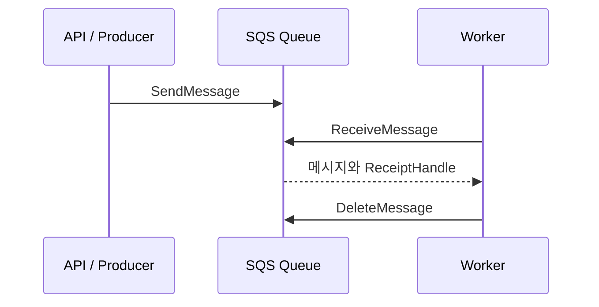
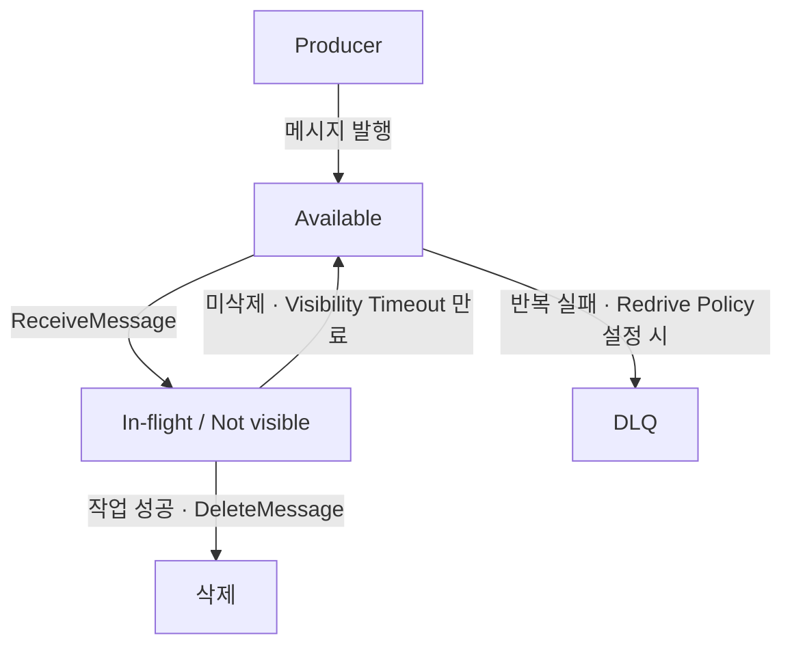
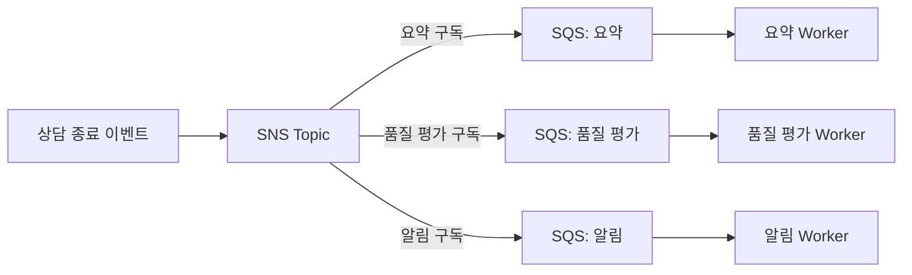
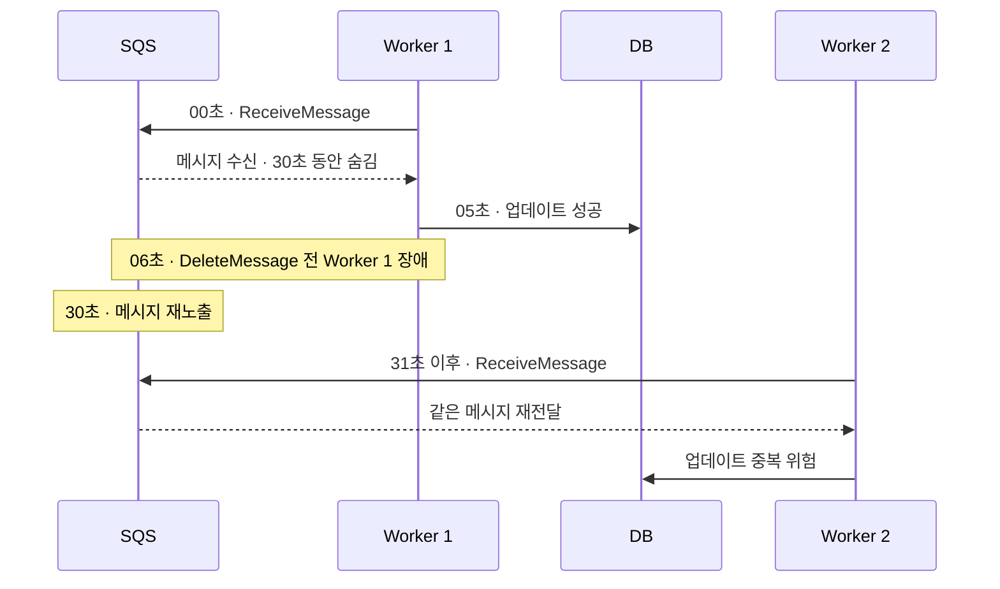
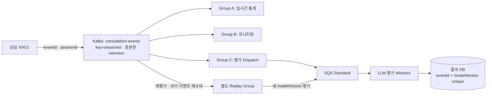

# 분산 메시지 큐 스터디 — AWS SQS

> 목적: AWS SQS의 동작 원리와 운영 특성을 이해하고, Kafka 등 다른 메시징 기술과 비교해 실무 선택 기준을 정리한다.
>
> 작성: 2026-10-25 · 기준: AWS 공식 문서(링크는 말미 참조)

## 한눈에 보는 결론

- **SQS는 작업 큐**: 서비스 간 결합도를 낮추고 비동기 작업을 안정적으로 전달한다. AWS가 메시지 큐 인프라를 관리한다.
- **Standard는 순서 보장 없이 높은 병렬성**, **FIFO는 `MessageGroupId` 단위 순서 보장**을 제공한다.
- **메시지 전달과 비즈니스 작업 성공은 별개**: `ReceiveMessage` 이후 처리에 성공하더라도 `DeleteMessage` 전에 장애가 발생하면 재처리될 수 있다. 멱등성이 필요하다.
- **Kafka는 재생 가능한 이벤트 로그**: 여러 Consumer Group이 독립적으로 읽고 보관 기간 내 과거 데이터를 재처리하는 데 유리하다.
- 결정 기준은 트래픽 크기보다 **작업 분배인가, 이벤트 보관·재생인가**, 순서·팬아웃·운영 요구사항이다.

---

## 1. 개요 및 특징

**Amazon SQS(Simple Queue Service)**는 AWS의 완전 관리형 메시지 큐 서비스다. API 서버가 오래 걸리는 작업을 직접 처리하는 대신 메시지를 큐에 넣고 별도 Worker가 가져가 처리하도록 하여 **비동기 처리, 부하 완충, 서비스 간 결합도 감소**를 구현한다.



| 특징 | 내용 |
|---|---|
| 운영 모델 | Broker 설치, 복제 구성, 장애 조치 등을 AWS가 관리 |
| 소비 모델 | 같은 큐의 여러 Consumer가 경쟁하며 메시지를 가져감 |
| API | `SendMessage`, `ReceiveMessage`, `DeleteMessage`, `ChangeMessageVisibility` |
| 큐 종류 | Standard와 FIFO (생성 후 타입 변경 불가) |
| 보관 | 기본 4일, 설정 가능 최대 14일(미삭제 메시지) |
| 전송 | 기본 Pull/Polling; Long Polling 최대 20초 |
| 활용 | 비동기 작업, 백그라운드 처리, 서비스 분리, 순간적인 트래픽 완충 |

### Standard vs FIFO

| 항목 | Standard | FIFO |
|---|---|---|
| 순서 | 보장하지 않음 | 같은 Message Group 내 순서 보장 |
| 전달/중복 | At-least-once; 중복 전달 가능 | 중복 전송 제거 기능 제공, 처리 재시도는 여전히 가능 |
| 병렬성 | Consumer 수 확대가 비교적 자유로움 | 활성 Message Group과 처리 전략이 중요 |
| 처리량 | 높은 처리량 지향 | 기본 FIFO 할당량 또는 High Throughput FIFO 모드 |
| 적합 사례 | 독립적인 상담 요약 작업 | 동일 세션 상태 변경 이벤트를 순서대로 처리 |

**주의:** FIFO의 'exactly-once processing'은 SQS의 중복 전송 억제 기능을 가리키며, 외부 DB/API 작업의 정확히 한 번 실행까지 보장하는 것은 아니다.

## 2. 아키텍처

### 구성 요소

- **Producer:** 큐 URL 또는 ARN을 기준으로 메시지 발행.
- **Queue:** AWS가 관리하는 분산 메시지 저장 계층. 사용자가 Broker나 내부 Replica에 접근하거나 Partition을 직접 배치하지 않는다.
- **Consumer/Worker:** `ReceiveMessage`로 메시지를 Polling하여 처리. 동일 큐의 Worker들은 경쟁 소비한다.
- **Visibility Timeout:** 수신한 메시지를 일정 시간 다른 Consumer에게 보이지 않게 함. 이때 메시지가 **삭제되는 것은 아님**.
- **DLQ(Dead-Letter Queue):** 반복해서 처리에 실패한 메시지를 격리하는 별도 큐.
- **CloudWatch:** 대기 메시지 수·가장 오래된 메시지의 나이·In-flight 메시지 수 등을 모니터링.

### 메시지 생명주기



- 수신 시 **ReceiptHandle**을 받아 해당 메시지를 삭제할 때 사용한다.
- Kafka와 달리 사용자가 Offset을 관리하지 않는다. 메시지는 성공 처리 후 삭제하는 작업 큐 구조다.
- SQS는 다중 AZ 기반의 내구성과 가용성을 제공하지만, 내부 저장 토폴로지나 Replica 수는 공개 운영 설정이 아니다.
- **Kafka의 Partition ≠ SQS의 Message Group**: Partition은 로그 저장·할당 단위, Message Group은 FIFO 메시지의 순서·동시성 제어를 위한 논리적 키다. FIFO 내부 Partition은 AWS가 관리한다.

## 3. 메시지 처리 방식

### Queue / Pub-Sub

- **SQS 단독:** 한 메시지를 모든 Worker에게 브로드캐스트하지 않는다. 같은 큐를 읽는 Consumer 중 하나가 메시지를 받아 처리한다(실패·중복 전달 예외 존재).
- **SNS + SQS Fan-out:** 하나의 이벤트를 여러 독립 큐에 전달. 구독 서비스마다 별도의 Worker와 재시도 정책을 둘 수 있다.
- **Kafka:** 같은 Topic을 서로 다른 Consumer Group이 독립적으로 소비할 수 있다.



### Push / Pull, Polling

- SQS는 Consumer가 `ReceiveMessage`를 호출하는 **Pull** 모델이다.
- **Short Polling:** 즉시 응답, 빈 요청이 많아질 수 있음.
- **Long Polling:** 메시지가 없다면 최대 20초 대기. 대기 중 메시지가 도착하면 즉시 응답할 수 있음. 불필요한 빈 호출 및 비용을 줄이는 데 유리.
- Lambda와 SQS를 연결할 경우 AWS 이벤트 소스 매핑이 Polling을 대신 수행해 함수 호출로 연결한다. 큐가 일반 Worker에게 직접 Push하는 방식은 아니다.

### Consumer Group과 순서

- Kafka식 Consumer Group/Partition Rebalance 기능은 SQS Consumer에 없다. Worker들이 같은 큐를 독립적으로 Polling한다.
- Standard는 순서를 보장하지 않는다.
- FIFO에서는 `MessageGroupId=sessionId`를 사용하면 **동일 상담 세션의 메시지를 순서대로** 처리하며, 서로 다른 세션은 병렬로 처리할 수 있다.
- 같은 그룹의 메시지 여러 개가 **하나의 Batch**로 수신될 수 있다. 애플리케이션이 그 배치를 무조건 병렬 처리하면 업무 처리 순서를 깨뜨릴 수 있다.
- Kafka에서도 `key=sessionId`를 사용하면 같은 키의 메시지를 같은 Partition으로 라우팅해 Partition 내부 순서를 유지할 수 있다(Partition 수 변경 시 키의 매핑 변화 주의).

## 4. 메시지 전달 신뢰성

### 전달 보장 수준

| 모델 | 의미 | SQS에서 이해할 점 |
|---|---|---|
| At-most-once | 유실 가능, 중복 없이 최대 한 번 전달 | SQS의 일반적인 기본 목표가 아님 |
| At-least-once | 재전달 가능, 중복 가능 | Standard의 기본 전달 모델. Consumer 멱등성 권장 |
| Exactly-once | 범위에 따라 '정확히 한 번' | FIFO 중복 제거가 외부 DB 트랜잭션까지 보호하지 않음 |

FIFO의 `MessageDeduplicationId` 또는 Content-based Deduplication은 **5분 중복 제거 간격** 내 동일 발행을 억제하는 기능이다. 반면 수신 후 작업 완료·삭제 실패에서 발생하는 **재처리 가능성은 별개의 문제**다.

### Visibility Timeout, ACK와 삭제

예시: Visibility Timeout 30초, DB 업데이트가 5초 만에 완료.



- `DeleteMessage`는 SQS에서 처리 완료를 알리는 ACK에 **해당하는 효과**를 갖는다(별도 ACK 프로토콜은 아님).
- 처리 시간이 가변적인 LLM 작업: 초기 Timeout을 적절히 설정하고 `ChangeMessageVisibility`로 연장 가능. Timeout이 지나치게 길면 장애 후 재시도가 늦어진다.
- 장애·네트워크 지연으로 같은 이벤트가 여러 번 처리될 수 있으므로 **비즈니스 멱등성**을 설계한다.

### 멱등성 실무 구현

```json
{
  "eventId": "evt-1001",
  "sessionId": "session-A",
  "type": "CONSULTATION_ENDED"
}
```

- DB에 `eventId` 또는 `eventId + processingVersion` Unique Constraint 설정.
- 처리 상태 변경과 결과 저장은 가능한 경우 **동일 DB 트랜잭션**으로 묶음.
- 이미 완료된 이벤트라면 작업을 반복하지 않고 성공 처리한 뒤 메시지 삭제.
- 외부 API 호출은 DB 트랜잭션만으로 원자성 보장이 불가능하므로 상대 시스템의 Idempotency Key 지원, Outbox, 재조정(reconciliation) 등을 고려.
- **중요:** 중복 체크용 `SELECT`만으로는 경쟁 조건을 막지 못함.

### 실패 재시도와 DLQ

- 삭제하지 않은 메시지는 Timeout 후 다시 받을 수 있다.
- `maxReceiveCount` 등 Redrive Policy를 통해 반복 실패 메시지를 DLQ로 보낼 수 있다.
- DLQ는 장애 메시지를 **격리**할 뿐, 자동 수정을 보장하지 않는다. 원인을 확인하고 수정한 뒤 Redrive할 수 있다.
- FIFO에서 DLQ로 실패 이벤트를 제거한 뒤 나중에 재투입하면 원래 이벤트의 엄격한 전역 업무 순서가 훼손될 수 있다. 순서 무결성이 핵심이면 DLQ 사용 정책을 따로 검토한다.

## 5. 확장성 및 성능

### Consumer 수평 확장

| 구분 | Kafka | SQS Standard | SQS FIFO |
|---|---|---|---|
| 병렬성 주요 단위 | Partition | 가용 메시지와 Consumer 처리능력 | 독립 Message Group + Consumer 처리능력 |
| Worker 증가 시 | 같은 Group 내 Partition 수가 병렬성 상한 | 고정된 Kafka식 Partition 할당 한계 없음 | 그룹 수가 적으면 Worker만 늘려도 효과 제한 |
| 리밸런스 | Partition 재할당 발생 가능 | Kafka식 리밸런스 없음 | Kafka식 리밸런스 없음 |
| 순서 | Partition 단위 | 보장 없음 | Message Group 단위 |

**계산 예제:** 활성 세션 2개, `MessageGroupId=sessionId`, 세션별 메시지 1개씩 순차 처리, 메시지 1개 처리시간 10초, 유입 초당 5개.

- 세션당 처리량 `1/10 = 0.1 msg/s`
- 전체 평균 처리량 `2 × 0.1 = 0.2 msg/s`
- 미처리 증가량 `5 - 0.2 = 4.8 msg/s = 288건/분`
- Worker를 10개에서 50개로 늘려도 해결되지 않음. 그룹 내부 순차 실행이라는 요구사항이 제약이기 때문.

*계산은 작업 시간 일정·각 그룹당 동시 실행 1개 등 단순화된 가정이다.*

### 처리량, 지연시간

- **Standard:** 매우 높은 처리량을 지향하지만 무조건 무제한 성능을 보장하는 것은 아니다. 클라이언트·API 제한·메시지 크기·다운스트림에 의해 제한된다.
- **FIFO 기본 모드:** AWS 문서 기준 비 High Throughput 모드에서 **Partition당 API 동작별 초당 300 TPS**; 메시지 10개 배치 처리 시 동작별 최대 3,000 msg/s/Partition 수준. 큐 전체의 실제 처리량은 내부 Partition 구성 및 그룹 분포에 좌우된다.
- **High Throughput FIFO:** 지역별 할당량과 설정(`DeduplicationScope=messageGroup`, `FifoThroughputLimit=perMessageGroupId`)을 확인해야 한다.
- Batch: 수신/발행/삭제에서 최대 10개 메시지를 묶어 API 호출량을 줄일 수 있다. 각 동작의 Batch API 형태를 확인한다.
- **Latency:** SQS는 네트워크 호출·Polling·Worker 스케줄링을 포함하는 비동기 작업 큐다. 고정된 종단 간 지연시간 SLA를 가정해서는 안 된다. 초저지연 동기 요청·응답의 직접 대체재로는 부적합하다. Long Polling 20초는 *최대 대기시간*이지 메시지에 추가되는 고정 지연이 아니다.

### 병목과 Backpressure

- FIFO의 **Hot Message Group**: 동일 세션에 트래픽 집중 → 그룹 내부 순차 처리가 상한.
- **In-flight 메시지:** 수신했지만 삭제되지 않은 메시지가 많으면 추가 수신이 제한될 수 있음(기본 할당량 확인).
- **Downstream:** LLM 서버, DB, 외부 API의 처리량이나 Rate Limit이 실제 병목.
- **API/네트워크:** 과도한 Short Polling, 빈 요청, 작은 Batch는 비용과 지연에 영향.
- Producer가 Consumer보다 빠르면 메시지는 큐에 쌓인다. SQS는 버퍼 역할을 하지만 Producer의 발행 속도를 자동으로 제한하지는 않는다.
- 대응: Backlog 기반 Worker 스케일링, 작업 속도 제한, Long Polling/Batch, 지연시간 SLA 모니터링, 큐 분리. 보관 기간을 넘기는 메시지는 삭제될 수 있다.

## 6. 장애 대응 및 운영

### HA · 내구성 · 복구

| 관점 | AWS SQS | Kafka (자체 운영 기준) |
|---|---|---|
| Broker/Replica 운영 | AWS가 관리, 여러 AZ에 복제 | Broker/Replica/ISR/Leader 구성과 운영 필요 |
| Consumer 장애 | Visibility Timeout 후 재수신 | Consumer Group Rebalance와 Offset 기반 복구 |
| 완료 이벤트 재처리 | `DeleteMessage` 후 SQS에서 재생 불가 | 보관 로그의 Offset/Timestamp로 재처리 가능 |
| 리전 재해 복구 | 별도 Multi-region DR 설계 필요 | 별도 클러스터 및 복제/DR 설계 필요 |
| 메시지 보관 | 기본 4일, 최대 14일 | Topic 별 retention 설정(시간/크기 등) |

**SQS의 Multi-AZ와 Multi-region은 다르다.** 단일 리전의 SQS를 쓴다고 지역 전체 장애에 대한 자동 Failover가 제공되는 것은 아니다.

### CloudWatch 모니터링

| 지표 | 용도 |
|---|---|
| `ApproximateNumberOfMessagesVisible` | 대기(Backlog) 메시지 규모 |
| `ApproximateAgeOfOldestMessage` | 가장 오래된 대기 메시지 지연 감지 |
| `ApproximateNumberOfMessagesNotVisible` | In-flight 증가 확인 |
| `ApproximateNumberOfGroupsWithInflightMessages` | FIFO에서 실제 활성 그룹 병렬성 추정 |
| `NumberOfEmptyReceives` | 빈 Polling 호출 확인 |
| DLQ의 `ApproximateNumberOfMessagesVisible` | 실패 격리 메시지 감시 |

- 추천 경보: **Oldest Age 지속 증가, Backlog 지속 증가, DLQ 유입, 처리 성공률 저하, Worker 에러율 상승**.
- `Approximate*` 지표는 근사치이며 특히 Oldest Age는 실패 메시지의 재배치 및 DLQ 이동에 따른 해석 주의가 필요하다.
- Kafka에서는 Consumer Lag, Partition 편중, Broker 디스크/네트워크/ISR 등을 함께 본다.

### 운영 비용

**SQS**는 사용량 기반. 메시지 발행·수신·삭제 및 Polling의 API 호출, Payload 크기(과금 단위), 큐 종류, 암호화·모니터링·데이터 전송 등을 고려한다. Batch와 Long Polling은 호출 수 절감에 유리하다. 가격·무료 티어·지역별 단가는 변경될 수 있으므로 AWS 가격표를 확인한다.

**Kafka**는 자체 운영 시 Broker/스토리지/네트워크/복제/운영 인건비가 들며, 관리형 MSK를 쓰면 관리 비용의 성격이 달라진다. 높은 지속 처리량에서는 규모에 따라 경제적일 수 있지만 **Kafka가 무조건 싸거나 SQS가 무조건 비싼 것은 아니다**.

예: 월 100만 메시지, 각 메시지 발행/수신/삭제 1회, 빈 수신·재시도 없음, 작은 메시지라면 약 300만 API 호출(단순 예제). 10개씩 꽉 채운 Batch는 발행/수신/삭제 호출을 줄일 수 있으나 실제 Batch 적재율·재시도에 따라 달라진다.

## 7. 주요 Use Case 및 기술 선택

### SQS에 적합한 사례

1. **AI 상담 종료 후 요약/품질 분석**: 긴 LLM 작업을 API 요청에서 분리, Worker 처리, DLQ·Timeout 관리. 서로 독립적인 상담이라면 Standard 우선 검토.
2. **문서 파싱·임베딩 생성**: 업로드 이벤트를 작업 큐에 적재, Worker 수평 확장, 실패 재시도.
3. **마이크로서비스 비동기 후처리**: 주문/상담 후 알림, 이메일, 통계 집계 등. 여러 독립 구독자는 SNS + 여러 SQS 큐.
4. **순서가 중요한 상태 전이**: 같은 세션의 명령을 순차 실행해야 하면 FIFO + `MessageGroupId=sessionId`.
5. **트래픽 버퍼링**: 입력 피크를 Worker 처리 속도와 분리. 다만 큐에 쌓이는 지연과 보관기한을 감시.

### SQS를 단독으로 선택하기 어려운 사례

- 지난 7일 또는 30일의 **이미 처리된 이벤트**를 자유롭게 재생해야 하는 경우.
- 여러 독립 Consumer Group이 같은 로그를 다양한 시점에서 읽어야 하는 경우.
- Stateful Stream Processing, 윈도우 집계, 장기간 이벤트 기록이 핵심인 경우.
- 순서 요구가 강하지만 Message Group이 하나로 몰려 동시 처리량을 확보하기 어려운 경우.

### 실무 아키텍처 예시 — 상담 이벤트 및 AI 평가

**요구사항:** 일 100만 이벤트(평균 약 11.6건/초), 실시간 모니터링, 평가 모델별 독립 소비, 평가 모델 업데이트 후 최근 7일 재처리.



- **Kafka 선택 이유:** 보관된 이벤트 재생, 신규 서비스 추가 시 독립 Consumer Group, 모델 버전별 재평가.
- **SQS 추가 이유:** LLM처럼 오래 걸리고 실패 가능성이 있는 작업을 Kafka 소비로부터 분리해 별도로 확장.
- **주의:** Kafka → SQS 발행 성공과 Kafka Offset Commit은 원자적 트랜잭션이 아니다. 중복 발행·재시도에 대비하여 `eventId` 기반 멱등성 및 실패 복구가 필요하다.
- SQS만 쓴다면 재분석용 원본 이벤트를 **DB/S3 등에 별도 보관**하고 재발행 흐름을 설계해야 한다. 원본 저장과 큐 발행의 정합성은 Outbox 같은 패턴으로 검토 가능.

### Kafka vs SQS 선택 요약

| 조건 | 우선 검토 |
|---|---|
| 비동기 작업을 Worker에 분배, Kafka 로그 재생 필요 없음 | **SQS Standard** |
| 동일 사용자/세션 순서가 필수 | **SQS FIFO** 또는 Kafka(key 기반), 처리량·재생 요구에 따라 선택 |
| 여러 서비스에 한 번씩 이벤트 전달 | **SNS + SQS** |
| 과거 이벤트 재생과 독립 소비 위치가 중요 | **Kafka** |
| 이벤트 보관과 느린 AI 작업의 확장을 분리 | **Kafka + SQS** |
| 트래픽 작고 불규칙하며 운영 단순성 중시 | **SQS** 우선 검토 |

---

## 비교 질문 10개 — 빠른 답변

| 질문 | AWS SQS 관점 답변 | Kafka와 비교 |
|---|---|---|
| **1. 메시지 순서** | Standard 보장 X; FIFO 동일 `MessageGroupId`에서 보장. 세션 ID 사용 가능 | Kafka는 동일 Partition에서 순서 보장, key로 매핑 |
| **2. Consumer 확장** | 같은 큐에 Worker 추가. Standard는 Kafka 같은 고정 Partition 상한 없음. FIFO는 그룹 분포가 제약 | 동일 Group 내 병렬성은 Partition 수에 영향 |
| **3. Consumer 장애** | 미삭제 메시지는 Timeout 후 재수신 가능. 작업 성공 후 삭제 실패 시 중복 실행 위험 | Offset Commit 전에 장애 시 재처리 가능 |
| **4. 과거 재처리** | 삭제된 메시지를 SQS에서 재생 불가; DLQ나 별도 원본 보관 필요 | 보관 기간 내 Offset/Timestamp 이용해 재생 |
| **5. 트래픽 급증** | 큐가 버퍼 역할. Backlog/Age 상승, 보관기한·In-flight·다운스트림 한계 확인 | Kafka는 로그 누적과 Consumer Lag 상승 |
| **6. 비용** | API 호출·Payload 크기·큐 종류 등에 따라 증가, Batch/Long Polling으로 최적화 | Kafka는 인프라·복제·저장·운영·관리형 비용 고려 |
| **7. 전달 보장** | Standard At-least-once; FIFO Dedup은 업무 Exactly-once 아님. Unique Key 등 멱등성 필수 | Kafka의 exactly-once 지원도 외부 DB/API까지 자동 보장하지 않음 |
| **8. 메시지 보관** | 기본 4일, 최대 14일. 기간 만료 시 삭제; 완료 메시지는 즉시 삭제 | Consumer 처리와 무관하게 retention 정책에 따라 보관 |
| **9. 실시간성** | 비동기 Polling 모델, 고정 초저지연 보장 X; Long Polling 최대 대기 20초는 지연 추가값이 아님 | 지속적 스트리밍과 이벤트 처리 생태계 강점 |
| **10. 기술 선택** | 작업 큐·운영 단순성·AWS 연동에 유리, 로그 재생에는 불리 | 이벤트 스트림·다중 독립 소비·재생에 유리, 운영 구조 고려 |

## 최종 체크리스트

- 메시지는 처리 후 **삭제**할 것인가, 계속 **기록**할 것인가?
- 순서는 전체 순서가 필요한가, 특정 `sessionId` 내부만 필요한가?
- Consumer 장애 후 중복 처리에 대한 멱등성을 보장하는가?
- 메시지가 오래 밀릴 때 허용 가능한 최대 지연과 보관 기간은 얼마인가?
- 과거 데이터를 재처리해야 한다면 원본 이벤트가 어디에 보관되는가?
- Worker 증가보다 먼저 Message Group/Partition/DB/LLM 처리량 병목을 검토했는가?

## 공식 참고 자료

- [AWS SQS 개발자 가이드](https://docs.aws.amazon.com/AWSSimpleQueueService/latest/SQSDeveloperGuide/welcome.html)
- [SQS Standard / FIFO 유형](https://docs.aws.amazon.com/AWSSimpleQueueService/latest/SQSDeveloperGuide/sqs-queue-types.html)
- [Visibility Timeout과 In-flight](https://docs.aws.amazon.com/AWSSimpleQueueService/latest/SQSDeveloperGuide/sqs-visibility-timeout.html)
- [FIFO 메시지 그룹 / 수신 순서](https://docs.aws.amazon.com/AWSSimpleQueueService/latest/SQSDeveloperGuide/FIFO-queues-understanding-logic.html)
- [SQS 메시지 할당량](https://docs.aws.amazon.com/AWSSimpleQueueService/latest/SQSDeveloperGuide/quotas-messages.html)
- [High Throughput FIFO](https://docs.aws.amazon.com/AWSSimpleQueueService/latest/SQSDeveloperGuide/enable-high-throughput-fifo.html)
- [SQS CloudWatch 지표](https://docs.aws.amazon.com/AWSSimpleQueueService/latest/SQSDeveloperGuide/sqs-available-cloudwatch-metrics.html)
- [SQS 가격](https://aws.amazon.com/sqs/pricing/)
- [Apache Kafka 공식 문서](https://kafka.apache.org/documentation/)

*주: 실제 리전별 SQS API 할당량, 요금, Kafka 배포 방식은 환경과 시기에 따라 달라질 수 있으므로 설계·비용 산정 전에 공식 문서를 재확인해야 한다.*
