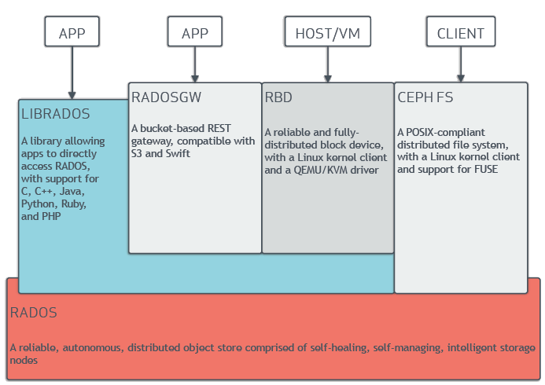
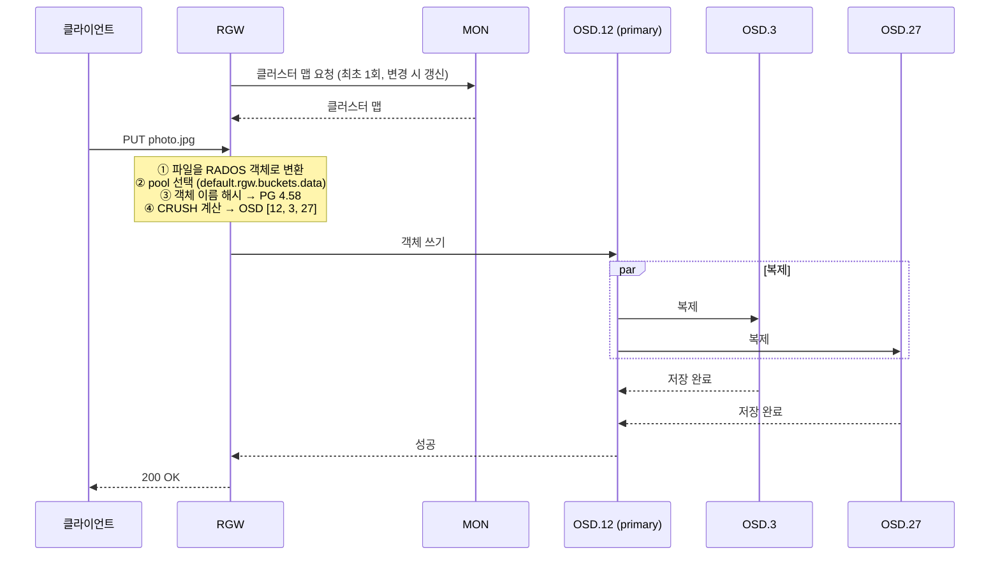
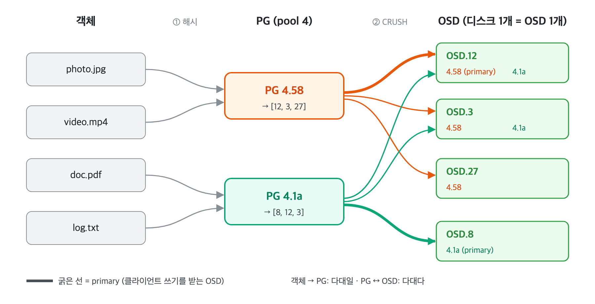
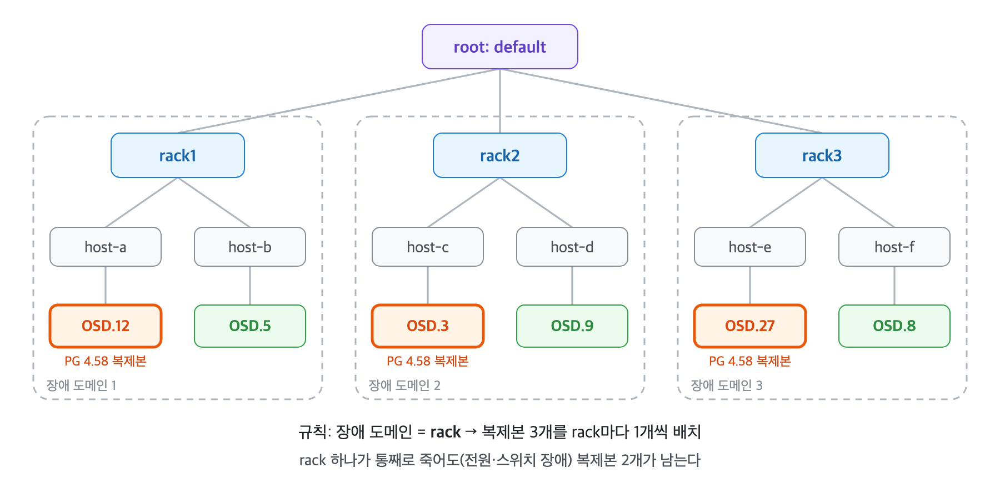
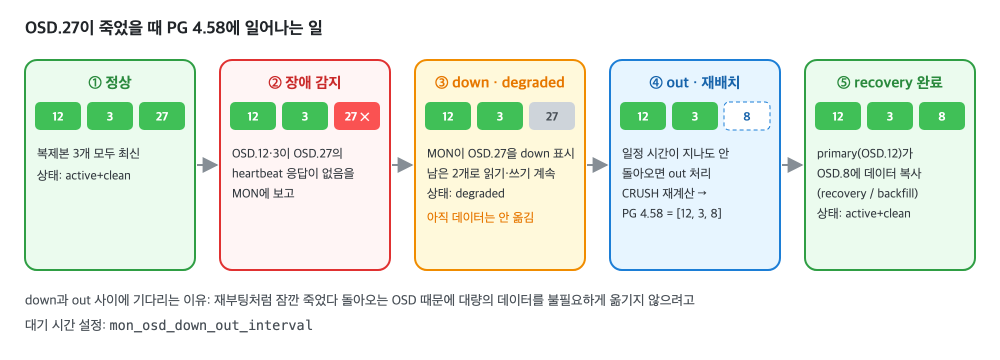
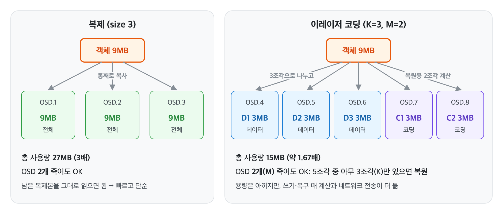
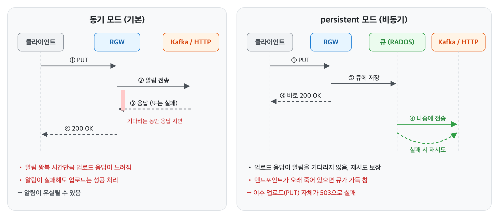
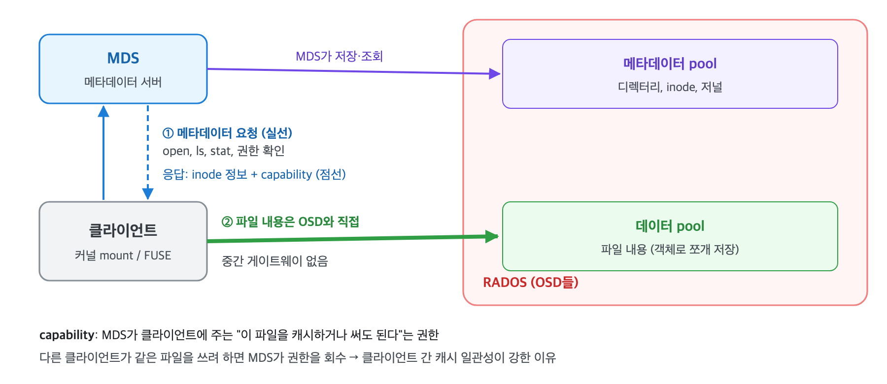
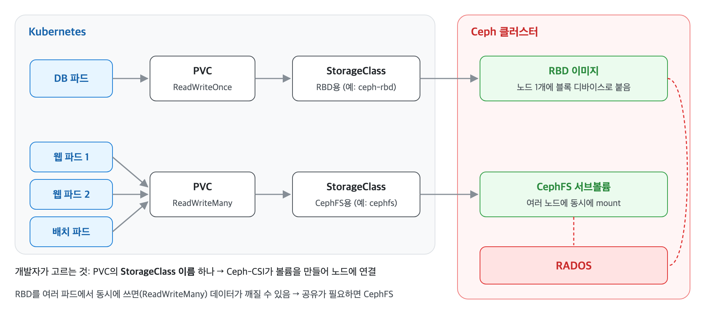

# Ceph

Ceph 공식 문서의 S3(RGW), 블록(RBD), 파일(CephFS), 쿠버네티스 연동(CSI) 부분을 AWS 기준으로 정리했다.

> **문서 버전**
> 공식 문서는 개발 버전(latest) 기준이다. 운영 중인 클러스터 버전에 따라 일부 기능이나 기본값이 다를 수 있다.

## 0. AWS와의 대응

| AWS | Ceph | 비고 |
|---|---|---|
| S3 | **RGW** (RADOS Gateway) | S3 호환 REST API |
| EBS | **RBD** (블록 디바이스) | 볼륨을 마운트해서 사용 |
| EFS | **CephFS** | 여러 서버/파드가 같이 쓰는 파일시스템 |
| IAM 사용자, Access Key | RGW 사용자 (`radosgw-admin`으로 발급) | IAM 콘솔 같은 건 없음 |
| STS AssumeRole | RGW STS (일부만 구현) | |
| KMS | Vault / Barbican / KMIP 연동 | |
| S3 이벤트 알림 → SNS/SQS/Lambda | Bucket Notification → HTTP/Kafka/AMQP | Lambda 같은 건 없음 |
| S3 Cross-Region Replication | RGW 멀티사이트 (zone 간 복제) | |
| EBS 스냅샷 복사 (리전 간) | RBD mirroring (클러스터 간) | |
| EBS/EFS CSI 드라이버 | Ceph-CSI | |


*Ceph 스택 구조 ([Architecture](https://docs.ceph.com/en/latest/architecture/))*

- 세 서비스 모두 밑바닥은 **RADOS**라는 하나의 객체 저장소다 ([클라이언트 아키텍처](https://docs.ceph.com/en/latest/architecture/ceph-clients/))
	- RGW: S3 + OpenStack Swift 호환 API
	- RBD: thin provisioning, 크기 조절, 스냅샷, 클론이 되는 블록 디바이스
	- CephFS: `mount`나 FUSE로 붙이는 POSIX 파일시스템
- [세 가지를 한 클러스터에서 동시에 운영할 수 있다](https://docs.ceph.com/en/latest/rbd/)

### 0-1. RADOS: 세 서비스의 공통 기반

**한 줄 요약:** RGW·RBD·CephFS는 자기 데이터를 RADOS 객체로 바꿔 저장하는 클라이언트다. 저장·복제·장애 감지·복구는 전부 RADOS가 맡는다.

- RADOS = **R**eliable **A**utonomic **D**istributed **O**bject **S**tore
- 앱은 `librados` 라이브러리로 RADOS에 직접 붙을 수도 있다 (C, C++, Python 등)

#### 용어 먼저 정리

아래에 나오는 용어를 큰 것 → 작은 것 순서로 모았다.

| 용어          | 뜻                                             |
| ----------- | --------------------------------------------- |
| 클러스터        | Ceph를 이루는 서버 전체                               |
| OSD         | 디스크 하나를 맡아서 데이터를 실제로 저장하는 프로세스. 보통 디스크 1개당 1개 |
| MON         | 지금 어떤 OSD가 살아 있는지 같은 클러스터 상태를 관리하는 프로세스       |
| 클러스터 맵      | MON이 클라이언트와 OSD에 나눠 주는 클러스터 상태 정보             |
| pool        | 데이터를 담는 논리적인 공간. 복제를 몇 개 할지 같은 정책을 pool마다 정한다 |
| PG          | pool 안의 객체를 여러 묶음으로 나눈 것. 복제와 복구를 이 묶음 단위로 한다 |
| CRUSH       | 어떤 PG를 어느 OSD에 둘지 계산하는 알고리즘                   |
| primary OSD | 한 PG를 맡은 OSD 중에서 클라이언트의 쓰기 요청을 받는 OSD         |
| 객체          | RADOS에 저장되는 데이터 한 조각                          |

#### 전체 흐름: RGW로 `photo.jpg`를 올리면 (3복제 pool 기준)



- ①~④는 어디에 물어보지 않고 RGW가 갖고 있는 클러스터 맵으로 직접 계산한다.
- MON은 맵만 내려주고, 실제 데이터를 쓰고 읽는 과정에는 끼지 않는다.
- [클라이언트의 쓰기 요청은 primary OSD만 받는다. primary는 나머지 OSD에 복제를 보내고, 모두 저장을 마친 뒤에야 성공을 응답한다](https://docs.ceph.com/en/latest/architecture/dynamic-cluster-management/). 그래서 성공 응답을 받았다면 데이터는 이미 복제본 3개에 모두 저장된 상태다.

#### RADOS 객체

- [flat namespace에 저장된다. 디렉터리 계층이 없다](https://docs.ceph.com/en/latest/architecture/storage-cluster/)
- 객체 = 식별자(클러스터 전체에서 유일) + 바이너리 데이터 + 메타데이터(name/value 쌍)
- S3 객체와 다른 점: 버킷, 접근 정책, HTTP API가 없다. 이런 기능은 RGW가 위에 얹는다
- RBD 볼륨, CephFS 파일, RGW의 큰 객체는 모두 여러 RADOS 객체로 쪼개져 저장된다

#### 구성 데몬

| 데몬 | 역할 | 데이터 경로 |
|---|---|---|
| OSD | 객체를 실제로 저장. 복제·복구·리밸런싱·장애 감지를 OSD끼리 직접 처리 | O |
| MON | 클러스터 맵을 관리하고 Paxos로 합의 | X (맵만 내려줌) |
| MGR | 모니터링 지표, 대시보드, 오케스트레이션 모듈 | X |
| MDS | CephFS 메타데이터 전용. RGW·RBD에는 필요 없음 | CephFS 메타데이터만 |

**OSD (Object Storage Daemon)**

- 보통 **디스크 1개 = OSD 1개**다. 서버 10대에 디스크가 10개씩이면 OSD는 100개
- [기본 저장 엔진 BlueStore는 파일시스템 없이 raw 블록 디바이스를 직접 관리한다](https://docs.ceph.com/en/latest/rados/configuration/storage-devices/)
- [노드들의 CPU·RAM을 활용하는 "똑똑한" 데몬](https://docs.ceph.com/en/latest/architecture/scalability-high-availability/): 중앙 컨트롤러 없이 복제, heartbeat 장애 감지, 복구, scrub을 OSD끼리 처리한다
- 상태는 두 축으로 본다
	- `up` / `down`: 프로세스가 살아 있는가
	- `in` / `out`: 데이터 배치 대상에 포함되는가 (`out`이 되면 그 OSD의 PG가 다른 OSD로 옮겨 감)

**MON과 Paxos**

- MON은 [과반수가 살아 있어야 동작한다 (3대 중 2대, 5대 중 3대)](https://docs.ceph.com/en/latest/architecture/scalability-high-availability/). 1대면 단일 장애점이라 보통 3대나 5대를 둔다
- **Paxos:** 일부 노드 장애나 메시지 지연이 있어도 여러 노드가 하나의 값에 합의하게 하는 합의(consensus) 알고리즘
	- 제안자가 값을 제안하고, 노드 **과반수**가 수락하면 그 값으로 확정
	- 어떤 두 과반수든 최소 한 노드가 겹침 → 서로 다른 값이 동시에 확정될 수 없음. 네트워크가 갈라져도 과반수 쪽만 결정을 내림(split-brain 방지)
	- N대 중 `(N-1)/2`대 장애까지 견딤. 4대는 3대와 견디는 장애 수가 같아서 보통 홀수로 둠
	- Ceph MON은 이걸로 "지금 어떤 OSD가 살아 있는지" 같은 클러스터 맵의 최신 버전에 합의. Raft, ZooKeeper의 ZAB도 같은 계열

#### 클러스터 맵

[MON이 관리하는 맵은 5종](https://docs.ceph.com/en/latest/architecture/scalability-high-availability/)이다. 클라이언트와 OSD는 이 맵을 받아 두고 스스로 판단한다.

| 맵 | 내용 |
|---|---|
| Monitor Map | MON 목록과 주소 |
| OSD Map | OSD 목록, up/down·in/out 상태, pool 목록 |
| PG Map | PG별 상태, Up Set·Acting Set |
| CRUSH Map | 장애 도메인 계층(데이터센터 → 랙 → 호스트 → OSD)과 배치 규칙 |
| MDS Map | CephFS MDS 상태 |

#### 데이터 배치: 객체 → PG → OSD

[중앙 조회 테이블 없이 클라이언트가 위치를 직접 계산한다](https://docs.ceph.com/en/latest/architecture/scalability-high-availability/). 중앙 메타데이터 서버는 단일 장애점이 되고 성능·확장 한계가 생기지만, 계산으로 위치를 정하면 그 일이 모든 클라이언트·OSD에 분산된다.

1. [객체 ID를 해시하고 PG 수로 나눈 나머지 → PG 번호. 앞에 pool ID를 붙인다 (예: pool 4의 PG 58 → `4.58`)](https://docs.ceph.com/en/latest/architecture/storage-cluster/)
2. **CRUSH**가 PG를 OSD 목록으로 매핑한다 (예: `4.58` → `[12, 3, 27]`, 맨 앞이 primary)
3. 클라이언트가 그 OSD와 직접 통신한다



헷갈리기 쉬운 부분을 단계별로 나누면 다음과 같다.

| 단계 | 무엇이 일어나나 | 데이터가 쪼개지나 |
|---|---|---|
| 파일 → 객체 | RGW·RBD·CephFS가 큰 파일을 여러 RADOS 객체로 나눈다 (RBD는 기본 4MiB 단위) | 쪼개진다 |
| 객체 → PG | 객체마다 이름을 해시해서 어느 PG에 속할지 정한다. PG는 객체를 담는 묶음일 뿐이다 | 안 쪼개진다. 객체 하나는 통째로 PG 하나에 속한다 |
| PG → OSD | PG 하나를 OSD 3개에 둔다. 복제 pool이면 세 OSD가 같은 데이터를 통째로 하나씩 갖는다 | 복제 pool은 안 쪼개진다. EC pool은 이 단계에서 조각으로 나눠 OSD마다 다른 조각을 둔다 |

- `4.58`의 `4`는 pool 번호다. "pool 4에 있는 58번 PG"라는 뜻이지, 4개로 나눈다는 뜻이 아니다.

**PG (Placement Group)**

- pool 안의 객체를 정해진 개수의 묶음으로 나눈 것이다. 실제 디스크나 파일이 아니라 논리적인 단위다.
- 객체 여러 개가 PG 하나에 들어간다. PG 하나는 OSD 3개에 복제되고, OSD 하나는 여러 PG를 함께 맡는다.
- primary OSD도 PG마다 다르다. 그림에서 4.58의 primary는 OSD.12, 4.1a의 primary는 OSD.8이다. 그래서 쓰기 요청이 특정 OSD에 몰리지 않는다.
- 복제, 복구, 데이터 검사(scrub)를 모두 객체 하나하나가 아니라 PG 단위로 한다.
- Kafka 파티션과 비슷하다. 메시지를 파티션 단위로 나눠 브로커에 배치하듯, 객체를 PG 단위로 나눠 OSD에 배치한다.
- PG를 맡은 OSD 목록을 Acting Set, 그중 지금 살아 있는 OSD를 Up Set이라고 부른다.

| 객체를 OSD에 바로 매핑하면 | PG를 중간에 두면 |
|---|---|
| 객체 수억 개의 위치·상태를 하나씩 추적해야 함 | 수천 개 PG의 상태만 추적하면 됨 |
| OSD가 추가되면 해시 결과가 바뀌어 거의 모든 객체가 이동 | 객체 → PG는 그대로이고 PG → OSD 매핑만 일부 바뀜 |
| 장애 복구 시 객체마다 복제본을 찾아야 함 | 죽은 OSD에 있던 PG 목록만 보고 PG 단위로 복구 |

- **PG 수:** PG가 너무 적으면 묶음 하나가 커서 데이터가 OSD에 고르게 퍼지지 않는다. 너무 많으면 OSD마다 관리할 PG가 늘어나 메모리와 CPU를 많이 쓴다.
	- [`pg_autoscale_mode`(`off`/`on`/`warn`)로 autoscaler가 자동 조정. OSD당 목표 PG 수는 `mon_target_pg_per_osd`(기본 100)](https://docs.ceph.com/en/latest/rados/operations/placement-groups/)
	- 수동 계산식: `Total PGs = OSDs × 100 / pool size`, 2의 거듭제곱으로 올림
- **PG 상태:** 운영에서 클러스터 건강을 볼 때 쓰는 단위 (`ceph pg stat`, `ceph health detail`로 확인)
	- `active+clean`: 정상, 모든 복제본이 최신
	- `degraded`: 복제본 수가 부족함 (OSD 장애 직후)
	- `recovering` / `backfilling`: 복제본을 다시 채우는 중

**CRUSH가 하는 일** ([CRUSH Maps](https://docs.ceph.com/en/latest/rados/operations/crush-map/))

- CRUSH는 "이 PG를 어느 OSD들에 둘까"를 계산하는 알고리즘이다. 위치를 어딘가에 적어 두고 찾아보는 방식이 아니라, 그때그때 계산해서 정한다.
- 계산에 쓰는 재료는 세 가지다.
	- PG 번호 (예: `4.58`)
	- CRUSH Map: 어떤 OSD가 어느 서버·랙에 있고, 각 OSD가 얼마나 큰지
	- 규칙(rule): 복제본을 어떤 기준으로 흩어 놓을지
- 같은 맵과 규칙을 가진 클라이언트라면 누가 계산해도 결과가 같다. 그래서 위치를 물어볼 중앙 서버 없이 [클라이언트가 OSD와 바로 통신한다](https://docs.ceph.com/en/latest/rados/operations/crush-map/).
- 결과는 무작위처럼 고르게 흩어지지만 매번 같은 값이 나오는 계산이다 (문서 표현으로는 pseudo-random).

**가중치(weight)**

- OSD마다 가중치가 있고, [보통 디스크 용량(TiB)을 그대로 쓴다](https://docs.ceph.com/en/latest/rados/operations/crush-map/). OSD를 만들 때 자동으로 들어간다.
- 가중치가 큰 OSD일수록 PG를 더 많이 받는다. 4TB와 8TB 디스크가 섞여 있으면 8TB 쪽이 약 2배를 받아서, 두 디스크가 비슷한 비율로 찬다.
- [기본 버킷 방식인 `straw2`는 가중치가 바뀐 OSD와 관련된 PG만 옮긴다](https://docs.ceph.com/en/latest/rados/operations/crush-map/). 디스크 하나를 바꿔도 클러스터 전체가 뒤섞이지 않는다.

**규칙(rule)과 디바이스 클래스**

- pool마다 어떤 규칙을 쓸지 정한다. 복제 규칙은 대략 이런 모양이다.

```
step take default                    # default 트리의 꼭대기에서 시작해서
step chooseleaf firstn 0 type host   # 서로 다른 host를 복제 수만큼 고르고, 각 host에서 OSD 하나씩
step emit                            # 그 OSD 목록을 결과로 낸다
```

- [OSD는 시작할 때 디스크 종류에 따라 `hdd`, `ssd`, `nvme` 클래스가 자동으로 붙는다](https://docs.ceph.com/en/latest/rados/operations/crush-map/). 규칙에서 클래스를 지정하면 특정 pool을 SSD에만 둘 수 있다.

```bash
ceph osd crush rule create-replicated fast-rule default host ssd   # SSD만 쓰고, host 단위로 흩는 규칙
ceph osd pool set my-pool crush_rule fast-rule                      # my-pool에 그 규칙 적용
```

- RGW의 storage class(1-5)도 이런 식으로 "SSD pool", "HDD pool"을 나눠 두고 연결하는 경우가 많다.
- [primary affinity](https://docs.ceph.com/en/latest/rados/operations/crush-map/)로 특정 OSD가 primary로 뽑힐 확률을 낮출 수 있다 (0이면 primary가 되지 않음, 기본 1). 느린 디스크에 쓰기 요청이 몰리지 않게 할 때 쓴다.

**CRUSH와 장애 도메인**



- Ceph는 각 OSD가 어느 서버(host)에 꽂혀 있고, 그 서버가 어느 랙(rack)에 있는지 알고 있다. 이 위치 정보가 CRUSH Map에 `root → rack → host → OSD` 트리로 들어 있다.
- 복제본 3개를 아무 OSD에나 두면 운 나쁘게 같은 서버의 디스크 3개에 몰릴 수 있다. 그러면 서버 한 대만 꺼져도 복제본 3개를 한꺼번에 잃는다.
- 그래서 "복제본끼리는 이 단위를 같이 쓰지 마라"는 규칙을 정해 둔다. 이 단위를 **장애 도메인**이라고 한다. 한 번에 같이 고장 날 수 있는 범위라는 뜻이다.
- 장애 도메인을 `host`로 정하면 복제본이 서로 다른 서버 3대에 나뉜다. 서버 한 대가 죽어도 괜찮다. 다만 세 서버가 같은 랙에 있으면 랙 전원이나 스위치가 나갈 때 셋 다 같이 죽을 수 있다.
- 장애 도메인을 `rack`으로 정하면 복제본이 서로 다른 랙 3개에 나뉜다. 랙 하나가 통째로 꺼져도 나머지 두 랙에 복제본이 남는다. 대신 랙이 최소 3개는 있어야 한다.
- 위 그림이 `rack` 기준 예시다. PG 4.58의 복제본이 rack1의 OSD.12, rack2의 OSD.3, rack3의 OSD.27에 하나씩 놓여 있다.
- OSD를 새로 추가해도 전체를 다시 배치하지 않는다. [일부 PG만 새 OSD로 옮겨 가고 나머지는 원래 자리에 그대로 있다](https://docs.ceph.com/en/latest/architecture/dynamic-cluster-management/).

#### 장애 감지와 복구 (self-healing)



| 단계 | 동작 |
|---|---|
| 감지 | [OSD끼리 heartbeat를 확인하고, 응답 없는 이웃을 MON에 보고](https://docs.ceph.com/en/latest/architecture/dynamic-cluster-management/). MON이 down 처리 |
| down 대기 | 바로 데이터를 옮기지 않고 남은 복제본으로 서비스 계속 (degraded). [`mon_osd_down_out_interval`(기본 10분)](https://docs.ceph.com/en/latest/rados/configuration/mon-osd-interaction/) 동안 안 돌아오면 `out` |
| Peering | 같은 PG를 가진 OSD들이 PG 상태에 합의 (합의했다고 데이터가 최신이라는 뜻은 아님) |
| Recovery | CRUSH가 새 OSD를 정하고, 남은 복제본으로 부족한 복제 수를 채움. 운영자 개입 없음 |
| Scrub | [light scrub은 메타데이터 비교(보통 매일), deep scrub은 데이터를 비트 단위로 비교(기본 매주)](https://docs.ceph.com/en/latest/architecture/dynamic-cluster-management/) → 디스크 손상(bit rot) 탐지 |

- OSD가 죽었다고 바로 데이터를 옮기지 않고 10분을 기다리는 이유가 있다. 재부팅처럼 잠깐 꺼졌다 돌아오는 경우에도 매번 데이터를 대량으로 옮기면 디스크와 네트워크를 쓸데없이 쓰게 된다.
- **min_size:** [pool은 기본으로 복제본 3개(`osd_pool_default_size`)를 두고, 그중 최소 2개(min_size)가 살아 있어야 읽기·쓰기를 처리한다](https://docs.ceph.com/en/latest/rados/configuration/pool-pg-config-ref/).
	- [살아 있는 복제본이 min_size보다 적은 PG는 I/O를 처리하지 않는다](https://docs.ceph.com/en/latest/rados/operations/pools/). 같은 PG를 맡은 OSD 2개가 동시에 죽으면 복구가 끝날 때까지 그 PG의 요청이 멈춘다.

#### 용량이 차면 쓰기가 멈춘다

[OSD 사용률 기준값](https://docs.ceph.com/en/latest/rados/configuration/mon-config-ref/):

| 단계 | 기본값 | 결과 |
|---|---|---|
| nearfull | 85% | [경고만 (I/O 영향 없음)](https://docs.ceph.com/en/latest/rados/operations/health-checks/) |
| backfillfull | 90% | 그 OSD로는 복구 데이터를 더 옮기지 않음 |
| full | 95% | **새 쓰기 차단**. 읽기는 계속됨 |

- 기준은 클러스터 전체 사용률이 아니라 **OSD 하나하나의 사용률**이다. 클러스터 전체는 70%여도 데이터가 한쪽에 몰려 OSD 하나가 95%가 되면 쓰기가 막힐 수 있다.
- OSD가 죽으면 그 OSD의 데이터가 남은 OSD로 복구되면서 사용률이 올라간다. 평소에 여유 용량을 남겨 둬야 하는 이유다.
- 별개로 pool에 쿼터를 걸 수 있고, [쿼터에 도달하면 그 pool만 쓰기가 막힌다 (`POOL_FULL`)](https://docs.ceph.com/en/latest/rados/operations/health-checks/)

#### 복제 vs 이레이저 코딩

pool마다 둘 중 하나를 고른다. ([Erasure Coding](https://docs.ceph.com/en/latest/architecture/erasure-coding/))



| | 복제 (예: size 3) | 이레이저 코딩 (K+M) |
|---|---|---|
| 방식 | 객체를 통째로 N개 복사 | 데이터 청크 K개 + 코딩 청크 M개로 나눠 저장 |
| 용량 | N배 (3복제면 3배) | (K+M)/K배 (K=3, M=2면 약 1.67배) |
| 견디는 장애 | N-1개 | M개 (K+M개 중 아무 K개만 있으면 복원) |
| 비용 | 쓰기·복구가 단순하고 빠름 | 인코딩·복구에 CPU·네트워크를 더 씀 |
| 용도 | RBD, 메타데이터, 지연에 민감한 워크로드 | RGW 대용량 객체처럼 용량 효율이 중요한 데이터 |

[EC pool의 제약](https://docs.ceph.com/en/latest/rados/operations/erasure-code/):

- 기본적으로 객체 전체 쓰기만 지원한다 (RGW는 이 방식이라 바로 쓸 수 있음)
- RBD·CephFS처럼 일부만 덮어쓰려면 `allow_ec_overwrites`를 켜야 한다 (BlueStore에서만)
- omap(키-값 메타데이터)을 기본 지원하지 않는다 → RBD는 메타데이터를 복제 pool에 두고 데이터만 EC pool에 둔다 (`rbd create --data-pool ec_pool replicated_pool/image`)

#### 인증: CephX

- [클라이언트와 MON이 같은 비밀 키를 나눠 가지고, Kerberos처럼 유효 기간이 있는 티켓을 받아 OSD·MDS에 접근한다](https://docs.ceph.com/en/latest/architecture/scalability-high-availability/). 클라이언트는 사용자 ID와 keyring 파일을 받아 쓴다 (IAM Role 대신)
- 인증 이후 메시지는 서명된다
- [CephX는 전송 구간 암호화(TLS 등)나 저장 데이터 암호화를 다루지 않는다](https://docs.ceph.com/en/latest/architecture/scalability-high-availability/)

#### 발표 핵심 메시지

- **하나의 저장소, 세 가지 인터페이스:** 객체·블록·파일이 모두 RADOS 하나 위에 있다
- **중앙 조회 없음:** 클라이언트가 CRUSH로 위치를 계산해 OSD와 직접 통신한다 → 수평 확장
- **스스로 복구:** OSD끼리 장애를 감지·보고하고 복제본을 다시 맞춘다

## 1. S3 대체 (RGW): 제일 많이 쓰게 될 부분

### 1-1. 코드는 거의 그대로, 연결 설정만 다름

기존 boto3나 AWS SDK 코드를 그대로 쓰고 `endpoint_url`만 바꾼다. (아래는 직접 만든 예시)

```python
import boto3
from botocore.config import Config

s3 = boto3.client(
    "s3",
    endpoint_url="https://rgw.사내도메인:443",   # 인프라팀에 확인
    aws_access_key_id="...",
    aws_secret_access_key="...",
    region_name="default",                       # zonegroup api_name
    config=Config(
        s3={"addressing_style": "path"},
        retries={"mode": "adaptive"},            # 503 SlowDown 대비
    ),
    verify="/path/to/사내CA.pem",                 # 사내 인증서면 필요
)
```

| 항목 | 내용 |
|---|---|
| 포트 | [RGW 기본 프론트엔드 설정은 `beast port=7480`](https://docs.ceph.com/en/latest/radosgw/config-ref/). 실제 주소는 LB·HTTPS 구성에 따라 다르니 인프라팀에 확인 |
| Path-style vs virtual-host | `bucket.host` 형태의 virtual-host 방식은 [서버에 `rgw_dns_name`(또는 zonegroup hostnames)이 설정돼 있어야 동작](https://docs.ceph.com/en/latest/radosgw/config-ref/). 모르면 path-style이 안전 |
| Region | 버킷 생성 시 [`LocationConstraint`는 보통 zonegroup의 `api_name`(기본값 `default`)과 일치해야 함](https://docs.ceph.com/en/latest/radosgw/placement/). `ap-northeast-2`를 그대로 넣으면 실패할 수 있음 |
| HTTPS 인증서 | [cephadm으로 RGW를 띄울 때 인증서 없이 `ssl: true`만 켜면 cephadm이 인증서를 직접 생성·서명](https://docs.ceph.com/en/latest/cephadm/services/rgw/). 이 경우 SDK에 사내 CA를 지정해야 SSL 에러가 안 남 |

### 1-2. 어떤 S3 기능이 되나

- [대부분 "Supported"](https://docs.ceph.com/en/latest/radosgw/s3/): 버킷/객체 CRUD, 멀티파트 업로드, 버저닝, 라이프사이클, 버킷 정책, 태깅, 정적 웹사이트, 알림, PublicAccessBlock, Bucket Logging, Request Payment 등
- 예외
	- Bucket Replication은 "Partial" (zone 간에만 가능)
	- canned ACL 종류가 AWS와 일부 다름
- Object Lock, S3 Select 등은 이 호환성 표에 없으므로 쓰려면 클러스터 버전에서 따로 확인

### 1-3. 인증과 권한 (IAM 감각을 버려야 하는 부분)

- **키 발급:** IAM 콘솔이 없다. [관리자가 `radosgw-admin user create`로 사용자를 만들면 access key와 secret key가 나온다](https://docs.ceph.com/en/latest/radosgw/admin/)
	- 서비스마다 키를 따로 받는 구조
	- [생성된 키에 JSON 이스케이프 문자(`\`)가 섞여 클라이언트가 처리하지 못하는 경우가 있다](https://docs.ceph.com/en/latest/radosgw/admin/)는 경고가 있음 → 인증 에러가 나면 이것부터 의심
- **서명:** [SigV4 지원, AWS에선 폐기된 SigV2도 아직 지원](https://docs.ceph.com/en/latest/radosgw/s3/authentication/)
- **ACL보다 버킷 정책:** [공식 문서도 가능하면 ACL 대신 버킷 정책을 권장](https://docs.ceph.com/en/latest/radosgw/s3/authentication/)
- **버킷 정책은 AWS 정책 문법의 "일부"만 지원** ([버킷 정책](https://docs.ceph.com/en/latest/radosgw/bucketpolicy/))
	- `${aws:username}` 같은 문자열 치환(interpolation)은 아직 안 됨
	- 공통 조건 키는 `aws:SourceIp`, `aws:SecureTransport`, `aws:Referer`, `aws:UserAgent`, `aws:CurrentTime` 등 일부만 지원
	- AWS 정책을 복붙하면 조용히 다르게 동작할 수 있음
- **STS:** [`AssumeRole`, `AssumeRoleWithWebIdentity`(OIDC, Keycloak으로 테스트됨), `GetCallerIdentity` 구현. 세션 기본 길이 3600초](https://docs.ceph.com/en/latest/radosgw/STS/). 서버에서 켜줘야 쓸 수 있음

### 1-4. 멀티테넌시: URL에 `tenant:bucket`이 붙는 경우

tenant를 쓰는 클러스터라면 꼭 알아야 한다. ([멀티테넌시](https://docs.ceph.com/en/latest/radosgw/multitenancy/))

- 다른 tenant의 버킷은 `https://host/tenant:bucket` 형식으로 접근
	- hostname에 콜론을 쓸 수 없어 virtual-host 방식 불가, path-style만 가능
- Presigned URL은 tenant prefix 없이 만들어도 되지만, **public-read 객체는 반드시 tenant prefix를 붙인 URL로 접근**
	- "AWS에선 되는데 여기선 404"의 대표 원인

### 1-5. Storage Class와 라이프사이클

- [기본은 `STANDARD`만 있고, 다른 클래스는 관리자가 pool을 붙여 추가](https://docs.ceph.com/en/latest/radosgw/placement/)
- [클래스 이름 규칙](https://docs.ceph.com/en/latest/radosgw/placement/)
	- AWS에 있는 이름을 써야 함 (아니면 boto3가 요청을 거부할 수 있음)
	- `GLACIER`로 시작하는 이름은 SDK가 AWS 전용 동작(restore 등)을 기대해서 깨질 수 있으니 피함
	- `STANDARD_IA` 같은 이름 권장
- 라이프사이클은 실시간이 아님: [하루 한 번, 기본 `00:00-06:00` 시간대에 실행](https://docs.ceph.com/en/latest/radosgw/config-ref/)
	- 테스트에서 "만료 규칙을 넣었는데 안 지워진다"는 대부분 이 때문

### 1-6. 제한, 쿼터, 에러 처리

| 항목 | 내용 |
|---|---|
| 업로드 크기 | [멀티파트 각 파트는 마지막 파트를 빼고 최소 5Mi](https://docs.ceph.com/en/latest/radosgw/config-ref/). [한 번의 PUT·CopyObject는 `rgw max put size` 기본값 5GiB까지](https://docs.ceph.com/en/latest/radosgw/encryption/) → 큰 파일은 SDK 멀티파트 업로드(`upload_file`) 사용 |
| 쿼터 | [사용자별·버킷별 객체 수/용량 쿼터 가능, 사용량 통계는 비동기 갱신](https://docs.ceph.com/en/latest/radosgw/admin/) |
| Rate limit | [제한에 걸리면 `503 SlowDown` + `Retry-After` 헤더 (AWS와 같은 방식)](https://docs.ceph.com/en/latest/radosgw/admin/) → SDK 재시도 설정 켜두기 |
| 삭제 후 용량 | [삭제된 객체 데이터는 GC가 기본 최소 2시간 기다린 뒤 정리](https://docs.ceph.com/en/latest/radosgw/config-ref/) → 용량이 바로 안 줄어듦 |

### 1-7. 큰 버킷: 버킷 인덱스 샤딩

- RGW는 버킷마다 객체 목록을 담은 **버킷 인덱스**(RADOS 객체)를 둔다. [항목이 너무 많으면 성능 문제가 생겨서 인덱스를 여러 샤드로 나눈다](https://docs.ceph.com/en/latest/radosgw/dynamicresharding/)
- [동적 리샤딩은 기본 켜져 있고(`rgw_dynamic_resharding`), 샤드당 객체 수가 `rgw_max_objs_per_shard`(기본 100,000)를 넘으면 자동으로 샤드를 늘린다](https://docs.ceph.com/en/latest/radosgw/dynamicresharding/)
- [리샤딩 중에는 그 버킷의 쓰기가 잠깐 막힐 수 있다 (읽기는 괜찮음)](https://docs.ceph.com/en/latest/radosgw/dynamicresharding/) → 버킷 하나에 객체가 빠르게 쌓이는 서비스라면 쓰기 재시도를 꼭 넣기

### 1-8. 이벤트 알림 (S3 Event → Lambda 대체)

- [엔드포인트: HTTP, AMQP 0.9.1(RabbitMQ), Kafka. 필터: prefix/suffix, 메타데이터, 태그(정규식 포함)](https://docs.ceph.com/en/latest/radosgw/notifications/)
- SQS·Lambda가 없으니 Kafka 컨슈머나 HTTP 웹훅 서버를 직접 띄워야 함



| [모드](https://docs.ceph.com/en/latest/radosgw/notifications/) | 동작 | 주의 |
|---|---|---|
| 동기 (기본) | 알림 전송이 끝나야 업로드 응답 → 알림 왕복 시간만큼 업로드가 느려짐 | 알림이 실패해도 업로드는 성공 처리 (알림 유실 가능) |
| persistent (비동기) | 알림을 큐에 넣고 바로 응답, 나중에 전송·재시도 | 엔드포인트가 오래 죽어 있으면 큐가 가득 차서 업로드 자체가 `503`으로 실패 |

### 1-9. 암호화

- [지원 방식](https://docs.ceph.com/en/latest/radosgw/encryption/)
	- SSE-C: 클라이언트가 키 관리
	- SSE-KMS: Vault / Barbican / KMIP
	- SSE-S3: 현재는 Vault만
- SSE 요청은 반드시 HTTPS로
- SSE-KMS·SSE-S3는 인프라팀이 Vault 연동을 해놨는지 먼저 확인

### 1-10. 멀티사이트 (리전 간 복제 대체)

- [구성 단위](https://docs.ceph.com/en/latest/radosgw/multisite/)

| 단위 | 의미 | AWS로 치면 |
|---|---|---|
| realm | 멀티사이트 설정 전체 (zonegroup·zone 묶음) | 계정 전체 |
| zonegroup | 하나 이상의 zone을 묶은 지리적 단위. SDK의 region 값(`api_name`)이 여기서 나옴 | 리전 |
| zone | RGW 인스턴스들이 붙는 논리 그룹. 보통 클러스터 하나 | 리전 안의 사이트 |

- 같은 zonegroup 안의 zone들은 모든 데이터를 서로 복제한다. [Kraken부터 기본은 active-active](https://docs.ceph.com/en/latest/radosgw/multisite/) (secondary를 `--read-only`로 두면 active-passive)
- [사용자 생성 같은 메타데이터 작업은 master zone에서만 처리하고, secondary zone이 받은 버킷 작업은 master zone으로 넘긴다](https://docs.ceph.com/en/latest/radosgw/multisite/)
- [Reef 이전 버전은 멀티사이트에서 동적 리샤딩을 지원하지 않는다](https://docs.ceph.com/en/latest/radosgw/dynamicresharding/)

## 2. 블록 스토리지 (RBD = EBS 대체)

- [thin provisioning, 크기 조절 가능, 데이터는 여러 OSD에 분산 저장. 클라이언트는 커널 모듈이나 `librbd`로 연결](https://docs.ceph.com/en/latest/rbd/)
- [이미지는 기본 4MiB 크기의 RADOS 객체로 쪼개진다 (`rbd_default_order` 22)](https://docs.ceph.com/en/latest/rbd/rbd-config-ref/)
- [`librbd` 캐시는 기본 켜져 있다 (`rbd_cache`)](https://docs.ceph.com/en/latest/rbd/rbd-config-ref/)
- 접근에는 CephX 사용자 ID와 keyring 파일이 필요하다

**한 번에 한 노드만 쓰는 게 기본**

- [RBD를 `ReadWriteMany`로 쓰면 워크로드가 직접 접근을 조율하지 않는 한 데이터가 깨질 수 있다. 여러 곳에서 같이 쓰려면 CephFS를 쓴다](https://docs.ceph.com/en/latest/csi/)
- [exclusive lock](https://docs.ceph.com/en/latest/rbd/rbd-exclusive-locks/)은 새 이미지에 기본으로 켜진다. 단, **동시 쓰기를 막는 게 아니라 순서를 조율**하는 장치다
	- 기본 동작: 두 클라이언트가 같은 이미지를 열면 lock을 주고받으며 번갈아 쓴다
	- 이전 lock 보유자가 죽었으면 새 클라이언트가 lock을 빼앗고 이전 클라이언트를 **blocklist**한다 → OSD가 그 클라이언트의 요청을 거부 (fencing)

**성능 제한 (QoS)**

- [이미지별 IOPS·대역폭 제한(`rbd_qos_iops_limit`, `rbd_qos_bps_limit` 등)이 있지만 기본은 전부 꺼져 있다 (0 = 무제한)](https://docs.ceph.com/en/latest/rbd/rbd-config-ref/)
- EBS처럼 볼륨 타입별 IOPS 보장이 기본으로 있는 게 아니다

**스냅샷** ([RBD 스냅샷](https://docs.ceph.com/en/latest/rbd/rbd-snapshot/))

- crash-consistent일 뿐 → DB 볼륨이면 `fsfreeze` 등으로 I/O를 멈춘 뒤 찍기
- 복구는 rollback보다 스냅샷에서 clone하는 게 더 빠름
- 스냅샷을 지워도 용량은 비동기(snaptrim)로 회수

**미러링 (다른 클러스터로 비동기 복제)** ([RBD mirroring](https://docs.ceph.com/en/latest/rbd/rbd-mirroring/))

| 방식 | 동작 | 비용 |
|---|---|---|
| journal 기반 | 모든 쓰기를 저널에 먼저 기록해 시점 일관성 있게 복제 | 쓰기 지연이 거의 2배 |
| snapshot 기반 | 주기적으로(또는 수동) mirror-snapshot을 떠서 변경분 복제 | 스냅샷 주기만큼 데이터 손실 가능 |

- 장애 시 primary를 다른 클러스터로 넘기는(failover) 도구는 제공하지만, 자동 전환은 아니다

## 3. 파일 스토리지 (CephFS = EFS 대체)



- [메타데이터(open, ls, stat)만 MDS를 거치고, 파일 내용은 클라이언트가 OSD와 직접 주고받는다 → 중간 게이트웨이 없음](https://docs.ceph.com/en/latest/cephfs/)
- 메타데이터와 파일 내용은 서로 다른 pool에 저장된다
- MDS는 클라이언트에 capability(캐시·쓰기 권한)를 주고, 다른 클라이언트가 같은 파일을 쓰려 하면 회수한다 → [NFS보다 클라이언트 간 캐시 일관성이 강하다. POSIX 준수 수준: HDFS < NFS < CephFS < XFS/ext4](https://docs.ceph.com/en/latest/cephfs/posix/)

**MDS 구성** ([Multi MDS](https://docs.ceph.com/en/latest/cephfs/multimds/))

- 파일시스템당 기본 active MDS는 1개 (`max_mds`로 늘림)
- 고가용성을 위해 standby MDS를 따로 둬야 active가 죽었을 때 넘겨받는다
- 메타데이터 작업이 많은 워크로드(작은 파일 대량 생성, `ls` 반복)는 MDS가 병목이 될 수 있다

**쿼터** ([CephFS 쿼터](https://docs.ceph.com/en/latest/cephfs/quota/))

- 디렉터리에 xattr로 건다: `setfattr -n ceph.quota.max_bytes -v 100000000 /some/dir` (`max_files`도 가능)
- **협조적(cooperative)** 방식이다: 클라이언트가 지켜 주는 구조라 조작된 클라이언트는 막지 못함
- 정확하지 않다: 보통 한도를 넘고 수십 초 안에 쓰기가 멈춘다
- EFS처럼 "용량 무제한"이 아니므로 디렉터리(서브볼륨)별 한도를 확인해야 한다

**스냅샷** ([CephFS 스냅샷](https://docs.ceph.com/en/latest/cephfs/snapshots/))

- 숨김 디렉터리 `.snap` 아래에서 관리한다: `mkdir /dir/.snap/snap-name`으로 생성, `rmdir`로 삭제
- 새 파일시스템은 스냅샷 기능이 기본으로 켜져 있다

**서브볼륨** ([FS volumes](https://docs.ceph.com/en/latest/cephfs/fs-volumes/))

- 서브볼륨 = 독립된 CephFS 디렉터리 트리. 서브볼륨 그룹 = 그 위 단계로, file layout 같은 정책 적용 단위
- Ceph-CSI가 만드는 CephFS PVC가 바로 이 서브볼륨이다

**POSIX와 다른 점** ([CephFS POSIX 차이](https://docs.ceph.com/en/latest/cephfs/posix/))

- `atime`을 관리하지 않음
- sparse 파일은 `du`가 실제보다 크게 나옴
- `.snap` 디렉터리가 있어서 같은 이름으로 파일을 만들면 에러
- 여러 writer가 동시에 쓰면 객체 경계를 넘는 write는 atomic하지 않음
- 여러 호스트에서 쓰는 mmap 쓰기는 서로 동기화되지 않음

## 4. 쿠버네티스에서 쓸 때 (Ceph-CSI)



[CSI 문서](https://docs.ceph.com/en/latest/csi/) 기준:

| 드라이버 | 접근 모드 | 용도 |
|---|---|---|
| RBD | `ReadWriteOnce` (ext4·XFS 같은 로컬 파일시스템) | DB, 대부분의 단일 writer 워크로드 |
| CephFS | `ReadWriteMany` | 여러 파드가 데이터를 공유할 때 |
| NFS | CephFS를 NFS로 export | Ceph 클라이언트를 설치할 수 없는 곳 |

- PVC를 만들 때 **StorageClass 이름만 RBD용 / CephFS용 중에서 고르면** 된다. 이름은 인프라팀에 확인
- RBD도 raw block `ReadWriteMany`가 있지만 특수한 워크로드용이다 (위 2장의 동시 쓰기 주의 참고)

## 5. AWS에서 옮겨 올 때 달라지는 점

AWS가 대신 해 주던 일을 이제 **사내 인프라팀이 직접 운영**한다. 대부분의 설정은 콘솔이 아니라 인프라팀에 요청해야 한다. 개발자가 체감하는 차이는 아래와 같다.

| 주제 | AWS | Ceph (온프렘) | 관련 섹션 |
|---|---|---|---|
| 용량 | 사실상 무제한 | 클러스터 크기만큼. OSD 하나가 95%만 차도 쓰기 차단, 사용자·버킷·pool·디렉터리 쿼터 존재 | 0-1 용량, 1-6, 3 쿼터 |
| 내구성·가용성 | SLA로 보장 | 복제 수·장애 도메인·min_size 같은 클러스터 설정이 결정. 같은 PG의 OSD가 여러 개 죽으면 그 PG의 I/O가 멈출 수 있음 | 0-1 복구 |
| 장애 중 성능 | 사용자에게 안 보임 | OSD 장애 후 복구·리밸런싱이 같은 디스크·네트워크를 써서 지연이 늘 수 있음 | 0-1 복구 |
| 쓰기 지연 | 서비스가 흡수 | 모든 복제본 저장 후 응답 → 디스크·네트워크 지연이 그대로 보임. RBD journal 미러링은 쓰기 지연 약 2배 | 0-1 흐름, 2 미러링 |
| 블록 성능 | 볼륨 타입별 IOPS 보장 | QoS 기본 꺼짐, 클러스터 전체를 공유 | 2 QoS |
| 권한 | IAM 콘솔, 정책 전체 문법 | RGW 사용자·키 발급 요청, 정책은 일부 문법만, CephX keyring | 1-3, 0-1 CephX |
| 리전 간 복제 | CRR, EBS 스냅샷 복사 | RGW 멀티사이트, RBD mirroring을 인프라팀이 구성해야 함 | 1-10, 2 미러링 |
| 서버리스 연동 | S3 이벤트 → Lambda/SQS | HTTP·Kafka·AMQP 엔드포인트를 직접 운영 | 1-8 |
| 비동기 처리 | 대부분 즉시 반영처럼 보임 | 라이프사이클은 하루 한 번(00:00-06:00), GC는 최소 2시간 뒤, 쿼터 통계는 비동기 | 1-5, 1-6 |
| 큰 버킷 | 자동 확장 | 버킷 인덱스 리샤딩 중 쓰기가 잠깐 막힐 수 있음 | 1-7 |
| 기능 지원 | 최신 기능 바로 사용 | 클러스터 버전에 따라 기능·기본값이 다름 → 버전부터 확인 | 문서 버전 |

## 참고한 공식 문서

- RGW: [S3 API 호환성](https://docs.ceph.com/en/latest/radosgw/s3/), [S3 인증/ACL](https://docs.ceph.com/en/latest/radosgw/s3/authentication/), [버킷 정책](https://docs.ceph.com/en/latest/radosgw/bucketpolicy/), [멀티테넌시](https://docs.ceph.com/en/latest/radosgw/multitenancy/), [STS](https://docs.ceph.com/en/latest/radosgw/STS/), [Storage Class](https://docs.ceph.com/en/latest/radosgw/placement/), [알림](https://docs.ceph.com/en/latest/radosgw/notifications/), [암호화](https://docs.ceph.com/en/latest/radosgw/encryption/), [Admin(쿼터/레이트리밋)](https://docs.ceph.com/en/latest/radosgw/admin/), [Config 레퍼런스](https://docs.ceph.com/en/latest/radosgw/config-ref/), [동적 리샤딩](https://docs.ceph.com/en/latest/radosgw/dynamicresharding/), [멀티사이트](https://docs.ceph.com/en/latest/radosgw/multisite/), [cephadm RGW 배포](https://docs.ceph.com/en/latest/cephadm/services/rgw/)
- RADOS: [Architecture](https://docs.ceph.com/en/latest/architecture/), [클라이언트 아키텍처](https://docs.ceph.com/en/latest/architecture/ceph-clients/), [확장성과 고가용성](https://docs.ceph.com/en/latest/architecture/scalability-high-availability/), [동적 클러스터 관리](https://docs.ceph.com/en/latest/architecture/dynamic-cluster-management/), [Erasure Coding](https://docs.ceph.com/en/latest/rados/operations/erasure-code/), [Placement Groups](https://docs.ceph.com/en/latest/rados/operations/placement-groups/), [Pools](https://docs.ceph.com/en/latest/rados/operations/pools/), [MON 설정](https://docs.ceph.com/en/latest/rados/configuration/mon-config-ref/), [MON-OSD 상호작용](https://docs.ceph.com/en/latest/rados/configuration/mon-osd-interaction/), [Health checks](https://docs.ceph.com/en/latest/rados/operations/health-checks/), [Storage devices](https://docs.ceph.com/en/latest/rados/configuration/storage-devices/)
- RBD: [RBD](https://docs.ceph.com/en/latest/rbd/), [RBD 스냅샷](https://docs.ceph.com/en/latest/rbd/rbd-snapshot/), [Exclusive locks](https://docs.ceph.com/en/latest/rbd/rbd-exclusive-locks/), [Mirroring](https://docs.ceph.com/en/latest/rbd/rbd-mirroring/), [Config 레퍼런스](https://docs.ceph.com/en/latest/rbd/rbd-config-ref/)
- CephFS: [CephFS](https://docs.ceph.com/en/latest/cephfs/), [POSIX 차이](https://docs.ceph.com/en/latest/cephfs/posix/), [Multi MDS](https://docs.ceph.com/en/latest/cephfs/multimds/), [쿼터](https://docs.ceph.com/en/latest/cephfs/quota/), [스냅샷](https://docs.ceph.com/en/latest/cephfs/snapshots/), [FS volumes](https://docs.ceph.com/en/latest/cephfs/fs-volumes/)
- [CSI](https://docs.ceph.com/en/latest/csi/)
