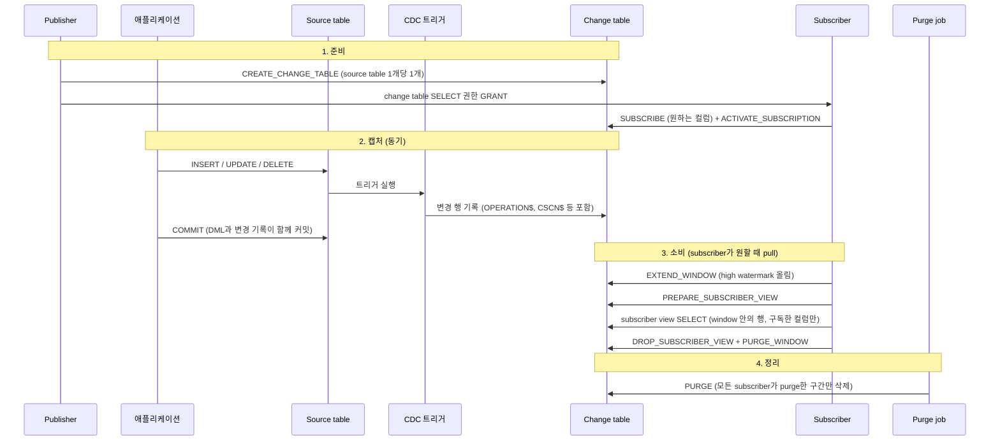
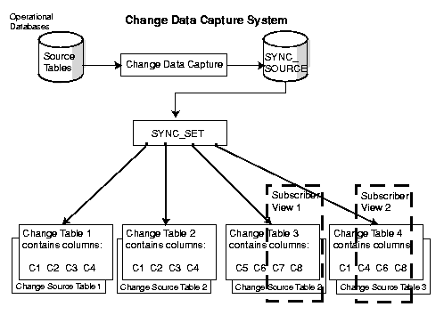

# Change Data Capture

[Oracle9i Data Warehousing Guide - Change Data Capture](https://docs.oracle.com/cd/B10500_01/server.920/a96520/cdc.htm)

Oracle9i(9.2, 2002년경)에 내장된 Change Data Capture(CDC) 기능을 공식 문서 기준으로 정리했다. 이 챕터는 **동기(synchronous) 캡처만** 다룬다. 지금은 쓰이지 않는 기능이지만, publish/subscribe 모델이나 subscriber별 읽기 위치(window)처럼 요즘 CDC 도구에도 이어지는 개념이 많다. 마지막 섹션에 이후 Oracle CDC가 어떻게 바뀌었는지 덧붙였다.

**핵심 요약**

- CDC는 테이블의 INSERT/UPDATE/DELETE를 캡처해서 **change table**에 쌓고, 여러 소비자가 나눠 읽게 해주는 기능이다.
- Oracle9i CDC는 source table에 **트리거**를 걸어 DML마다 change table에 기록하는 동기 방식이다.
- 소비자(subscriber)마다 **subscription window**(읽을 구간)가 따로 있고, 모든 subscriber가 다 읽은 구간만 정리된다.
- 12c에서 desupport되고 GoldenGate로 대체되었다. 요즘은 DB 로그를 읽는 방식(Debezium 등)이 주류다.

## 1. CDC란

- 관계형 테이블에서 추가·수정·삭제된 행을 효율적으로 찾아 캡처하고, 애플리케이션이 쓸 수 있게 제공하는 기능
- INSERT, UPDATE, DELETE의 결과를 **change table**이라는 DB 객체에 저장한다. 중간 flat file이 필요 없다.

### CDC가 없으면 무엇이 어려운가

| | CDC 사용 | CDC 미사용 |
|---|---|---|
| 추출 | 변경이 일어나는 즉시 추출 | INSERT는 잘해야 겨우 가능(새 행은 테이블에 남아 있어 찾을 수는 있지만 비효율적). UPDATE/DELETE는 이전 값·삭제된 행이 테이블에 없어서 어려움 |
| 스테이징 | 관계형 테이블로 바로 저장 | 테이블 전체를 flat file로 옮김 |
| 인터페이스 | publish/subscribe 인터페이스 (`DBMS_LOGMNR_CDC_PUBLISH`, `DBMS_LOGMNR_CDC_SUBSCRIBE`) | 오류가 잦고 손이 많이 감 |
| 비용 | Oracle9i에 기본 포함 | 캡처 소프트웨어를 직접 만들거나 서드파티 제품 구매 |

### 스테이징(Staging)

- 이 문서는 데이터 웨어하우스 가이드라서 ETL(Extract → Transform → Load) 흐름을 전제로 한다.
- 스테이징은 운영 DB에서 **추출한 데이터를 웨어하우스에 적재하기 전에 잠시 보관하는 중간 저장소**다.
	- `운영 DB → (추출) → 스테이징 영역 → (변환·정제) → 데이터 웨어하우스`
	- 운영 DB의 부담을 줄이고, 변환 작업을 따로 하기 위해 둔다.
- CDC 미사용: 변경분만 골라내기 어려워서 테이블 **전체**를 flat file로 덤프해 옮긴 뒤 비교·가공한다 → 데이터가 크고 파일 관리가 번거롭다.
- CDC 사용: 변경분만 change table(관계형 테이블)에 바로 쌓인다 → change table 자체가 스테이징 역할을 하고, SQL로 바로 읽을 수 있다.

## 2. 동작 방식

전체 흐름은 **준비 → 캡처 → 소비 → 정리** 4단계다.



1. **준비**: publisher가 캡처할 source table마다 change table을 만들고 권한을 준다. subscriber는 필요한 컬럼을 구독하고 활성화한다.
2. **캡처**: source table에 DML이 실행되면 CDC가 걸어둔 트리거가 **같은 트랜잭션 안에서** change table에 변경 행을 기록한다.
	- 같은 트랜잭션이라 DML이 롤백되면 변경 기록도 같이 사라진다 → 커밋된 변경만 남는다.
	- UPDATE는 설정에 따라 수정 전 값(`UO`)과 수정 후 값(`UN`)을 각각 행으로 남긴다.
3. **소비**: subscriber는 자기가 원할 때 window를 넓히고, CDC가 만들어 준 view를 SQL로 읽는다. 다 읽으면 view를 지우고 window를 purge한다. 이 과정을 반복한다.
4. **정리**: purge job이 주기적으로 돌면서 **모든 subscriber가 다 읽은 구간**만 change table에서 지운다.

### 동기 캡처 모드의 특징

- 운영 시스템에서 변경을 실시간으로 계속 캡처한다 → 초 단위 정확도
- source table에 DML이 실행된 직후 change table이 채워진다.
- 캡처 시점에 오버헤드가 생기지만, 추출이 단순해지고 비용을 줄일 수 있다.

## 3. 구성 요소

- subscriber view를 제외한 모든 구성 요소는 publisher가 관리한다.



| 구성 요소 | 설명 |
|---|---|
| Source system | 캡처 대상 테이블이 있는 운영 DB |
| Source table | 캡처할 데이터가 있는 테이블. 변경이 change table에 즉시 반영됨 |
| Change source | source system을 나타냄. 시스템이 만든 `SYNC_SOURCE` |
| Change set | change table의 묶음. 시스템이 만든 `SYNC_SET` |
| Change table | source table **하나**의 DML 변경을 담는 테이블 + 관리용 메타데이터. 게시된 컬럼 + CDC가 관리하는 control column으로 구성 |
| Publication | 같은 source table에 change table을 여러 개 게시해 접근을 제어 (예: A는 EMPLOYEE 전체 컬럼, B는 SALARY 제외 → SALARY는 A를 허락받은 사람만 봄) |
| Subscriber view | subscription window 안의 행 중 **구독한 컬럼만** 보여주는 view |
| Subscription window | subscriber가 볼 수 있는 시간 범위. 가장 오래된 행 = low watermark, 가장 최신 행 = high watermark |

### 구성 요소 간 흐름

```
[Source system: 운영 DB]
  Source table ──DML──▶ 트리거
                          │  (Change source = SYNC_SOURCE: 출처 표시)
                          ▼
                [Change set = SYNC_SET: change table들을 묶는 폴더]
                  ├─ Change table 1 ◀── Source table A의 변경 (C1~C4)
                  ├─ Change table 2 ◀── Source table A의 변경 (다른 publication)
                  ├─ Change table 3 ◀── Source table B의 변경 (C5~C8)
                  └─ Change table 4 ◀── Source table C의 변경 (C1, C4, C6, C8)
                          │
                          ▼  window로 행 범위를, 구독으로 컬럼을 잘라냄
                Subscriber view 1 (change table 3의 C7, C8만)
                Subscriber view 2 (change table 4의 C4, C6, C8만)
```

1. **변경 발생**: 애플리케이션이 source table에 `UPDATE emp SET sal = 5000 WHERE empno = 7369`를 실행한다.
2. **캡처**: 트리거가 같은 트랜잭션 안에서 change table에 행을 기록한다.
	- `CAPTURE_VALUES => 'both'`면 수정 전(`OPERATION$ = 'UO'`)과 수정 후(`'UN'`) 2행이 생긴다.
	- 커밋 SCN(`CSCN$`), 커밋 시각 같은 control column도 함께 채워진다.
3. **보관**: change table은 `SYNC_SET` 안에 있고, 출처는 `SYNC_SOURCE`로 표시된다. 동기 모드에서는 둘 다 시스템이 미리 만든 하나뿐이라 사실상 고정값이다.
4. **접근 제어**: publisher는 같은 source table이라도 컬럼 구성이 다른 change table(publication)을 여러 개 만들고, 각각 SELECT 권한을 따로 준다.
5. **읽기**: subscriber는 change table을 직접 읽지 않는다. CDC가 만들어 준 subscriber view로 읽는다.
	- **행**은 subscription window(low ~ high watermark)로 제한된다.
	- **열**은 내가 구독한 컬럼으로 제한된다.

### Change table의 control column

change table에는 source에서 가져온 컬럼 외에 CDC가 관리하는 control column이 붙는다.

| 컬럼 | 타입 | 설명 |
|---|---|---|
| `RSID$` | NUMBER | 행 고유 시퀀스 ID |
| `OPERATION$` | CHAR(2) | `I` 삽입 / `UO`·`UU` 수정 전 값 / `UN` 수정 후 값 / `UL` LOB 수정 / `D` 삭제 |
| `CSCN$` | NUMBER | Commit SCN |
| `COMMIT_TIMESTAMP$` | DATE | 트랜잭션 커밋 시각 |
| `SOURCE_COLMAP$` | NUMBER | 수정된 컬럼 비트마스크 (source table 기준, 선택) |
| `TARGET_COLMAP$` | NUMBER | 수정된 컬럼 비트마스크 (change table 기준, 선택) |
| `USERNAME$` | VARCHAR2(30) | 작업한 사용자 (선택) |
| `TIMESTAMP$` | DATE | source table에서 작업이 일어난 시각 (선택) |
| `ROW_ID$` | ROW_ID | 영향받은 source 행의 row ID (선택) |
| `SYS_NC_OID$` | RAW(16) | Object ID (선택) |

- subscriber는 control column이 아니라 source column을 구독한다. 구독 시점에 있던 control column은 볼 수 있다.

## 4. Publish / Subscribe 모델

publisher 하나가 여러 source table의 변경을 캡처해서 게시하고, subscriber는 여러 명일 수 있다.

| 역할 | 주체 | 하는 일 |
|---|---|---|
| Publisher | 보통 DBA | 캡처할 source table 결정 → change table 생성·게시 → `GRANT`/`REVOKE`로 SELECT 권한 관리 |
| Subscriber | 보통 애플리케이션 | 원하는 컬럼 구독 → window 확장 + subscriber view 생성 → SELECT로 읽기 → view 삭제 + window purge → 필요 없으면 구독 삭제 |

- **게시(publish)**: publisher가 change table을 만들고 읽기 권한을 주는 것
- **구독(subscribe)**: subscriber가 필요할 때 직접 window를 넓히고(`EXTEND_WINDOW`) view를 SQL로 읽는다 → 밀어주는(push) 방식이 아니라 **가져가는(pull) 방식**
- 데이터는 같은 DB 안 테이블에 그대로 있고, CDC는 **누가 어디까지 읽었는지만** 관리한다.

### Subscription window

change table을 **공용 게시판**, subscriber를 **각자 북마크를 가진 독자**라고 생각하면 쉽다.

```
change table:  [ 월 | 화 | 수 | 목 | 금 ]   ← 변경이 계속 쌓임
Subscriber 1:        [화]                  ← 지금 화요일분 읽는 중
Subscriber 2:             [수 | 목]        ← 지금 수~목요일분 읽는 중
```

- 모든 subscriber가 **같은 change table**을 읽지만 **자기 위치(window)**를 따로 가진다 → 읽는 속도가 달라도 서로 간섭하지 않는다.

| 단계 | 하는 일 | 비유 |
|---|---|---|
| Extend | window를 다음 구간까지 넓히고, 그 구간만 보이는 subscriber view를 받음 | 다음 페이지까지 북마크 이동 |
| Read | view를 SELECT로 읽음 | 그 페이지 읽기 |
| Purge | view를 지우고 "이 구간은 다 읽었음"을 알림 | 읽은 페이지에 체크 |

- 이 과정을 반복하면서 각자 자기 속도로 진행한다.
- **모든 subscriber가 다 읽었다고 체크한 구간만** CDC가 지운다 → change table이 무한히 커지지 않는다.
- 다 읽은 구간은 window 밖으로 나가므로 같은 데이터를 다시 읽지 않는다.

### Subscriber 입장의 이점

- **누락·중복 없음**: 모든 변경을 정확히 한 번씩 본다.
- **공유**: 여러 subscriber가 같은 change table을 함께 쓴다.
- **자동 정리**: 아무도 필요 없는 데이터는 CDC가 알아서 지운다.

## 5. Publisher: 변경 데이터 게시와 관리

### 필요 권한

- 커밋된 데이터만 캡처·게시한다.
- `EXECUTE_CATALOG_ROLE`: `DBMS_LOGMNR_CDC_PUBLISH` 실행
- `SELECT_CATALOG_ROLE`: 모든 view 조회
- subscriber에게 change table SELECT 권한을 줄 수 있어야 함

### 게시 절차

1. **source system 결정**: subscriber 요구사항을 모으고 관련 테이블이 있는 인스턴스를 찾는다.
2. **change table 생성**: `DBMS_LOGMNR_CDC_PUBLISH.CREATE_CHANGE_TABLE`
	- 동기 캡처에서는 `SYNC_SOURCE`, `SYNC_SET`이 미리 만들어져 있고, change table은 `SYNC_SET`에 들어간다.
	- source table 하나당 change table 하나를 만들고, 포함할 컬럼을 고른다.
	- UPDATE는 이전 값 / 새 값 / 둘 다 중 무엇을 캡처할지 정한다.
	- `OPTIONS_STRING`에 `CREATE TABLE` 옵션(물리 속성, 테이블스페이스)을 넣을 수 있다.

```sql
EXECUTE DBMS_LOGMNR_CDC_PUBLISH.CREATE_CHANGE_TABLE (
  OWNER             => 'cdc',
  CHANGE_TABLE_NAME => 'emp_ct',
  CHANGE_SET_NAME   => 'SYNC_SET',
  SOURCE_SCHEMA     => 'scott',
  SOURCE_TABLE      => 'emp',
  COLUMN_TYPE_LIST  => 'empno number, ename varchar2(10), job varchar2(9), mgr number, hiredate date, deptno number',
  CAPTURE_VALUES    => 'both',  -- UPDATE 1건 → 수정 전/후 2행
  RS_ID             => 'y',
  ROW_ID            => 'n',
  USER_ID           => 'n',
  TIMESTAMP         => 'n',
  OBJECT_ID         => 'n',
  SOURCE_COLMAP     => 'y',
  TARGET_COLMAP     => 'y',
  OPTIONS_STRING    => null);
```

### Purge

| 주체 | 프로시저 | 역할 |
|---|---|---|
| Publisher | `DBMS_CDC_PUBLISH.PURGE` | 활성 subscription window가 참조하지 않는 데이터만 삭제. 보통 job queue로 자동 실행 |
| Subscriber | `DBMS_CDC_SUBSCRIBE.PURGE_WINDOW` | "이 window의 데이터는 더 필요 없음"을 알림 |

- **모든 subscriber가 purge해야** 데이터가 지워진다. `PURGE_WINDOW`를 호출하지 않는 subscriber가 있으면 데이터가 계속 쌓인다.
	- `DBA_SUBSCRIPTIONS`로 그런 subscriber를 찾을 수 있다.
	- 최후 수단: publisher가 `DROP_SUBSCRIBER_VIEW` → `DROP_SUBSCRIPTION`으로 구독을 삭제해 공간을 회수한다.

### Change table 삭제

- 일반 `DROP TABLE`로는 지울 수 없다 → `ORA-31496` ("change table은 `DBMS_CDC_PUBLISH.DROP_CHANGE_TABLE`로 지워야 함")
- `DROP_CHANGE_TABLE`을 써야 테이블과 CDC 메타데이터가 함께 지워진다.
- 활성 구독이 있으면 실패한다 → `ORA-31424` ("change table에 활성 구독이 있음")
	- `FORCE => 'Y'`로 강제 삭제할 수 있다. 이때 구독은 무효가 되고 subscriber는 접근할 수 없다.
- `DROP USER ... CASCADE`: 그 사용자의 change table(`FORCE => 'Y'`)과 구독을 함께 삭제한다. 다른 사용자가 가진 해당 구독은 무효가 된다.

> `ORA-xxxxx`는 Oracle DB의 에러 코드다. ORA는 Oracle, 뒤 숫자는 에러 번호이며 메시지와 함께 반환된다.

## 6. Subscriber: 변경 데이터 구독

subscriber(보통 애플리케이션)는 권한이 있는 게시된 source table을 구독할 수 있다.

### 구독 절차

모두 `DBMS_LOGMNR_CDC_SUBSCRIBE`의 프로시저다.

| 단계 | 프로시저 / 작업 | 설명 |
|---|---|---|
| 1 | `ALL_SOURCE_TABLES` 조회 | 접근 가능한 source table 확인 |
| 2 | `GET_SUBSCRIPTION_HANDLE` | change set(`SYNC_SET`)으로 구독 핸들 발급. 이후 계속 사용 |
| 3 | `SUBSCRIBE` | source table과 컬럼 구독 (예: scott.emp의 empno, ename, hiredate). 같은 change set의 테이블 여러 개 가능 |
| 4 | `ACTIVATE_SUBSCRIPTION` | 테이블을 다 추가한 뒤 한 번 호출. window는 빈 상태로 시작하며, 이후 테이블 추가 불가 |
| 5 | `EXTEND_WINDOW` | high watermark를 올려 이전 window 끝부터 새 window 생성. 새 데이터가 없으면 아무것도 안 함 |
| 6 | `PREPARE_SUBSCRIBER_VIEW` | change table마다 subscriber view 생성. 구독 컬럼 + 아직 안 본 행만 보이며 내용은 고정 |
| 7 | `SELECT` | subscriber view 조회 (이름 예: `CDC#CV$119490`). change table을 직접 읽지 않는다 |
| 8 | `DROP_SUBSCRIBER_VIEW` | view 삭제. 삭제 전까지는 새 데이터가 들어와도 view 내용이 유지된다 |
| 9 | `PURGE_WINDOW` | 현재 window의 데이터가 더 필요 없음을 알림 |
| 10 | 5~9 반복 | |
| 11 | `DROP_SUBSCRIPTION` | 구독 종료. 하지 않으면 change table이 무한히 커진다 |

### Publisher가 변경했을 때 구독에 미치는 영향

| Publisher 변경 | 영향 |
|---|---|
| change table 추가 | 별도 알림 없음. subscriber가 view를 확인해야 함 |
| 활성 구독이 있는 change table 삭제 | force가 필요하므로 미리 알려야 함. 모르는 subscriber는 `PREPARE_SUBSCRIBER_VIEW`에서 예외가 나서 알게 됨 |
| user column 추가 + 새 구독이 그 컬럼 포함 | window가 컬럼 추가 시점부터 시작 |
| user column 추가 + 새 구독이 그 컬럼 미포함 | window가 low watermark부터 시작 (테이블 전체 조회 가능) |
| user column 추가 + 기존 구독 | window 변화 없음 |
| control column 추가 + 새 구독 | low watermark부터 시작. 바로 보이며 이전 행은 NULL |
| control column 추가 + 기존 구독 | `EXTEND_WINDOW`로 low watermark가 컬럼 추가 시점을 넘어가야 보임 |

## 7. 운영 시 주의사항

### 설치와 제거

- 동기 캡처용 드라이버는 Oracle9i에 포함되어 있다.
- CDC는 Java를 쓰므로 서버 설치 시 Java가 활성화되어 있어야 한다.
- CDC는 `CREATE TABLE`, `ALTER TABLE`, `DROP TABLE`에 시스템 트리거를 건다. **시스템 트리거를 끄면 CDC가 제대로 동작하지 않는다.**
- 제거: `rmcdc.sql` (시스템 트리거와 CDC Java 클래스 제거). JVM도 제거한다면 `rmjvm`보다 먼저 실행한다.
- 재설치: `initcdc.sql`

### Direct-path INSERT는 캡처되지 않는다

- CDC는 source table에 트리거를 만들어 변경을 캡처한다.
- direct-path INSERT는 트리거를 끄기 때문에, 이 방식으로 들어간 행은 **캡처되지 않는다.**
- parallel DML 모드의 multitable insert도 direct-path INSERT를 쓰므로 마찬가지다.
- **에러 없이 조용히 누락된다.**

| | Conventional INSERT (일반) | Direct-path INSERT |
|---|---|---|
| 쓰는 방식 | 버퍼 캐시를 거쳐 테이블의 빈 공간에 한 행씩 기록 | 버퍼 캐시를 건너뛰고 테이블 끝(HWM 위)에 블록 단위로 바로 기록 |
| 속도 | 보통 | 대량 적재에 훨씬 빠름 |
| 트리거 | 실행됨 | 실행 안 됨 (문서 기준) |
| 쓰는 곳 | 일반 `INSERT` | `INSERT /*+ APPEND */ ... SELECT`, SQL*Loader direct 모드, parallel DML 대량 적재 |

- 비유: CDC 트리거는 정문 경비원이다. 일반 INSERT는 정문으로 들어와 경비원이 하나하나 기록하지만, direct-path INSERT는 대량 짐을 뒷문으로 바로 들이는 셈이라 경비원이 보지 못한다.
- 결과: 데이터는 source table에 들어갔는데 change table에는 없다 → subscriber는 그 변경을 끝내 모른다.
- 에러가 나지 않아 알아채기 어렵다. CDC를 걸어둔 테이블에 대량 적재할 때는 direct-path를 쓰지 않도록 주의한다.

### 보안

- change table 권한은 source table 권한과 별개다. source table을 SELECT할 수 있어도 change table은 못 볼 수 있다.
- publisher가 `GRANT`/`REVOKE`로 change table의 SELECT 권한을 관리한다. 구독하려면 먼저 SELECT 권한이 있어야 한다.
- subscriber에게 INSERT/UPDATE/DELETE 권한은 **주면 안 된다.** change table이 source table과 어긋날 수 있다. 사용자가 DML 권한을 가진 스키마에 change table을 만드는 것도 피한다.

### Export / Import

- **change table을 import할 때**: purge job이 없으면 `DBMS_CDC_PUBLISH.PURGE` job이 자동 등록된다. 구독이 생기기 전에 purge가 돌면(기본 24시간) **모든 행이 삭제된다.**
	- 방지 1: `DBMS_JOB`으로 purge job을 멈추거나(`BROKEN`) 나중에 실행하도록(`NEXT_DATE`) 바꾼다. 멈췄다면 구독이 시작된 뒤 다시 켜야 한다.
	- 방지 2: 더미 구독을 만들어 데이터를 붙잡아 두고, 실제 구독이 생기면 삭제한다.
- 이미 change table이 있는 source table에 import하면 → import한 데이터도 change table에 기록된다.
- source table과 change table이 둘 다 없던 DB로 import하면 → import가 끝날 때까지 CDC가 설정되지 않는다 (중복 방지).
- source table과 change table을 새 인스턴스로 함께 export/import하면 → source 데이터가 change table에 다시 기록되지 않는다 (이미 들어 있으므로).
- `ROW_ID` 컬럼은 source table을 import하지 않았을 때만 의미가 있다. source를 새로 만들거나 import하면 row ID가 바뀐다.
- 같은 이름의 테이블이 있는 DB로 change table을 옮기면 import 에러가 날 수 있다.
- 동기 change table이나 source table을 옮길 때는 **둘을 함께 옮기고** import 로그를 확인한다.

## 8. 참고: CDC 관련 View

| 분류 | View | 용도 |
|---|---|---|
| 환경 | `CHANGE_SOURCES`, `CHANGE_SETS`, `CHANGE_TABLES` | publisher가 change source/set/table 확인 |
| Source table | `ALL_` / `DBA_` / `USER_SOURCE_TABLES` | 게시된 source table |
| Source column | `ALL_` / `DBA_` / `USER_SOURCE_TAB_COLUMNS` | 게시된 source column |
| Published column | `ALL_` / `DBA_` / `USER_PUBLISHED_COLUMNS` | 권한 있는 게시 컬럼 |
| Subscription | `ALL_` / `DBA_` / `USER_SUBSCRIPTIONS` | 구독 현황 |
| Subscribed table | `ALL_` / `DBA_` / `USER_SUBSCRIBED_TABLES` | 구독한 테이블 |
| Subscribed column | `ALL_` / `DBA_` / `USER_SUBSCRIBED_COLUMNS` | 구독한 컬럼 |

- 접두어: `ALL_`은 subscriber가 볼 수 있는 범위, `DBA_`는 publisher용 전체, `USER_`는 현재 사용자 것

## 9. 이후 Oracle CDC는 어떻게 되었나

> 원문(Oracle9i) 이후의 흐름은 별도로 찾아 정리했다.

### Oracle 내장 CDC의 퇴장

| 시기 | 변화 |
|---|---|
| Oracle 12c | 내장 Change Data Capture **desupport**. Oracle 노트 1644090.1에 따르면 12c에 포함되지 않고 **Oracle GoldenGate로 대체** |
| Oracle 12c | Advanced Replication, Oracle Streams도 deprecated → 복제·CDC를 GoldenGate로 일원화 |
| Oracle 19c | LogMiner의 continuous mine 기능 deprecated |
| 19c 이후 | XStream도 GoldenGate 쪽으로 유도 |

- 이유: Oracle이 GoldenGate를 인수하면서 복제 솔루션을 두 개 유지하지 않으려 했다.
- 단점: GoldenGate는 라이선스 비용이 비싸서 Qlik Replicate, Dbvisit Replicate, Estuary 같은 서드파티 대안도 쓰인다.

### 요즘 방식: 로그 기반 CDC

```
[9i]   DML → 트리거 → change table(같은 DB) ← subscriber가 SQL로 읽어감
[요즘] DML → redo log/binlog → CDC 도구가 로그 읽음 → Kafka → consumer
```

| | 이 문서의 CDC (9i) | 요즘 CDC |
|---|---|---|
| 캡처 방식 | source table **트리거** (동기) | DB **로그**(redo log, MySQL binlog 등)를 읽음 |
| 운영 DB 부담 | DML마다 트리거 실행 → 오버헤드 | 이미 쓰고 있는 로그를 읽으므로 적음 |
| 전달 대상 | 같은 DB의 change table | Kafka 등 외부 시스템 |
| 대표 도구 | Oracle 내장 CDC | Oracle GoldenGate, Debezium |

- **Debezium Oracle connector**는 Oracle의 변경을 읽는 방법을 고를 수 있다.
	- LogMiner (기본값): Oracle 내장 유틸리티로 redo/archived log를 조회
	- XStream: capture process가 변경을 LCR(Logical Change Record)로 바꿔 클라이언트에 전달. Confluent의 Oracle XStream CDC connector도 이 방식
	- OpenLogReplicator (Debezium 2.5 문서부터)
- 주의: 로그 기반이라 **redo log 보존 기간**이 중요하다. connector가 보존 기간보다 오래 멈춰 있으면 끊긴 구간을 읽지 못해 재시작에 실패한다.
- 이 문서의 publish/subscribe 모델, subscriber별 window(≈ Kafka consumer offset), "모두 읽은 데이터만 정리" 같은 개념은 지금도 그대로 통한다.

### 참고 자료

- [dbi-services: Oracle CDC for datawarehouse](https://www.dbi-services.com/blog/oracle-cdc-for-datawarehouse-dbvisit-replicate-as-an-alternative/)
- [Oracle MOSC: Change Data Capture in Oracle 12c](https://community.oracle.com/mosc/discussion/3952696/question-about-change-data-capture-cdc-in-oracle-12c)
- [Striim: LogMiner Continuous Mining Deprecation](https://www.striim.com/blog/logminer-continuous-mining-deprecation-what-you-need-to-know/)
- [Debezium Connector for Oracle (2.5)](https://debezium.io/documentation/reference/2.5/connectors/oracle.html)
- [Confluent: Oracle XStream CDC Source Connector](https://docs.confluent.io/kafka-connectors/oracle-xstream-cdc-source/current/overview.html)
- [Decodable: Oracle CDC source connector](https://docs.decodable.co/connect/source/oracle-cdc)
