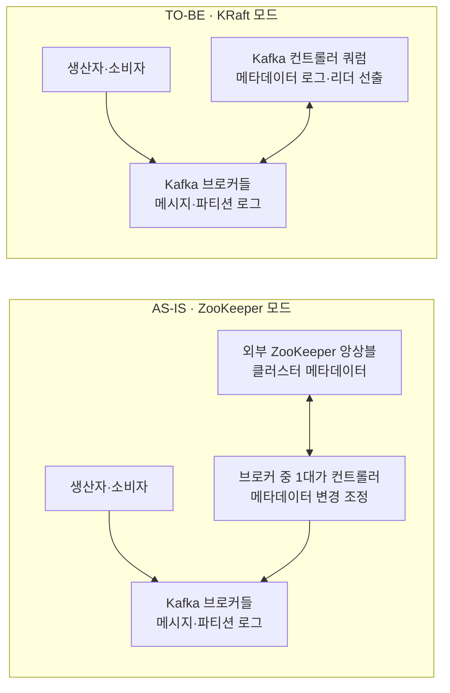

# Kafka KRaft와 ZooKeeper

## 한눈에 보는 변화



**바뀐 부분은 클러스터 메타데이터의 저장과 컨트롤러 선출 방식이다.** 기존에는 외부 ZooKeeper와 브로커 중 한 대의 컨트롤러가 맡았고, KRaft에서는 Kafka 컨트롤러 쿼럼이 맡는다. 생산자·소비자가 브로커를 통해 메시지를 읽고 쓰는 데이터 흐름은 그대로다.

> 읽은 글: Giorgos Myrianthous, [Kafka No Longer Requires ZooKeeper](https://towardsdatascience.com/kafka-no-longer-requires-zookeeper-ebfbf3862104), 2021-04-27. 아래는 기사 내용을 바탕으로 다시 쓴 학습 메모다. 기사의 Kafka 2.8 설명과 현재 동작을 구분했다.

## 핵심 요약

Kafka는 과거에 토픽·파티션·브로커 등 클러스터 메타데이터의 관리와 컨트롤러 선출을 위해 별도 ZooKeeper 클러스터를 사용했다. KRaft(Kafka Raft metadata mode)는 이 역할을 Kafka 컨트롤러 쿼럼으로 옮긴 방식이다. **Kafka 2.8의 KRaft는 시험용 초기 공개 기능이었고, Kafka 4.0부터는 ZooKeeper 모드가 제거되었다.**

기사에 반복된 `KPI-500`은 오기다. 정확한 이름은 **KIP-500(Kafka Improvement Proposal 500)**이다.

## 먼저, Kafka의 구성 요소

**ZooKeeper는 브로커가 아니었다.** 예전 Kafka에도 생산자, 브로커, 소비자가 있었고, 메시지는 ZooKeeper를 거치지 않았다. ZooKeeper는 Kafka와 별도로 실행되며 클러스터 메타데이터와 컨트롤러 선출을 지원했다.

```text
메시지 경로: 생산자 → 브로커(토픽의 파티션에 저장) → 소비자
관리 경로: ZooKeeper ↔ 컨트롤러(브로커 중 한 대) → 브로커들
```

즉 **브로커는 메시지를 저장·전달하는 Kafka 서버**, **컨트롤러는 클러스터 상태를 조정하는 역할**, **ZooKeeper는 그 관리를 돕던 외부 시스템**이다. KRaft에서는 관리 경로의 ZooKeeper와 기존 컨트롤러 선출 방식이 Kafka 컨트롤러 쿼럼으로 바뀌지만, 생산자·브로커·소비자의 메시지 경로는 유지된다.

| 구성 요소 | 하는 일 |
| --- | --- |
| 생산자·소비자 | Kafka에 메시지를 보내거나 읽는 **클라이언트 애플리케이션**. Kafka 서버 자체는 아니다. |
| 브로커 | 토픽의 파티션 로그를 저장하고 생산자·소비자의 읽기·쓰기 요청을 처리하는 Kafka 서버. |
| 파티션 리더·팔로워 | 브로커에 놓인 **메시지 데이터의 복제본**이다. 리더가 쓰기 요청을 받고 팔로워가 복제한다. |
| 컨트롤러 | 브로커 등록, 파티션 리더 변경, 토픽·파티션 상태 같은 **클러스터 메타데이터**를 조정하는 역할. 개별 메시지를 소비자에게 전달하는 역할은 아니다. |
| ZooKeeper | 기존 Kafka가 클러스터 메타데이터 보관과 컨트롤러 선출에 사용한 외부 시스템. 메시지를 저장하거나 생산자·소비자 요청을 처리하지 않는다. |

`컨트롤러`와 `소비자 그룹 코디네이터`도 구분해야 한다. 전자는 클러스터와 파티션 상태를 관리하고, 후자는 소비자 그룹의 멤버십·오프셋 커밋 등을 다룬다. 이름이 비슷해도 맡는 범위가 다르다.

## 컨트롤러는 원래 무엇을 했고, KRaft에서는 무엇이 바뀌나?

컨트롤러 **역할 자체는 KRaft 이전에도 있었다.** ZooKeeper 모드에서는 **브로커 중 한 대**가 컨트롤러로 선출되었다. ZooKeeper가 클러스터 메타데이터와 브로커 등록 상태를 보관하고 컨트롤러 선출을 도왔다. 선출된 컨트롤러는 브로커 장애를 감지하면 영향을 받은 파티션의 새 리더를 정하고, 그 결과를 다른 브로커에 알렸다. 컨트롤러가 장애를 겪으면 살아 있는 다른 브로커가 컨트롤러가 되었다. [Kafka의 기존 복제 설계](https://kafka.apache.org/35/design/design/)

KRaft 모드에서는 서버에 `process.roles=controller` 역할을 줄 수 있다. 이 컨트롤러들이 **Kafka 내부의 Raft 쿼럼**을 만들고, 그중 한 대가 활성 컨트롤러가 된다. 클러스터 메타데이터의 변경 사항은 ZooKeeper 대신 쿼럼의 로그에 기록·복제된다. 활성 컨트롤러가 장애를 겪으면 동기화된 다른 컨트롤러가 새 활성 컨트롤러가 된다. 브로커는 쿼럼으로부터 메타데이터를 받아 파티션 데이터를 계속 저장·처리한다. [Kafka KRaft 운영 문서](https://kafka.apache.org/43/operations/kraft/)

| 구분 | ZooKeeper 모드 | KRaft 모드 |
| --- | --- | --- |
| 컨트롤러 역할 | 브로커 중 한 대가 겸임 | 컨트롤러 역할을 지정한 Kafka 서버가 담당. 개발 환경에서는 브로커와 겸임도 가능 |
| 메타데이터의 기준 저장소 | 외부 ZooKeeper | Kafka 컨트롤러 쿼럼의 메타데이터 로그 |
| 컨트롤러 선출·장애 대응 | ZooKeeper를 통해 다른 브로커가 컨트롤러가 됨 | 컨트롤러 쿼럼이 새 활성 컨트롤러를 선출 |
| 메시지 데이터 | 브로커의 파티션 로그 | 브로커의 파티션 로그 |

예를 들어 파티션 리더가 있던 브로커가 죽으면 **두 방식 모두 새 파티션 리더를 정해야 한다.** 달라진 것은 그 결정을 조정할 컨트롤러를 선출하고 메타데이터를 합의·보관하는 기반이다. ZooKeeper 방식은 외부 ZooKeeper와 컨트롤러 브로커에 의존했고, KRaft는 Kafka 컨트롤러 쿼럼의 로그를 사용한다. **컨트롤러가 메시지 데이터까지 직접 저장하는 구조로 바뀐 것은 아니다.**

## ZooKeeper 의존성을 없애려 한 이유

- **운영 대상 감소:** Kafka와 ZooKeeper는 설정, 배포, 모니터링, 보안 설정이 서로 다른 두 시스템이었다.
- **메타데이터 관리 단순화:** 이전 구조에서는 컨트롤러 시작이나 교체 시 ZooKeeper에 저장된 클러스터 상태를 읽어야 했다. 파티션 수가 늘수록 이 과정이 부담이 될 수 있었다.
- **확장성 개선:** 메타데이터 관리를 Kafka 내부로 통합해 많은 토픽과 파티션을 다루기 쉬운 구조로 바꾸려 했다.

ZooKeeper를 없앴다고 브로커의 메시지 데이터와 컨트롤러의 메타데이터가 하나의 로그에 섞여 저장되는 것은 아니다. 둘은 역할과 저장 대상이 다르다.

## KRaft는 어떻게 동작하나?

KRaft에서는 선택된 Kafka 서버가 **컨트롤러**가 되어 메타데이터 쿼럼에 참여한다. 컨트롤러 한 대가 활성 컨트롤러 역할을 맡고, 나머지는 메타데이터를 복제하며 장애에 대비한다. 브로커는 이 메타데이터를 바탕으로 토픽과 파티션의 상태를 파악하고 메시지 읽기·쓰기 요청을 처리한다.

```text
                 메타데이터 쿼럼
       컨트롤러 1 ─ 컨트롤러 2 ─ 컨트롤러 3
              │ 활성 컨트롤러 선출
              │ 메타데이터 로그 복제
              ▼
       브로커들: 파티션 데이터 저장·처리
```

메타데이터는 Raft 기반 로그로 관리된다. 기사의 `@metadata`라는 표기는 정확하지 않다. Kafka 문서에서 확인할 수 있는 메타데이터 파티션 이름은 **`__cluster_metadata-0`**이다. 이는 애플리케이션 이벤트를 발행하는 일반 토픽과 구분해야 한다.

쿼럼은 과반수의 컨트롤러가 살아 있어야 가용하다. 예를 들어 컨트롤러 3대는 1대 장애를, 5대는 2대 장애를 견딜 수 있다. 따라서 운영 환경에서는 컨트롤러 수뿐 아니라 서로 다른 장애 영역에 배치하는 것도 중요하다.

## 서버 역할과 설정

`process.roles`는 서버 역할을 지정한다.

| 값 | 역할 |
| --- | --- |
| `broker` | 메시지 데이터와 클라이언트 요청 처리 |
| `controller` | 메타데이터 쿼럼 참여 |
| `broker,controller` | 두 역할을 한 프로세스에서 수행 |

기사의 예시는 브로커 7대와 컨트롤러 3대를 별도 노드로 두고, 각 노드에 고유한 `node.id`를 부여한다. 컨트롤러 노드는 컨트롤러용 `listeners`를 사용하며, 당시의 **정적 쿼럼** 설정은 `controller.quorum.voters=1@host1:port1,2@host2:port2,3@host3:port3` 형태로 모든 컨트롤러를 열거했다.

이 설정은 기사 작성 당시의 예시다. 현재 Kafka에는 동적 컨트롤러 쿼럼도 있으며, 이 경우 `controller.quorum.bootstrap.servers`를 사용한다. 실제 배포 설정은 사용 중인 Kafka 버전과 쿼럼 방식의 공식 문서를 기준으로 작성해야 한다. `broker,controller` 결합 모드는 개발 환경에는 편리하지만 중요한 운영 환경에서는 역할을 분리하는 편이 좋다.

## 기사 시점과 현재의 차이

| 시점 | KRaft 상태 |
| --- | --- |
| Kafka 2.8 (2021) | ZooKeeper 없는 Kafka의 초기 공개 기능. 운영 환경에는 권장되지 않았음 |
| Kafka 3.3 (2022) | 새 클러스터에 KRaft를 운영용으로 사용할 수 있게 됨 |
| Kafka 4.0 이후 | ZooKeeper 모드 제거. KRaft만 지원 |

따라서 기사에 나온 “초기 공개라 운영에 쓰지 말라”, “`process.roles`를 생략하면 ZooKeeper 모드가 된다”는 설명을 현재 버전의 운영 지침으로 읽으면 안 된다. 반대로 **ZooKeeper를 별도로 운영해야 했던 문제와 KRaft가 이를 해결한 방향**은 지금도 유효한 학습 포인트다.

## 현재 KRaft가 표준인가? (2026-10-25 확인)

**Apache Kafka 4.x에서는 KRaft가 선택 가능한 대안이 아니라 유일한 메타데이터 관리 방식이다.** [Kafka 4.0 업그레이드 문서](https://kafka.apache.org/40/getting-started/upgrade/)는 ZooKeeper 모드가 제거됐으며, 기존 ZooKeeper 클러스터는 4.x로 올리기 전에 KRaft로 이전해야 한다고 명시한다. [KRaft 운영 문서](https://kafka.apache.org/43/operations/kraft/)도 컨트롤러 구성·쿼럼 관리·상태 조회를 KRaft 기준으로 설명한다. 따라서 **새 Kafka 4.x 클러스터의 표준 아키텍처는 KRaft**라고 이해하면 된다.

다만 이것이 모든 **운영 중인 Kafka 클러스터**가 이미 KRaft라는 뜻은 아니다. ZooKeeper를 지원하던 3.x 클러스터는 여전히 남아 있을 수 있다. Apache Kafka 3.9가 ZooKeeper 모드를 지원한 마지막 버전이며, 4.x로 업그레이드하려면 메타데이터 모드 전환이 선행되어야 한다. 또한 KRaft가 표준이라는 사실과 특정 클라우드 서비스가 어느 버전·이전 방식을 지원하는지는 구분해야 한다.

공식 운영 문서에서 확인할 사항도 있다.

- `process.roles`로 브로커와 컨트롤러 역할을 정한다. 중요한 운영 환경에서는 결합 모드보다 역할 분리를 권장한다.
- 컨트롤러 쿼럼은 과반수가 살아 있어야 동작한다. 3대라면 1대, 5대라면 2대 장애를 견딘다.
- 과거의 정적 쿼럼은 `controller.quorum.voters`에 투표자 전체를 적었다. 동적 쿼럼은 `controller.quorum.bootstrap.servers`를 사용하며, 실제 설정은 클러스터의 KRaft 기능 버전에 맞춰야 한다.
- `kafka-metadata-quorum.sh --bootstrap-server <브로커 주소> describe --status`로 활성 리더, 에포크, 높은 워터마크, 투표자 상태를 확인할 수 있다.

## AWS 글과 Amazon MSK 가이드에서 확인한 내용

보내준 [AWS 기술 블로그](https://aws.amazon.com/ko/blogs/tech/amazon-msk-kraft-mode/)는 ZooKeeper 의존성이 메타데이터 동기화와 컨트롤러 교체에 주는 부담을 설명한다. KRaft에서는 활성 컨트롤러가 메타데이터 변경을 로그에 기록하고, 투표권이 있는 컨트롤러들이 이를 복제한다. 브로커는 투표하지 않는 관찰자로 메타데이터를 받아 캐시한다. **일반 토픽의 파티션 복제와 컨트롤러 쿼럼의 메타데이터 합의는 목적과 커밋 기준이 다르다.**

Amazon MSK에 적용하면 다음과 같다.

| 항목 | AWS 문서에서 확인한 내용 |
| --- | --- |
| 새 클러스터 | MSK의 Kafka 3.7.x부터 KRaft 모드 생성 가능. 같은 버전의 ZooKeeper 모드도 선택 가능 |
| Kafka 4.x | ZooKeeper가 제거된 Kafka 버전이므로 KRaft만 사용 |
| 컨트롤러 운영 | MSK가 컨트롤러를 제공·관리하므로 사용자가 별도 ZooKeeper나 컨트롤러를 배포하지 않음 |
| 클라이언트 연결 | 생산자·소비자·일반 관리 도구는 브로커의 `--bootstrap-server`를 사용. 컨트롤러 엔드포인트는 주로 모니터링에 필요 |
| 기존 클러스터 | MSK는 ZooKeeper에서 KRaft로의 **제자리 이전**을 지원. 기존 데이터의 별도 복사는 필요하지 않음 |

[AWS의 메타데이터 관리 가이드](https://docs.aws.amazon.com/msk/latest/developerguide/metadata-management.html)에 따르면 MSK에서 KRaft를 지원하기 시작한 버전은 3.7.x다. 따라서 “MSK가 KRaft를 지원한다”는 말과 “MSK의 모든 3.x 클러스터가 KRaft다”는 말은 다르다.

### 기존 MSK 클러스터를 이전할 때

AWS 글은 2025년 게시 당시 “새 클러스터에서만 KRaft를 사용할 수 있다”고 설명한 문장과, **2026-08-21 업데이트 후 제자리 이전을 지원한다**는 문장을 함께 담고 있다. 현재 판단에는 업데이트된 내용과 [AWS의 이전 가이드](https://docs.aws.amazon.com/msk/latest/developerguide/zk-to-kraft-migration.html)를 따른다.

가이드의 주요 선행 조건은 ZooKeeper 모드의 **Kafka 3.9.x** 클러스터, `ACTIVE` 상태, ZooKeeper에 직접 연결하는 도구의 정리, 클라이언트의 `--bootstrap-server` 사용이다. Standard 브로커에서는 3개 가용 영역 배치와 ZooKeeper 클라이언트 접근 비활성화 등 추가 조건도 확인해야 한다. MSK는 KRaft 컨트롤러 구성 → 메타데이터 이전 → 브로커 전환 → ZooKeeper 제거를 관리하며, 그동안 클라이언트 트래픽은 계속 처리한다. **전환 후 ZooKeeper 모드로 되돌리는 것은 지원되지 않는다.** 실제 작업 전에는 대상 클러스터의 지원 버전과 전체 선행 조건을 가이드에서 다시 확인한다.

### 운영 중 무엇을 확인하나?

AWS 글의 `kafka-metadata-quorum.sh ... describe --status` 출력에서 `LeaderId`는 활성 컨트롤러, `LeaderEpoch`는 리더 선출 세대, `CurrentVoters`는 투표권이 있는 컨트롤러를 뜻한다. `HighWatermark`는 합의된 메타데이터 로그의 위치다. 운영 지표로는 현재 리더·에포크, 로그 끝과 높은 워터마크의 간격, 복제 지연, 선출·커밋 지연을 볼 수 있다. MSK 컨트롤러 지표의 수집 방식은 [AWS 모니터링 안내](https://docs.aws.amazon.com/msk/latest/developerguide/metadata-management.html)를 따른다.

AWS 글의 브로커 재부팅 실험에서는 Kafka 3.9, 브로커 3대, 파티션 3,000개 구성에서 KRaft가 **128초**, ZooKeeper가 **179초**로 측정됐다. 약 28% 단축된 결과지만 **그 실험 조건의 수치**이며 모든 클러스터의 성능 향상을 보장하지는 않는다.

## 참고 자료

- [Apache Kafka 다운로드 기록: 2.8 초기 공개 기능](https://kafka.apache.org/downloads/)
- [Apache Kafka 3.3 업그레이드 문서: KRaft 운영 준비](https://kafka.apache.org/33/getting-started/upgrade/)
- [Apache Kafka 4.0 업그레이드 문서: ZooKeeper 모드 제거](https://kafka.apache.org/40/getting-started/upgrade/)
- [Apache Kafka KRaft 운영 문서: 역할과 쿼럼 설정](https://kafka.apache.org/43/operations/kraft/)
- [Apache Kafka 소비자 오프셋 저장 방식](https://kafka.apache.org/42/implementation/distribution/)
- [AWS 기술 블로그: Amazon MSK에서 KRaft 모드 사용하기](https://aws.amazon.com/ko/blogs/tech/amazon-msk-kraft-mode/)
- [Amazon MSK 메타데이터 관리 가이드](https://docs.aws.amazon.com/msk/latest/developerguide/metadata-management.html)
- [Amazon MSK ZooKeeper → KRaft 제자리 이전 가이드](https://docs.aws.amazon.com/msk/latest/developerguide/zk-to-kraft-migration.html)
