# RedisConf17 - Geospatial Indexing: The 10 Million QPS Redis Architecture Powering Lyft - Daniel H.

https://www.youtube.com/watch?v=cSFWlF96Sds&t=2155s

## 0. 발표 개요

- 발표자는 Lyft 재직 약 3년. Redis를 스택에 도입한 것이 가장 임팩트 큰 일 중 하나였다고 함.
- 계기: 전년도 RedisConf에서 Redis geo 기능 세션 후 "geospatial index를 단일 Redis 서버 너머로 샤딩하는 건 생각해 봤냐"고 물었는데 답이 없었고, 세션 후 10명쯤이 와서 Lyft는 어떻게 하느냐고 물어봄 → 이 발표로 이어짐.
- Lyft의 두 가지 도전 과제
  - 하루 수백만 사용자를 서비스할 인프라
  - 조직 확장: 입사 당시 엔지니어 약 25명 → 발표 시점 300명 이상. Redis 같은 시스템이 이 규모에서 동작하려면 기술·조직 양쪽의 과제를 풀어야 함.
- 구성
  1. 케이스 스터디: geospatial index 확장 (원래 아키텍처 → Redis 도입 → 데이터 모델 반복 개선)
  2. Redis 주변 생태계: 자동화, 클라이언트, 관측성, 용량 계획, 직렬화, Envoy 등 (오픈소스 포함)

---

## 1. 케이스 스터디: Geospatial Index 확장

### 1.1 원래 Lyft 아키텍처 (2012)

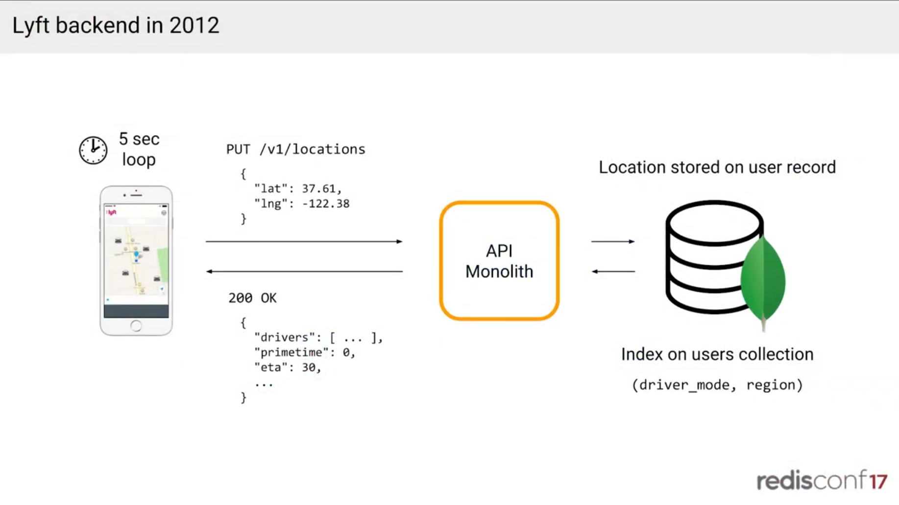

- 슬라이드 구성: 폰(5 sec loop) → `PUT /v1/locations {"lat": 37.61, "lng": -122.38}` → **API Monolith** → MongoDB. 응답은 `200 OK {"drivers": [...], "primetime": 0, "eta": 30, ...}`. MongoDB에는 users collection에 `(driver_mode, region)` 인덱스가 있고 위치는 user record에 저장됨.
- 클라이언트가 5초 주기로 위치를 전송하고, 당시 유일한 서비스였던 단일 API 서비스와 통신함.
- 위치는 user record의 필드(이름, 이메일 등과 같은 곳)로 저장됨.
- API가 반환해야 하는 것: 앱을 열었을 때 지도 화면을 그리는 데 필요한 모든 정보
  - 주변 운전자, 그 시점의 가격(pricing), 가장 가까운 운전자까지의 거리
- 위치 정보 호출 → 주변 운전자 정보 반환.

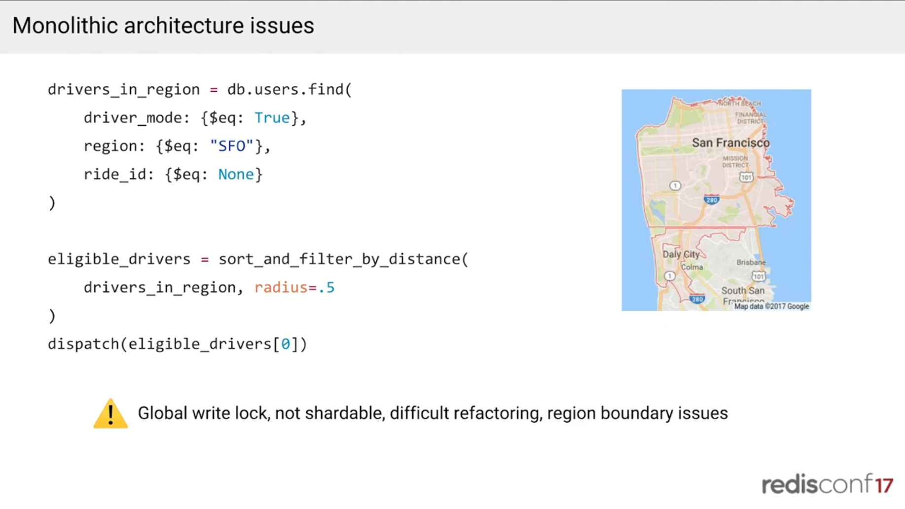

- 구현: users 컬렉션에 인덱스를 두고 조회. 슬라이드의 쿼리는 다음과 같음.
  ```python
  drivers_in_region = db.users.find(
      driver_mode: {$eq: True},
      region: {$eq: "SFO"},
      ride_id: {$eq: None}
  )
  eligible_drivers = sort_and_filter_by_distance(drivers_in_region, radius=.5)
  dispatch(eligible_drivers[0])
  ```
  - driver_mode가 같고, 특정 region에 속하고, ride ID가 없는(= 이용 가능한) 운전자
- 이후 단순 필터링(`radius=.5`)으로 특정 반경 내 가장 가까운 운전자를 찾고, 배차(dispatch) 시에는 첫 번째 운전자를 선택함.
- 슬라이드의 지도는 샌프란시스코 region과 아래의 데일리 시티 경계를 보여 줌. 슬라이드 요약: *Global write lock, not shardable, difficult refactoring, region boundary issues*.

### 1.2 문제점

- **MongoDB global write lock**
  - 한 mongod 인스턴스 안의 모든 컬렉션·DB에 걸리는 global write lock이 있음.
  - 5초마다의 위치 업데이트, 이용 약관 동의, 가입, 이메일 변경이 모두 같은 자원을 두고 경쟁함.
  - master/slave MongoDB 구성의 수직 확장 한계에 도달함.
- **샤딩이 쉽지 않음**
  - 샤딩하려 해도 unique index 같은 기능을 쓰고 있으면 sharded cluster로 바로 갈 수 없고, 먼저 그런 기능을 제거해야 함.
  - master/slave → sharded cluster로 가는 운영 부담·복잡도도 큼.
  - 보충 설명 (발표 내용이 아니라 MongoDB 동작에 대한 일반 지식이며, 자막에는 이유까지 나오지 않음)
    - **unique index가 걸림돌인 이유**: 샤딩하면 데이터가 여러 샤드에 나뉘어 저장되는데, MongoDB의 unique index는 샤드 키를 포함할 때만 보장됨. 샤드 키가 아닌 필드(예: 샤드 키가 `user_id`인데 `email`에 unique)는 서로 다른 샤드에 같은 값이 들어가도 막을 수 없음. 그래서 샤딩 전에 그런 인덱스를 없애고 유일성을 애플리케이션에서 보장하도록 바꿔야 함.
    - **운영 부담이 커지는 이유**: master/slave는 서버 한 대(와 복제본)만 관리하면 되지만, sharded cluster는 샤드, 라우터(mongos), config 서버가 따로 필요함. 샤드 키 선정, 데이터 재분배(balancing), 장애 대응 절차까지 새로 설계해야 함.
    - 결과적으로 Lyft는 이 비용을 치르는 대신 처음부터 수평 확장되는 Redis(Nutcracker)로 옮기는 쪽을 택함.
- **어려운 리팩터링**
  - 서비스가 몇 년 지나면서 추상화가 무너지고 인터페이스가 더 이상 좋지 않음. 코드가 얽혀(spaghetti) 있어 location 모델 같은 것을 크게 바꾸기 어려움.
- **region boundary 문제**
  - 예: 샌프란시스코 region과 데일리 시티 region. 데일리 시티 경계 바로 위에 서 있고 길 건너편에 차가 있어도, 그 차가 다른 region에 속하면 배차되지 않을 수 있음. 지역 경계선에 있는 운전자를 찾지 못함.
- **region 개념 자체가 잘 안 맞음**
  - 미션 지구에서 호출했는데 금융 지구나 오션 비치의 운전자까지 조회됨. 같은 region이어도 먼 사람들이 있어 불필요한 DB 부하가 큼.

### 1.3 Lyft의 불문율: "Day 0부터 수평 확장 가능 + 고가용성"

- 누구나 Lyft·Twitter·Airbnb 같은 시스템을 설계하라고 하면 처음부터 수평 확장 가능, 고가용성으로 만들려 함. Lyft에서는 이것이 명문화되지 않은 아키텍처 규칙임.
- 인프라 팀의 역할은, 앱을 크게 뜯어고치는 복잡도(위에서 겪은 master/slave → sharded 이전 같은)를 겪지 않도록 플랫폼을 만드는 것.
- 여러 선택지 중 Redis 샤딩 방안으로 **Twemproxy(= Nutcracker)** 를 선택함.

### 1.4 Nutcracker (Twemproxy)

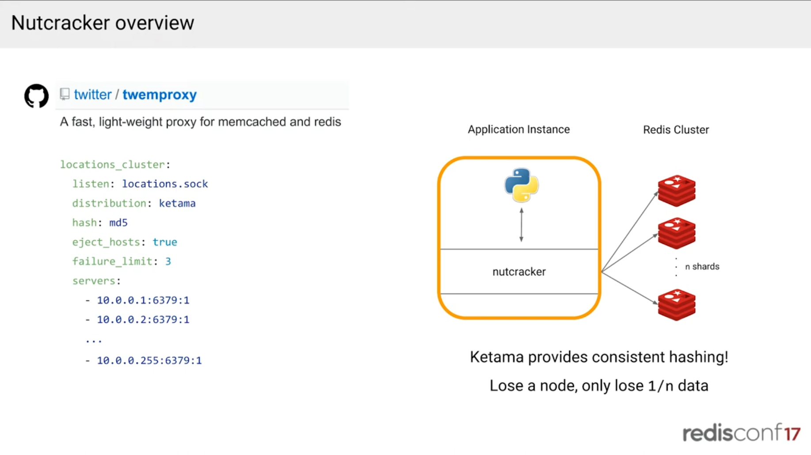

트위터가 만든 **Redis/Memcached용 경량 프록시**. 슬라이드 구성은 다음과 같음.

**구조**
- 애플리케이션(Python) 옆에 nutcracker가 같은 인스턴스에 사이드카로 붙음.
- 앱은 Redis 샤드가 몇 개인지 몰라도 되고, 로컬 유닉스 소켓(`locations.sock`) 하나로 nutcracker에만 접속함.
- nutcracker가 키를 해싱해 n개의 Redis 샤드 중 맞는 곳으로 보냄.

**설정(YAML) 핵심**
- `distribution: ketama`, `hash: md5`: **컨시스턴트 해싱**으로 키를 샤드에 분배
- `servers`: 샤드 목록 (뒤의 `:1`은 가중치). 기본 Redis 포트로 통신.
- `eject_hosts: true`, `failure_limit: 3`: 서버와 3번 실패하면 클러스터에서 자동 제외(host ejection)

→ 수평 확장성(샤딩) + 고가용성(ejection)을 얻음.

**ketama 컨시스턴트 해싱: "Lose a node, only lose 1/n data"**
- 일반 `hash % n`은 노드 수가 바뀌면 거의 모든 키가 재배치되어 캐시가 대량으로 날아감.
- 컨시스턴트 해싱은 노드가 빠져도 그 노드가 담당하던 1/n 데이터만 영향받고, 그 노드로 가던 쓰기는 남은 노드에 고르게 분산됨.

**왜 쓰나**
- Redis 클러스터를 지원하지 않는 클라이언트도 샤딩을 쓸 수 있음 (클라이언트 코드 변경 최소화).
- 커넥션을 프록시가 모아서 Redis 쪽 커넥션 수를 줄여 줌.

### 1.5 Pipelining

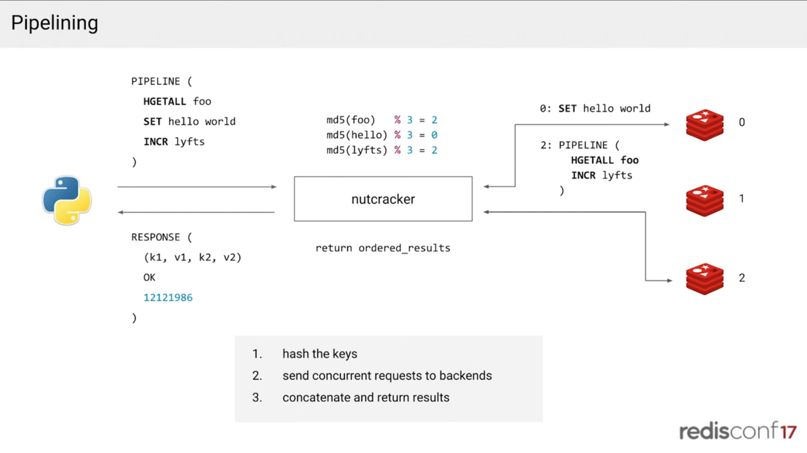

- 일반 Redis에서는 여러 쿼리/쓰기를 담은 pipeline을 보내고 결과를 한 번에 받음.
- Nutcracker는 내부적으로 pipeline을 쪼개서(= "cracking the nut") 각 키에 해시 함수를 적용하고, 맞는 서버로 동시에 요청을 보낸 뒤, 응답을 모아 올바른 순서로 재정렬해서 돌려줌.
- 슬라이드의 예시 (샤드 3개): `PIPELINE(HGETALL foo, SET hello world, INCR lyfts)`
  - `md5(foo) % 3 = 2`, `md5(hello) % 3 = 0`, `md5(lyfts) % 3 = 2` → 샤드 0에는 `SET hello world`, 샤드 2에는 `PIPELINE(HGETALL foo, INCR lyfts)`를 보냄.
  - 단계: ① 키를 해시 ② 백엔드로 동시 요청 ③ 결과를 합쳐(재정렬해) 반환 (`return ordered_results`)
  - 클라이언트는 `RESPONSE((k1, v1, k2, v2), OK, 12121986)`처럼 원래 순서대로 받음.
  - (슬라이드는 설명용으로 `md5 % 3`을 쓰지만, 실제 설정은 위의 ketama 컨시스턴트 해싱.)
- 클라이언트 입장에서는 하나의 Redis 서버와 연결한 것과 같음.
- 서버를 100대 추가해도 키 분포가 충분히 크다면 100대에 고르게 해시됨.

### 1.6 Parity 데이터 모델 (MongoDB와 동일하게)

- 마이그레이션 중 변경 범위를 줄이려고, MongoDB와 같은 데이터 모델을 Redis에 그대로 재현함.
- 주요 조회 두 가지
  - 운전자 정보 찾기(이미 매칭됐고, ride에 user ID가 있으며 "이 운전자 어디야?"를 계속 물을 때)
  - 내 주변 이용 가능한 운전자 목록 조회(화면 표시 + 배차용)
- 구현 (pipeline 하나로)
  - user ID별 일반 string에 location JSON 저장 → 첫 번째 조회용
  - region별 hash에 user location 저장 → 두 번째 조회용(MongoDB의 region 방식과 유사)
- 문제: 활성이 아닌 운전자도 `HGETALL`로 가져옴.
  - 로그아웃 시 `HDEL`로 지우면 될 것 같지만, 운전 중 배터리가 꺼지면 누가 그 레코드를 지우나? Reaper 프로세스를 만들 수도 있지만 복잡도가 너무 큼.
  - 가장 명백한 해법은 expiration인데 **Redis hash의 필드 단위 만료는 지원되지 않음.** 구현해 달라는 GitHub 이슈가 25개쯤 있어도 antirez(Salvatore)가 구현하지 않을 것이고, 그럴 만한 이유가 있음.

### 1.7 Hash expiration 우회: 시간 버킷

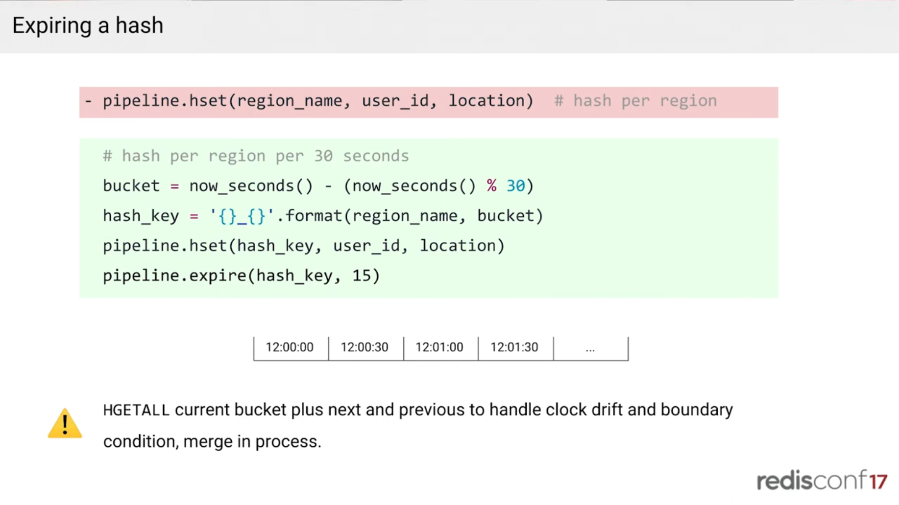

- region별 hash 대신 **region별 + 30초 구간별 hash** 를 사용함 → 해시 키에 시간이라는 차원을 추가.
- 슬라이드의 코드
  ```python
  # before: hash per region
  # region 하나가 hash 키 하나 → 필드(운전자) 단위 만료가 안 돼서 유령 운전자가 남음
  pipeline.hset(region_name, user_id, location)

  # after: hash per region per 30 seconds
  # 현재 시각을 30초 단위로 내림 (예: 12:00:47 → 12:00:30)
  bucket = now_seconds() - (now_seconds() % 30)
  # 키에 시간 버킷을 붙임 (예: 'SFO_1700000030')
  hash_key = '{}_{}'.format(region_name, bucket)
  pipeline.hset(hash_key, user_id, location)
  # 키 전체에 TTL을 걸어 오래된 버킷이 통째로 사라지게 함
  pipeline.expire(hash_key, 30)
  ```
  - 버킷은 12:00:00, 12:00:30, 12:01:00, ... 처럼 30초 단위.
  - 슬라이드 경고문: 현재 버킷과 이전·다음 버킷을 `HGETALL`해 clock drift와 경계 조건을 처리하고, 프로세스 안에서 merge.
- 간단한 공식으로 30초 버킷을 만들어 데이터를 쓰고, 쓸모가 없어지면 키째로 expire.
- 보완 처리 (업데이트가 5초 간격)
  - **clock drift**: 쓰기 서버가 3초 앞서 있고 읽기 서버가 3초 뒤에 있으면 다른 버킷을 볼 수 있음 → **다음(미래) 버킷도 읽음**.
  - 29초에 업데이트하고 2초 뒤에 현재 버킷을 읽으면 데이터가 이전 버킷에 있음 → **이전 버킷도 읽음**.
  - 따라서 이전/현재/다음 3개 버킷에 `HGETALL`하여 프로세스 안에서 병합(merge)함.
- 약 1년은 잘 동작함.
- 시간 버킷으로 얻는 점 (보충 설명: 필드 단위 TTL이 없다는 것은 발표 내용이고, 아래 1~3번 정리는 풀어쓴 해석)
  - 기존 방식(region별 hash 하나)의 문제
    - 로그아웃은 `HDEL`로 지우면 되지만, 배터리가 꺼지거나 앱이 죽어 신호가 끊기면 아무도 지워 주지 않음 → `HGETALL` 때 비활성 운전자(유령 운전자)까지 읽힘.
    - `HDEL`을 대신할 청소 프로세스(Reaper)는 복잡도가 큼.
    - 필드 단위 TTL이 없어서 "30초간 신호 없으면 자동 삭제"를 설정할 수 없음.
  - 시간 버킷의 이점
    1. **자동 정리**: 키 이름에 시간이 들어 있으니(`SFO_12:00:30`) 버킷 키를 통째로 `EXPIRE`하면 끝. 청소 프로세스가 필요 없음.
    2. **유령 운전자 차단**: 신호가 끊긴 운전자는 새 버킷에 쓰이지 않으므로, 오래된 버킷이 만료되는 순간 조회 대상에서 자연스럽게 빠짐.
    3. **범위가 시간으로 한정**: 읽을 때 이전·현재·다음 3개 버킷만 보면 되므로 "최근 데이터만" 읽는다는 보장이 생김.
  - 대가
    - clock drift와 경계 문제 때문에 3개 버킷을 읽고 병합해야 함.
    - 이후 한계로 대량 만료가 Redis를 블록하는 문제와 hot shard 문제(region이 키)가 드러나 geohash + sorted set으로 바꿈 (→ 1.8, 1.11).

### 1.8 Growing pains

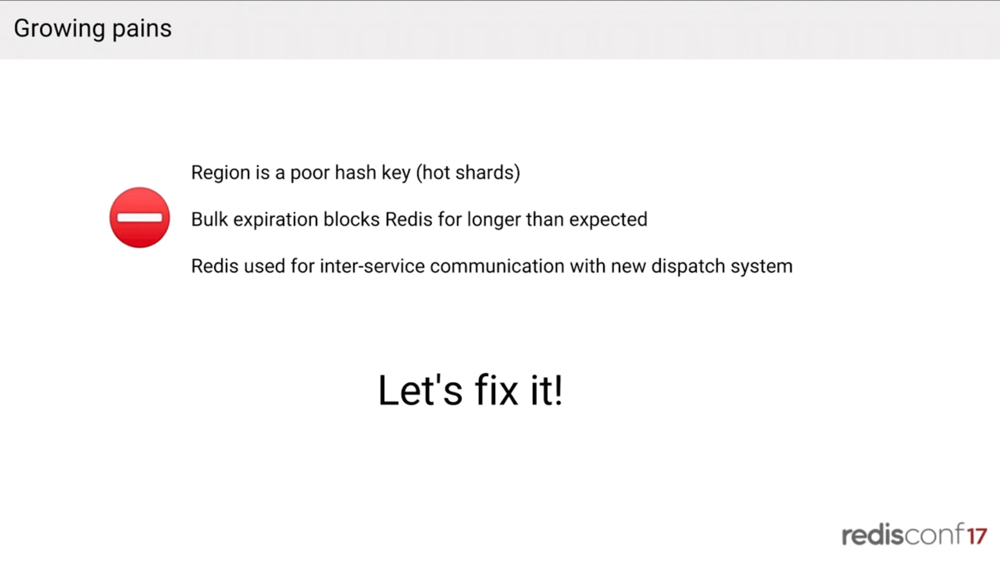

슬라이드 요약 (뒤이어 "Let's fix it!"): *Region is a poor hash key (hot shards) / Bulk expiration blocks Redis for longer than expected / Redis used for inter-service communication with new dispatch system*

1. **region은 나쁜 hash key** → hot shard
   - 샌프란시스코는 핼러윈·새해 같은 밤 피크에 수만 명의 운전자, 코퍼스 크리스티(텍사스)는 피크에도 활성 운전자 10명 정도. Redis 서버 간 분산이 매우 불균등해짐.
2. **대량 만료가 Redis를 예상보다 오래 블록**
   - region이 많으면 30초마다 새 hash를 할당하고 만료시키는 메모리 작업이 계속 반복됨(큰 문제는 아니었지만 해결할 과제).
   - Redis는 **싱글 스레드**로 명령을 처리하므로, 만료 처리 중 비싼 작업이 생기면 그동안 다른 모든 요청이 대기함.
     1. 같은 주기로 저장된 수많은 키가 거의 동시에 만료됨 (30초마다 일괄 갱신 → 일괄 만료).
     2. active expiry 작업(1초에 10번 샘플링)은 만료 키 비율이 높으면 반복해서 계속 돎. 이 시간 동안 일반 요청 처리가 밀림.
     3. region 하나에 큰 값(큰 set/hash 등)이 있으면 하나를 지우는 것만으로 오래 걸림(큰 컬렉션 삭제는 O(N)).
     4. region 수가 많을수록 동시에 만료되는 키가 늘어 블록 시간이 길어짐.
3. **Redis를 서비스 간 통신(inter-service communication)에 사용**
   - 새로 만든 dispatch 시스템이 Redis를 직접 읽음. 레거시 앱은 PHP이고 PHP로 hello world만 해도 오버헤드가 약 100ms라서, dispatch가 PHP 서비스를 거쳐 Redis(1ms)를 읽으면 총 101ms가 됨.
   - 그래서 API에서 Redis에 쓰고 dispatch 시스템이 Redis에서 직접 읽는 쉬운 길을 택했는데 좋은 선택이 아니었음. 이 경로(PHP에서 지연이 생기는 문제)가 서비스 간 통신 문제의 단면.
   - 피크에는 7~8개 서비스가 API 서비스가 쓴 Redis 데이터를 읽었음 → 데이터 모델 리팩터링이 거의 불가능.

### 1.9 해결 1: 올바른 서비스 간 통신 (Proper service communication)

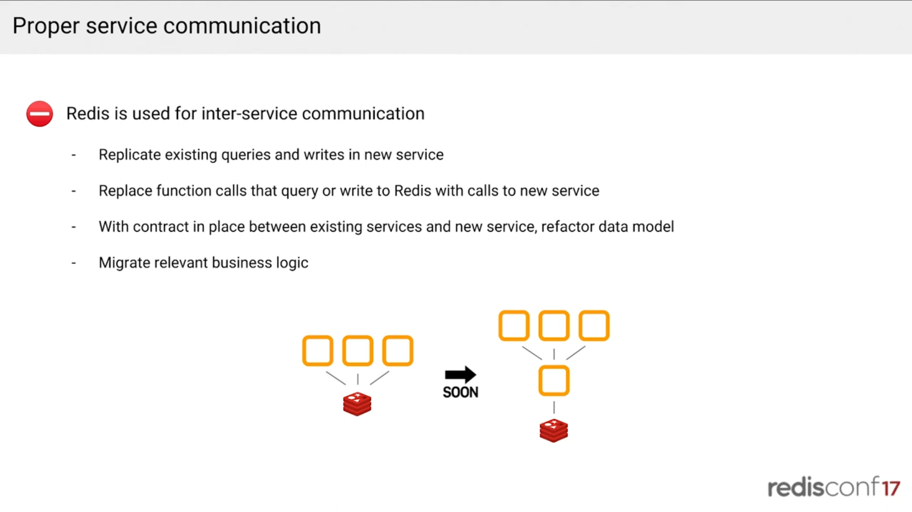

여러 서비스가 Redis를 공유 DB처럼 직접 읽고 쓰던 구조를, **Redis 앞에 전용 핵심(core) 서비스 하나를 두고 그 서비스만 Redis를 만지도록** 바꿈.

슬라이드 그림: 서비스 3개가 Redis를 직접 쓰는 구조 →(SOON)→ 서비스 3개가 중간의 서비스 하나를 거쳐 Redis에 접근하는 구조.

**순서 (슬라이드 4단계)**
1. 기존 쿼리/쓰기를 새 서비스에 똑같이 구현 (동작 그대로 복제)
2. Redis를 직접 호출하던 함수들을 새 서비스 호출로 교체. 기존 서비스들은 이제 Redis를 모르고 API만 앎.
3. 서비스 간 계약(contract)이 생겼으니 **데이터 모델을 리팩터링**. 이제 Redis 내부 구조를 바꿔도 기존 서비스는 영향이 없음. 앞의 hot shard, 대량 만료 문제도 이 단계에서 고칠 수 있음.
4. 관련 **비즈니스 로직을 새 서비스로 이전**. 데이터와 로직이 한곳에 모임.

**왜 이렇게 했나**
- 그동안 Redis 키 구조가 사실상 서비스 간 암묵적 API였고, 데이터 모델을 바꾸려면 모든 서비스를 동시에 고쳐야 했음.
- 중간에 서비스를 두면 인터페이스(계약)와 저장소 구현이 분리됨. 계약은 구현이 아니라 로직에 특화됨: "이 반경 안의 운전자를 달라"고 요청할 뿐 `HGETALL`이 무엇인지 알 필요가 없음. 구현에 의존하지 말고 데이터 계약에 의존할 것.
- 순서가 핵심: 모델을 먼저 바꾸지 않고, **먼저 계약을 만들고 그 다음에 모델을 리팩터링**. 복제하고 호출부를 교체하는 동안은 위험이 작고, 계약이 자리 잡은 뒤 안전하게 내부를 갈아엎을 수 있음. 레거시 마이그레이션에서 자주 쓰는 방식.
- 점진적 과정이라 애플리케이션에 따라 수개월~수년이 걸릴 수 있음.
- 비즈니스 로직 예: 터널에서 GPS가 매우 노이즈가 심할 때 튀는 포인트로 요금이 청구되면 안 되므로 나쁜 포인트를 제거하는 알고리즘이 있음. 이런 알고리즘을 고도화할 때 모놀리식 API 서비스가 아니라 새 서비스에서만 하면 됨.

### 1.10 해결 2: Geohash로 hash key 문제 해결

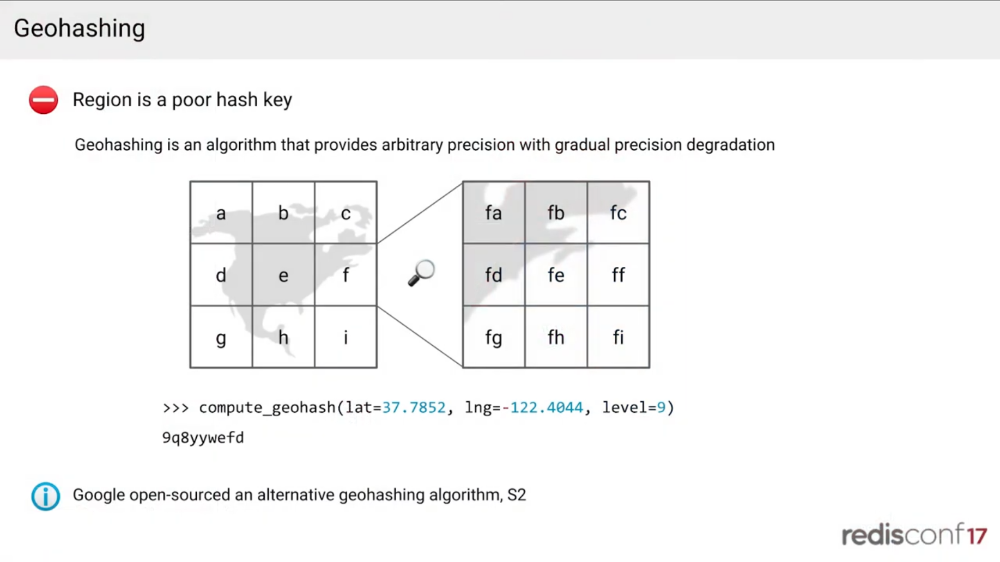

- region은 나쁜 hash key → **geohashing** 으로 해결.
- 슬라이드: *Geohashing is an algorithm that provides arbitrary precision with gradual precision degradation*. 격자 a~i 중 한 칸을 확대하면 fa~fi로 다시 9분할됨(문자가 하나 늘어날 때마다 정밀도가 올라감). 예시: `compute_geohash(lat=37.7852, lng=-122.4044, level=9)` → `9q8yywefd` (문자열 길이 = level). 슬라이드에도 "Google open-sourced an alternative geohashing algorithm, S2"라고 적혀 있음.
- Geohash는 임의 정밀도를 주는 알고리즘. 지도를 격자로 자르고, 문자를 하나 추가할 때마다 같은 일을 반복해 원하는 정밀도까지 갈 수 있음 (머리카락 굵기까지도 가능). 실제로는 위도·경도와 level을 넘기면 되고, level이 곧 결과 문자열의 길이(= 정밀도).
- Google이 오픈소스로 공개한 대안 알고리즘 **S2**가 있음. 속성이 더 좋아서 geohashing을 도입한다면 대부분 S2부터 시작하길 권장.

### 1.11 새 데이터 모델 (Geohash)

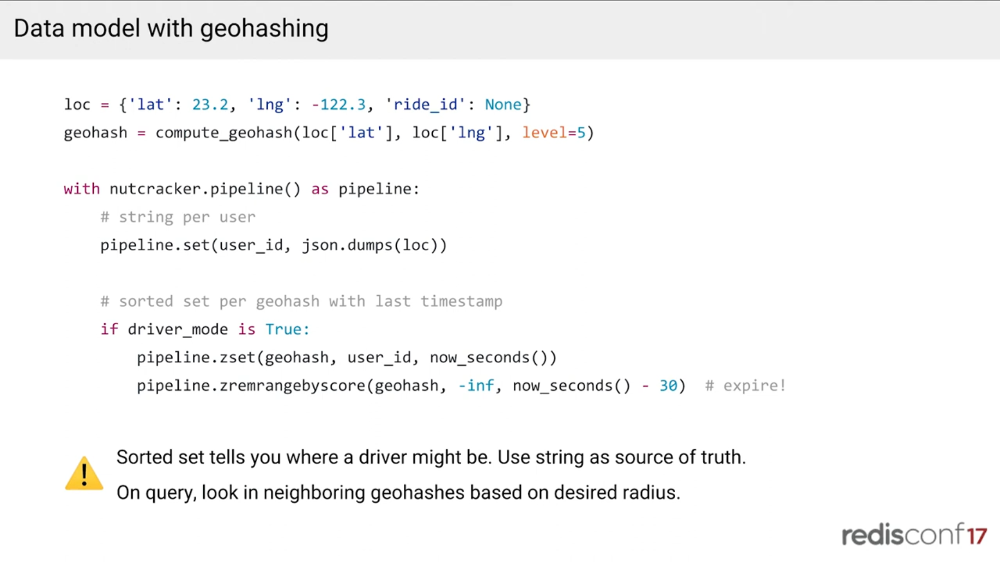

- 위치 표현에서 같은 공식으로 geohash를 계산하고 **level 5** 를 선택. level 5는 도시 블록 6~7개 정도의 크기.
  - 그 크기에 들어갈 수 있는 차 수는 물리적 한계가 있어서, geohash가 비어 있든 가득 차 있든 편차가 hot shard를 만들 정도로 크지 않음.
- 슬라이드의 코드
  ```python
  # 운전자가 5초마다 보내는 위치 (ride_id가 None이면 아직 배차되지 않은 상태)
  loc = {'lat': 23.2, 'lng': -122.3, 'ride_id': None}
  # 위치를 level 5 지오해시 셀로 변환 (도시 블록 6~7개 크기)
  geohash = compute_geohash(loc['lat'], loc['lng'], level=5)

  # 아래 명령들을 pipeline 하나로 묶어 nutcracker에 보냄 (키별로 알맞은 샤드로 분배됨)
  with nutcracker.pipeline() as pipeline:
      # string per user
      # ① 정확한 위치 저장: 키=user_id, 값=위치 JSON. 위치의 단일 진실 원천
      #    ("배정된 내 운전자 어디야?" 같은 user_id 조회용)
      pipeline.set(user_id, json.dumps(loc))

      # sorted set per geohash with last timestamp
      # ② 주변 검색용 인덱스는 운전 가능 상태(driver_mode)인 사용자만 등록
      if driver_mode is True:
          # 키=지오해시 셀, 멤버=user_id, score=마지막 보고 시각(초)
          # 같은 운전자가 다시 쓰면 score만 갱신됨 (실제 Redis 명령은 ZADD)
          pipeline.zset(geohash, user_id, now_seconds())
          # ③ score가 (현재 - 30초)보다 작은 멤버 = 30초 넘게 신호 없는 운전자를 셀에서 삭제
          #    멤버 단위 TTL이 없으므로 쓸 때마다 같은 셀을 정리하는 방식으로 만료 처리
          pipeline.zremrangebyscore(geohash, -inf, now_seconds() - 30)  # expire!
  ```
  - 슬라이드 경고문: *Sorted set tells you where a driver might be. Use string as source of truth. On query, look in neighboring geohashes based on desired radius.*
- 쓰기 (nutcracker pipeline)
  - 앞과 같이 user별 string에 위치를 set → "내 운전자 어디야?" 조회용 **단일 진실 원천(single source of truth)**
  - geohash별 **sorted set**에 마지막 타임스탬프(현재 초)를 score로 저장
  - 만료는 같은 sorted set에 `ZREMRANGEBYSCORE`를 호출해 처리
- 읽기: sorted set이 "운전자가 어디 있을 수 있는지" 알려 주고, Redis에 한 번 더 왕복(round trip)해서 user별 string에서 실제 위치를 확인.
- 반경 검색: 예컨대 geohash 한 칸이 1마일이고 2마일 반경이 필요하면, 반경을 덮는 geohash 셀들을 계산해 각 셀을 조회함 (인접 셀 여러 개 읽기).
- 운전 중 geohash 경계를 넘을 때
  - 이전 셀에서 지우고 새 셀에 써야 하지만, 이 삭제를 재시도하거나 다른 곳에 전파하지 않기로 함. 실패 처리와 전파가 "꽤 골치 아프다(pretty hairy)"고 함.
  - 그래서 경계를 넘는 순간 **두 셀 모두에 잠깐 나타날 수 있음.** 오래된 쪽은 TTL로 알아서 사라지므로 허용.
  - 삭제가 실패해 서버가 일관되지 않은 데이터를 볼 수 있으므로 단일 진실 원천(per-user string)이 필요함. 셀은 검색용 인덱스일 뿐이고 셀에 남은 낡은 항목은 per-user 조회에서 걸러짐.
- hash 방식을 버린 효과
  - 이전: 메모리를 계속 할당하고 해제함 (30초마다 새 hash 생성/만료).
  - 이후: 대부분 기존 키에 대한 **덮어쓰기** (score만 갱신). 30초 안에 보고하지 않은 사람만 만료.

### 1.12 왜 Redis의 GEO 기능을 쓰지 않았나

- GEO 기능은 Lyft가 Redis로 geospatial indexing을 시작하고 약 2년 후에 도입됨.
- point-and-radius, position-of-key 의미론은 Lyft 방식과 비슷하고, 내부적으로 geohash + sorted set을 사용하므로 구현이 크게 다르지는 않음.
- 하지만 부족한 점
  - **expiration, sharding 없음**
    - 보충 설명 (발표 내용이 아니라 풀어쓴 해석이며 2017년 발표 시점 기준. 현재 Redis GEO에 만료·샤딩이 추가됐는지는 미확인)
    - GEO가 샤딩이 안 되는 이유: GEO는 하나의 키(sorted set 하나)에 모든 위치를 담고, Redis에서 키 하나는 한 서버에만 있으므로 쪼갤 수 없음. 데이터가 커지거나 읽기가 몰리면 그 서버가 병목이 됨.
    - Lyft 방식에서 샤딩이 되는 이유: 지오해시 셀마다 sorted set을 따로 두고(키 = 지오해시 셀), Nutcracker가 키를 해싱(ketama)해 여러 샤드로 분산함. 반경 검색은 필요한 셀들을 각 샤드에서 읽어 모음(scatter-gather).
    - hot shard 방지: level 5 셀은 크기가 고정이고 들어갈 차 수에 물리적 한계가 있어 셀별 데이터 편차가 작음. region 단위일 때의 편차(샌프란시스코 vs 코퍼스 크리스티)가 사라져 샤드 분산이 고름.
    - 정리: "Lyft가 sharded GEO를 구현했다"가 아니라, **GEO를 쓰지 않고 키 설계(지오해시별 sorted set) + Nutcracker로 샤딩을 얻었다**가 정확함.
  - **메타데이터 저장 불가**: 예컨대 파란 차가 업데이트됐을 때 "파란 차"로 바로 조회할 수 없고 전체 키로 찾아야 함. 메타데이터를 저장할 수 없어서 옛 레코드를 지우고 새 레코드를 써야 함.
- 평가: GEO는 프로토타이핑에 좋음. Haversine 공식이나 geohashing을 몰라도 DB가 알아서 해 줌. 작고 정적인 데이터셋이나 durable Redis에서는 쓸 만할 때가 있음.
- Lyft의 추가 복잡도
  - 좌석 수 같은 메타데이터를 저장하고, 앱 애니메이션 같은 것들도 저절로 되는 게 아님.
  - **여러 인덱스에 쓰기**: 빈번한 쿼리의 비용을 낮추려는 선택. 예: 4인승 차 쿼리는 매우 빈번하고 6인승 쿼리는 드물다면, 쿼리가 쓰기보다 훨씬 많을 때는 쓰기 비용을 조금 높이더라도 읽기를 훨씬 싸게 만드는 게 맞음. 인덱스를 여러 개 두고 쓰기 vs. 사후 필터링을 선택하는 수학적 모델은 Yahoo의 **Feeding Frenzy** 논문에 있음.
  - **scatter-gather와 hot shard의 균형**: geohash level을 정할 때의 트레이드오프. 손바닥 크기로 하면 한 칸에 차가 0~1대뿐이라 균일하지만, 이 방에 해당하는 범위를 조회하려면 수만 개의 geohash를 읽어야 함. 그래서 scatter-gather가 너무 많지 않고 hot shard도 안 생기는 level을 선택함.

---

## 2. Redis on the Lyft platform

### 2.1 클러스터 생성 자동화

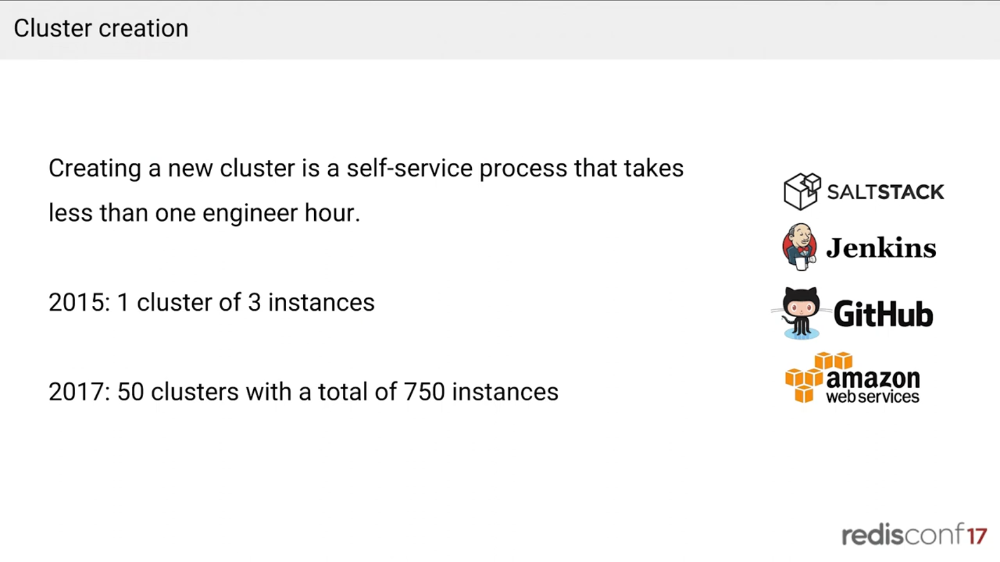

- 2015: 클러스터 1개, 인스턴스 3개 (프로토타입 locations cluster). 잘 동작해서 자동화 도구를 만들기 시작함.
- 현재: **클러스터 50개, 인스턴스 750개**. 몇 달마다 새 Redis 클러스터가 생길 정도로 인기.
- 슬라이드: *Creating a new cluster is a self-service process that takes less than one engineer hour.* 사용 도구: SaltStack, Jenkins, GitHub, AWS. 슬라이드 수치는 "2015: 1 cluster of 3 instances / 2017: 50 clusters with a total of 750 instances".
- 오케스트레이션·자동화는 주로 SaltStack 중심으로 관리함 (인프라는 Lyft 팀 전체에서 이 방식).

### 2.2 클라이언트 (Python)

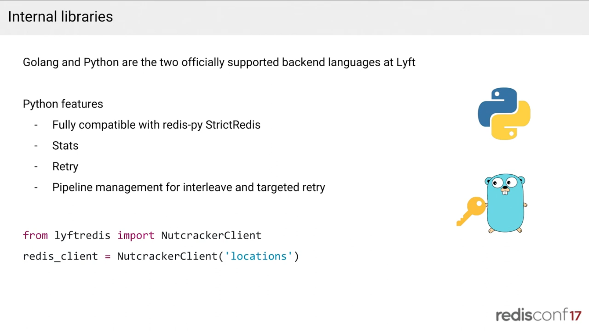

- Go와 Python이 Lyft에서 공식 지원하는 백엔드 언어. location 서비스용으로 풀 기능 Python 클라이언트를 작성함.
- 슬라이드의 사용 예: `from lyftredis import NutcrackerClient` → `redis_client = NutcrackerClient('locations')`
- redis-py(`StrictRedis`)와 완전 호환(fully compatible)이면서 다음을 추가함. 슬라이드 항목: Stats / Retry / *Pipeline management for interleave and targeted retry*.
  - **stats**: 연산 시간 측정, 실패 횟수 집계
  - **retry**: 코드마다 try/catch를 두지 않아도 라이브러리가 처리
  - **pipeline 관리**(동료 Elliot가 주로 작업): 2,000개 키를 한 번에 요청하기보다 50개씩 청크로 쪼개 순차 요청하는 편이 낫다. 쿼리 자체는 약간 더 느려지지만, Redis가 싱글 스레드이고 nutcracker와 하나의 커넥션을 공유하므로 다른 쿼리를 더 빨리 처리할 수 있음. 지연에 민감하지 않은 쿼리(수요 추정·가격 계산용으로 매분 전체 region 위치를 읽는 경우)는 느려도 되고, 앱이 열려 있을 때 주변 10대를 보는 쿼리는 빨라야 함.
- 사용법: import 후 이름을 주고 인스턴스화하면 끝.

### 2.3 관측성(Observability)

- Lyft는 infrastructure as code 기조 — 거의 모든 것이 코드로 관리됨. 통계용 UI와 dashboards 저장소가 있고, 서비스마다 대시보드 정의 파일이 있음.
- Redis 클러스터용 **매크로**를 작성해서 대시보드 파일에 한 줄만 넣으면 그래프와 알람이 생김. 알람 임계값은 튜닝하거나 기본값을 써도 됨.
- 런북/문서 링크를 같이 제공함. 다른 팀이 만든 Redis 클러스터의 온콜이 되었을 때 그래프에서 스파이크를 보면 바로 문서로 갈 수 있음.
- 백엔드: 과거 Graphite → 약 1년 반 전 **Wavefront** 로 이전, 프런트엔드는 Grafana.

### 2.4 용량 계획 (Capacity planning)

- 알람은 actionable 정보에는 좋지만, 한 달·일 년 치 용량을 미리 확보하기에는 부족하고 50개 클러스터를 추적하기 어려움.
- 가능한 API를 모두 결합: 표시는 Google Sheets API, 용량 파악은 내부 stats API와 EC2 API. 클러스터 전체에서 자원을 얼마나 쓰는지 알려 줌 (예: 100대에 걸쳐 전체 코어의 10% 사용). 메모리·네트워크·CPU 중 무엇이 제약인지도 알려 줌.
- 목표: 클러스터 리사이즈가 어려워서 **4배 headroom** 유지.
- 최적화에 쓸 actionable 정보도 제공. 사례: locations 클러스터가 네트워크 제약에 걸리기 시작 → 객체 직렬화 방식을 검토.

### 2.5 객체 직렬화

| 방식 | 효과 |
| --- | --- |
| JSON (location 약 1,000 bytes) | 기준 |
| MessagePack (drop-in 대체) | 약 **31%** 절감, 클러스터·애플리케이션 CPU 감소, 메모리 소비·메모리 대역폭도 감소 |
| Protocol Buffers (필드 정의 필요, drop-in 아님) | 약 **82%** 절감, 클러스터에 큰 여유 확보 |

- 직렬화 비용은 양쪽에서 줄어듦: Redis 응답을 직렬화하는 쪽과, 애플리케이션이 받아 네이티브 객체로 바꾸는 쪽 모두. protobuf → Python 객체는 사람이 읽는 JSON보다 훨씬 빠름.

---

## 3. 남은 과제와 Envoy

### 3.1 Nutcracker의 한계

- 사실상 유지보수가 끝남: Twitter는 새 Redis 클러스터링 솔루션(Nighthawk)을 쓰고 이 도구는 쓰지 않음. 커밋 그래프상 1년 반 넘게 README 수정 정도뿐.
- **passive health check만** 가능: 클라이언트 연산의 성공 여부로 장애를 판단하고, 일정 시간이 지나면 죽었는지 살았는지 모른 채 인스턴스를 다시 투입함. out-of-band active health check가 없음.
- **hot restart 없음**: 설정을 바꾸면 재시작해야 하고, 서버 목록이 설정 파일에 있어서 서버가 하나 사라지면 수정 후 nutcracker를 재시작해야 함 → 애플리케이션에 약 1초 장애.
- **확장이 어려움**: 오래된 C 코드베이스로 잘 쓰였고 잘 동작하지만, Lyft의 service discovery 연동 같은 기능을 넣으려면 큰 작업이 됨.
- 운영 측면: 인스턴스 하나가 죽으면 엔지니어를 호출(page)해서 교체하는 방식이었음. 인스턴스 10개일 때는 몇 달에 한 번이었지만 750개에서는 클러스터 전체 합쳐 주당 여러 번 호출됨.

### 3.2 Envoy

- Lyft가 만든 오픈소스 **C++ 서비스 메시 + 엣지 프록시**. Lyft 내부에서 ELB, Nginx, HAProxy를 대체했고 엣지 통신과 서비스 간 통신을 모두 처리함.
- 고급 로드 밸런서로서의 기능
  - service discovery 연동
  - **retry** (라이브러리의 retry와 비슷, 곳곳에 try/catch 불필요)
  - 컨시스턴트 해싱
  - **active health check** (out-of-band)
  - 방대한 stats
  - tracing (여러 hop을 거치는 요청의 각 서비스별 소요 시간 확인)
  - outlier detection, **fault injection** (예: 주기적으로 일부 요청에 지연을 주입해 timeout이 없을 때 백엔드가 죽으면 서버가 영원히 기다리는 등의 문제를 미리 발견)
- 가장 큰 특징은 **확장성을 염두에 둔 설계**: 네트워크 기능을 추가할 때 어려운 부분은 기능 구현 자체이지 Envoy 안 어디에 넣을지가 아니며, Envoy를 해킹할 필요가 없음. 다른 회사 사람들이 문서를 읽고 하루 만에 새 필터(Envoy의 구성 요소)를 작성하는 사례도 봄.
- 사례: Lyft가 만든 **MongoDB 필터**. API 서비스와 MongoDB 사이에 두고 전송되는 패킷을 보면 쿼리/읽기/쓰기를 알 수 있어 이전에 없던 통계를 얻음. → 자연스럽게 Redis에 Envoy를 적용하는 것을 평가함.

### 3.3 Envoy Redis (2017년 5월 기준 프로덕션 사용)

- 지원 연산이 적음: `INCR`, `INCRBY`, `SET`, `GET` 등. 오픈소스 **rate limit 서비스**에서 사용 중.
- 오픈소스 service discovery 서비스와 통합 → 노드가 들어오고 나갈 때 설정 파일을 수동 수정하지 않고 바로 알 수 있고, Redis 클러스터 **auto scaling** 도 가능성이 열림. 예: best-effort 캐시라면 CPU가 임계치에 닿을 때 노드를 추가하고 밤에는 줄이는 식.
- `PING` 기반 **active health check**: 죽은 노드를 알고 nutcracker처럼 다시 넣으려 하지 않음.
- Nutcracker와 같은 pipeline 분할·동시성 기능: 요청을 열어 맞는 백엔드로 보내고, 응답을 재정렬해 돌려줌.
- Python 클라이언트에서 언급한 기본 stats도 추가함.

### 3.4 Envoy Redis 로드맵

- **명령 지원 확대**: 50개 클러스터에서 다양한 Redis 명령을 쓰므로 nutcracker를 deprecate하려고 모두 지원할 계획.
- **더 나은 에러 처리**: 프로토콜을 인식할 수 없을 때 크래시하는 등 아직 에러 처리 작업이 적음. 우선순위 높음.
- **pipeline 관리**: 청크 분할, 한 pipeline 안의 **부분 실패 개별 재시도**. 예: 1,000개 항목 pipeline 중 3개만 실패하면 전체를 다시 보내지 않고 그 항목만 재시도해서 응답. 클러스터가 불안정할 때 큰 pipeline 재시도로 클러스터를 압도하지 않게 해 줌.
- **성능 최적화**: 프로덕션에서 쓰지만 벤치마킹은 안 함. 현재 nutcracker보다 약 1ms 느리지만 감수 가능.
- **Replication**: nutcracker를 계속 쓰지 않은 큰 이유. service discovery를 붙여 설정 파일을 다시 쓰는 방식도 가능했지만 원하는 기능이 훨씬 많았음.
  - **failover**: 데이터가 복제돼 있으면 백엔드 하나가 사라져도 다른 백엔드에서 읽음.
  - **큰 객체의 hot shard 완화**: 일반 객체보다 3배 큰 객체를 3배 복제하면 클러스터에 영향 없이 같은 수의 읽기를 처리할 수 있음.
  - **zone-local query routing**: 각 AWS availability zone에 복제해 두면 단일 AZ에서 읽어 지연을 줄임.
  - **quorum 같은 일관성**: 복제 계수가 3이면 세 서버에 묻고 둘이 같으면 더 정확한 결과로 간주.
- **Protocol overloading** (아직 논의 중): 요청 단위로 timeout, replication factor 같은 것을 세밀하게 제어. 예: 1MB 값 `SET`과 몇 바이트 읽기는 timeout이 달라야 하고, 큰 객체는 복제를 많이 해서 읽기 부담을 줄일 수 있음. 단점은 네이티브 클라이언트를 못 쓸 수 있다는 것 → **연결(connection) 단위** 설정(연결별 replication factor, timeout 등)도 고려 중.
- **coordination** 은 지금은 초점이 아님: Lyft는 Redis를 **완전 비영속(non-durable)** 으로 운영하고 백업하지 않음. 예컨대 위치 데이터는 5초마다 들어오므로 클러스터를 통째로 flush해도 5초 안에 올바른 데이터로 다시 채워지고, 이는 어떤 백업에서 복구하는 것보다 빠름.
- 마무리: Envoy 오픈소스 커뮤니티 참여 권장(github.com/lyft/envoy), HAProxy·nginx 같은 레거시 로드 밸런서를 대체할 때도 고려해 볼 것. Lyft 채용 중.

---

## 4. Q&A

**Q. 클러스터를 확장(샤드 추가)할 때는 어떻게 하나?**
- 데이터를 완전 휘발성으로 취급하므로 샤드를 추가해도 데이터를 옮기지 않음.
- 노드를 필요한 만큼 추가하고 nutcracker 설정에 넣으면 되며, 재시작이 많이 일어남. 가끔은 데이터를 스캔해서 해당 노드에 더 이상 속하지 않는 남은 데이터를 지우지만 대부분 그냥 추가하고 계속 진행함.
- 리밸런싱을 하려면 클러스터를 두 배로 키워야 하는 경우가 많음.
- 복제가 도입되면: 새 랙(rack)을 하나의 복제 단위로 추가해 데이터를 복제한 뒤 전환하고, 기존 서버를 더 큰 인스턴스로 교체하는 식이 가능(향후 방안). 지금은 백업하지 않고 데이터가 사라질 수 있다고 엔지니어들에게 알려 둠.

**Q. Envoy도 Redis 때처럼 대시보드 매크로가 있나?**
- 모든 것에 매크로가 있음. 서비스를 띄우면 Lyft 워크로드의 약 90%가 Envoy와 관련되어 기본으로 Envoy 통계(응답 시간, 5xx 등)를 받음.
- Envoy의 큰 목표: 네트워크를 애플리케이션에는 투명하게(일시적 장애·retry는 Envoy가 처리), 엔지니어에게는 쉽게 이해되게 만듦. 모든 대시보드에 수많은 그래프가 있어 문제가 생기면 대시보드에서 지연과 상관관계를 바로 확인함.
- 스택: Grafana + Wavefront(과거 Graphite).

**Q. Redis Cluster(마스터-마스터)로 갈 계획은?**
- 이 작업을 시작할 때 Redis Cluster는 새롭고 안정적이지 않았음. 요청 단위 replication factor 같은 고급 기능은 Redis Cluster에 들어가지 않을 것 같고, Lyft의 워크로드(특히 locations/geospatial index)에 맞는 아주 커스텀한 기능을 원함.
- 목표는 nutcracker와 parity를 맞춘 뒤 고급 기능을 추가하는 것. 과거에 다른 기술도 시도했지만 큰 성과가 없었고, Redis Cluster가 크게 발전했지만 Lyft의 현 모델과 큰 단절이 있음. nutcracker 모델을 유지하면서 현대적 코드베이스로 옮기고 기능을 얹는 쪽이 최선.

**Q. 크기가 다양한 객체 때문에 메모리 단편화(fragmentation)는 없었나?**
- 거의 모든 클러스터가 CPU 바운드(한두 개 예외). 직렬화 때문일 수도 있고, 운전자 수는 트윗 등에 비해 적어 메모리를 많이 쓰지 않음(물리적 제품을 다룸). 단편화를 겪은 적이 없고, Redis가 가득 찬 적도 손에 꼽을 정도.
- 다만 메모리 대역폭 포화는 의심 중. VM 안에서는 확인이 어렵고 하이퍼바이저 오버헤드가 있어 정확한 CPU 수치도 얻기 어려움. Amazon과 논의하며 (전용 인스턴스에서 노출되기 시작한) PMC(performance metric counters)를 보려는 중. 한계 지점을 알기 어려우므로 **과잉 프로비저닝**하고, 항상 AZ 하나를 통째로 잃어도 되도록 **절반 용량**을 여유로 둠.

**Q. Twemproxy 인스턴스가 몇 개인가?**
- 애플리케이션 인스턴스마다 자체 nutcracker가 있고 각각이 Redis 백엔드에 연결을 하나 맺음. 피크에 전체 EC2 인스턴스가 약 7,000대이고 그중 약 1/4이 nutcracker를 실행한다고 추정.

**Q. 키의 일부로 샤드를 지정할 수 있나(태깅)?**
- Nutcracker의 **hash tag** 기능: 키의 일부를 중괄호로 감싸고 기능을 켜면 그 부분만 해시해서 키가 갈 샤드를 결정함. 메타데이터를 키에 넣어도 한 부분만으로 해시 가능.
- Lyft는 아직 탐색하지 않았고 우선순위는 낮음. 애플리케이션이 분배를 알 수 있다면 향후 Envoy에 추가할 수도 있음.
