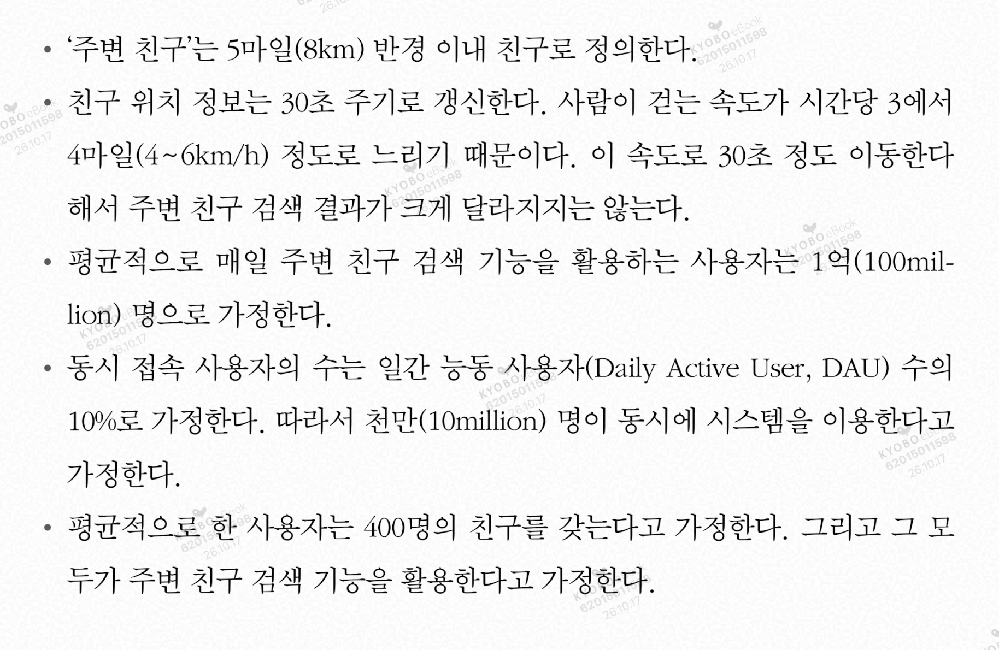
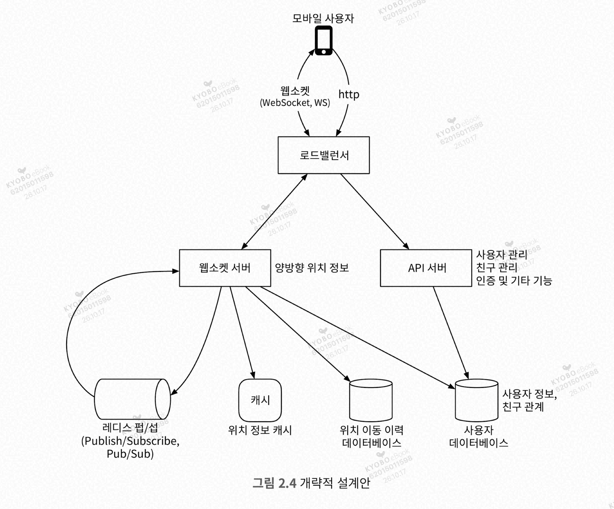
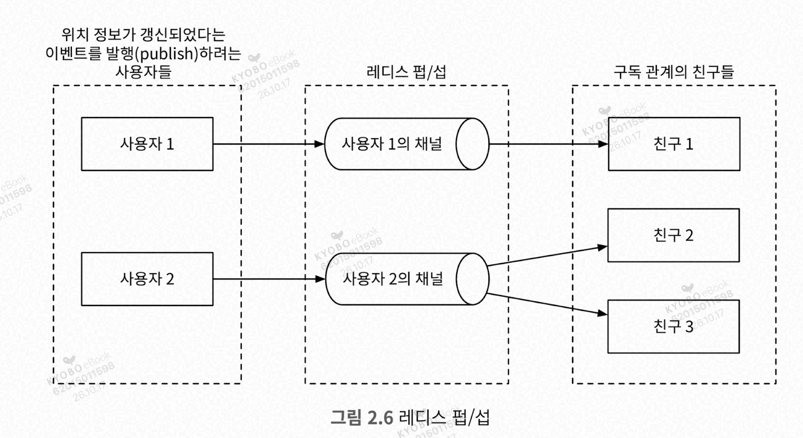
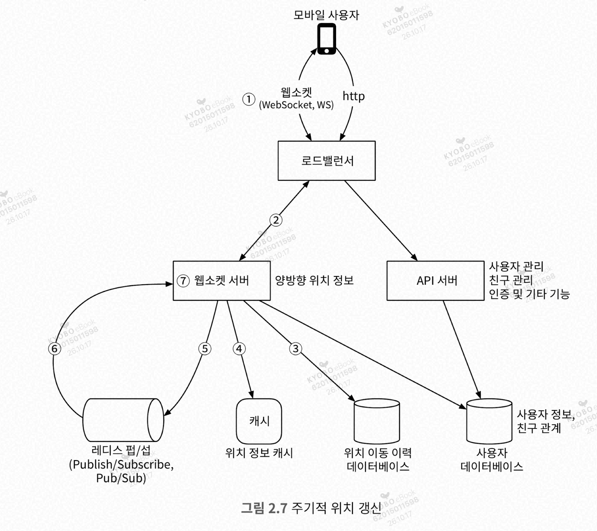
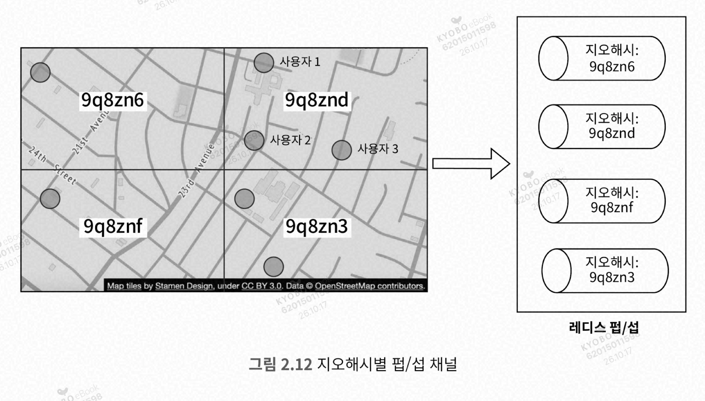
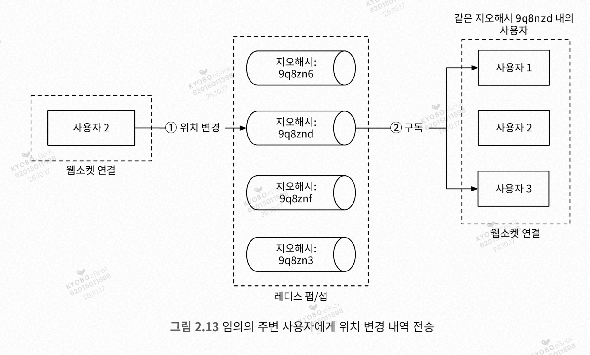

# 가상 면접 사례로 배우는 대규모 시스템 설계 기초 2 — 주변 친구

- 주변 친구는 5마일(8km) 반경 이내 친구로 정의한다.
- 위치는 30초 주기로 갱신한다.

모바일 P2P 방식은 개념적으로는 가능하다. 다만 실제로는 공통 백엔드가 있어야 한다.

**웹소켓 서버**
- 친구 위치 정보 변경을 실시간에 가깝게 처리하는 유상태 서버 클러스터

**레디스 펍/섭**
- 초경량 메시지 버스
- 새로운 채널을 생성하는 것이 아주 값싼 연산
- 기가바이트급 메모리를 갖춘 레디스 서버에는 수백만 개의 채널을 생성할 수 있음

| 항목 | Redis Pub/Sub | RabbitMQ 등 | Kafka |
|---|---|---|---|
| 메시지 저장 | 없음 (휘발) | 큐에 저장, ack 후 삭제 | 디스크 로그, 보존기간 동안 유지 |
| 전달 보장 | at-most-once | at-least-once (ack/재시도) | at-least-once, 설정에 따라 exactly-once |
| 재처리 | 불가 | 기본적으로 불가 | 가능 (offset 되감기) |
| 컨슈머 확장 | 불가 (전원 수신) | 큐 단위로 경쟁 소비 | 컨슈머 그룹 + 파티션 |
| 순서 보장 | 채널 내 대체로 | 단일 큐 기준 | 파티션 내 보장 |
| 처리량 | 높음 (지연 최소) | 중간 | 매우 높음 |
| 운영 복잡도 | 낮음 | 중간 | 높음 |

**선택 기준**
- 유실돼도 되고 **즉시 전파**만 필요하면 Redis Pub/Sub
- **작업을 안전하게 나눠 처리**하고 실패 재시도가 중요하면 RabbitMQ류
- **대용량 이벤트를 쌓아두고 여러 시스템이 각자 읽거나 재처리**해야 하면 Kafka

동작 흐름은 다음과 같다. 특정 사용자의 위치 정보 변경 이벤트가 펍/섭 채널에 발행된다. 그 친구들과 각각 연결된 웹소켓 핸들러가 구독자로 설정되어 있으므로, 사용자 위치가 바뀌면 모든 친구의 웹소켓 연결 핸들러가 호출된다.

**주기적 위치 갱신**
1. 모바일 클라이언트가 위치 변경 사실을 로드 밸런서(LB)에 전송한다.
2. LB가 웹소켓 서버에 요청을 전달한다.
3. 해당 이벤트를 위치 정보 이력 데이터베이스에 저장한다.
4. 새 위치를 위치 정보 캐시에 보관하고 TTL을 갱신한다.
5. 레디스 펍/섭 서버의 사용자 채널에 새 위치를 발행한다.
6. 새로운 위치 변경 이벤트를 모든 구독자에게 브로드캐스트한다.
7. 메시지를 받은 웹소켓 서버는 새 위치를 보낸 사용자와 메시지를 받은 사용자 사이의 거리를 계산한다.

**API 설계**
- 주기적 위치 정보 갱신
- 클라이언트가 갱신된 친구 위치를 수신하는 데 사용할 API
- 웹소켓 초기화
- 새 친구 구독
- 구독 해지

**데이터 모델**

위치 정보 캐시
- 키: 사용자 ID, 값: {위도, 경도, 시각}
- DB를 쓰지 않은 이유
  - 사용자의 현재 위치만 이용하므로 레디스가 적합하다. 현재 위치만 보관하면 되고, 빠르고, TTL도 지원한다.
  - 영속성은 보장할 수 없지만 문제없다.

위치 이동 이력 데이터베이스
- 쓰기 연산 부하를 감당하고 수평적 규모 확장이 가능한 데이터베이스
- 예: 카산드라

### 중요 구성요소별 규모 확장성

**웹소켓 서버**
- 유상태 서버라서 기존 서버를 제거할 때 유의해야 한다.
- 노드를 실제로 제거하기 전에 기존 연결부터 종료될 수 있도록 해야 한다.
- 해당 노드를 draining 상태로 바꿔 새로운 웹소켓 연결이 붙지 않게 한다.

**클라이언트 초기화**
1. 사용자 위치 정보를 갱신한다.
2. 사용자의 친구 정보를 가져와 일괄 요청을 보내고, 한 번에 받아 캐시에 설정한다.
3. 거리를 계산해서 반경 이내에 있으면 정보를 클라이언트에 반환한다.
4. 레디스 펍/섭 채널을 구독한다.
5. 사용자의 현재 위치를 모든 친구에게 전송한다.

**위치 정보 캐시**
- 데이터 크기: TTL이 있고 항목 하나가 100바이트 정도라면 수 GB 메모리면 충분하다.
- 그러나 초당 연산 수가 334K이므로 샤딩이 필요하다.
- 가용성을 높이기 위해 각 샤드에 보관하는 위치 정보를 standby 노드에 복제해 둔다.

**레디스 펍/섭 서버**

펍/섭 서버를 모든 온라인 친구에게 보내는 위치 변경 내역 메시지의 라우팅 계층으로 활용한다.
- 레디스 펍/섭을 쓰는 이유는 비용이 저렴하기 때문이다.
- 구독자가 없는 채널로 전송된 메시지는 그냥 버려지며 부하가 거의 없다.
- 채널 유지를 위해 구독자 관계를 추적할 해시 테이블/연결 리스트가 필요하지만, 소량의 메모리만 사용한다.

채널 운영 방식
1. 모든 사용자에게 채널 하나씩 부여하고, 앱 초기화 시 모든 친구의 채널과 구독 관계를 설정한다.
   1. 이때 친구의 상태는 개의치 않는다. 친구의 상태에 따라 채널 구독/비활성화를 처리하지 않는다.
2. 메모리를 많이 사용하지만, 메모리가 병목이 될 가능성은 없다.

몇 개의 서버가 필요한가?
- 메모리: 모든 사용자에게 채널 하나씩 할당하면 채널은 1억 개이고, 채널당 구독자(친구)는 약 100명, 구독자당 20바이트이므로 약 200GB가 필요하다.
- CPU: 펍/섭 서버가 전송해야 하는 위치 정보 업데이트 양은 초당 1,400만 건이다. 하나의 서버로는 감당할 수 없다.
- 결론: 병목은 CPU이므로 분산 레디스 펍/섭 클러스터가 필요하다.

**분산 레디스 펍/섭 서버 클러스터**

모든 채널은 서로 독립적이므로 메시지를 발행할 사용자의 ID를 기준으로 펍/섭 서버를 샤딩하면 된다. 서버 목록 관리를 위해 service discovery 컴포넌트(etcd / ZooKeeper)를 도입한다. 레디스 펍/섭 서버 클러스터는 유상태 서버 클러스터로 취급하는 것이 바람직하다.

**1. 채널 분산 방식**
- 채널은 서로 독립적이라, **발행하는 사용자 ID 기준으로 샤딩**하면 된다.
- 수백 대 규모라서 서버 장애를 전제로 해야 하고, 이를 위해 **서비스 탐색(service discovery)** 컴포넌트(etcd, ZooKeeper 등)를 도입한다.
- 서비스 탐색은 사실상 설정 데이터를 보관하는 소규모 키-값 저장소이고, 여기서는 두 가지 기능만 쓴다.
  1. 가용한 서버 목록 유지 및 갱신 (예: 키 `/config/pub_sub_ring`, 값 `["p_1","p_2","p_3","p_4"]`)
  2. 웹소켓 서버가 이 값의 **변경 내역을 구독**할 수 있게 하는 기능

**2. 해시 링 (안정 해시)**
- 서비스 탐색의 값에는 활성 상태인 모든 펍/섭 서버로 구성된 **해시 링**이 들어 있다.
- 채널을 발행/구독할 때 이 링을 참조해 담당 서버를 정한다. 예를 들어 hash(채널2)가 p_1의 범위에 속하면 채널2는 p_1이 관리한다.

**3. 메시지 발행 흐름 (그림 2.10)**
1. 웹소켓 서버가 해시 링을 보고 **발행할 펍/섭 서버를 선정**한다. 원본은 서비스 탐색에 있고, 성능을 위해 링 사본을 웹소켓 서버에 캐시할 수도 있다. 이 경우 **원본을 구독해서 사본을 항상 동일하게 유지**해야 한다.
2. 웹소켓 서버가 자기가 관리하는 사용자 채널에 위치 변경 내역을 발행한다.

**4. 규모 확장 시 고려사항**

| 구분 | 내용 |
|---|---|
| 메시지 | 메모리/디스크에 지속 보관되지 않고, 구독자 전원에게 전송된 뒤 바로 삭제된다. 구독자가 없으면 그냥 지워지므로 **무상태**로 볼 수 있다. |
| 채널 상태 | 하지만 서버는 **채널별 구독자 목록**이라는 상태 정보를 보관한다. 따라서 **유상태 서버**이다. |
| 서버 교체/제거 시 | 해당 서버가 맡던 채널을 **다른 서버로 이동**시키고, 그 채널의 **모든 구독자에게 알려야** 한다. 구독자가 기존 구독을 해지하고 새 서버의 대체 채널을 다시 구독할 수 있게 하기 위해서다. |
| 장애 영향 최소화 | 서버가 관리하는 채널의 구독자들과 적절히 협력해야 한다. |

**5. 운영 결론**
- 펍/섭 클러스터는 **유상태 서버 클러스터로 취급**하는 것이 바람직하다.
  - 채널별 구독자 목록 정보를 관리하고, 서버가 바뀌는 경우 채널을 다른 서버로 이동시키며, 해당 채널의 모든 구독자에게 그 사실을 알려 다시 구독하게 한다.
- 규모를 늘리거나 줄이는 일은 운영 부담과 위험이 크므로 **주의 깊게 계획**해야 한다.
- 그래서 트래픽에 따라 수시로 늘리고 줄이는 오토스케일링 대신, 혼잡 시간대 트래픽을 무리 없이 감당하고 불필요한 크기 변경을 피하도록 **어느 정도 여유를 두고 오버 프로비저닝**하는 것이 보통이다.

> 채널은 해시 링으로 서버에 분산하고, 링 정보는 etcd/ZooKeeper로 관리한다. 펍/섭은 구독자 목록 때문에 사실상 유상태라서, 서버 변경 시 구독자 재구독이 필요하고 그만큼 위험하니 평소에 넉넉하게 오버 프로비저닝한다.

클러스터 크기 조정 방법
- 새로운 링 크기를 계산하고, 크기가 늘어나는 경우 새 서버를 준비한다.
- 해시 링의 키에 매달린 값을 새로운 내용으로 갱신한다.
- 대시보드로 모니터링한다.

**친구 추가/삭제**
- 새 친구를 추가하면 웹소켓 서버 핸들러에 알려야 한다. 펍/섭 채널을 두고, 새 친구가 추가되면 호출될 콜백을 등록해 둔다.
- 삭제되면 호출될 콜백도 마찬가지로 등록한다.

**친구가 많은 사용자**
- 성능 문제를 일으킬 수 있는가?
- 친구 관계는 양방향이므로 수백만 팔로워를 가진 인플루언서는 없다고 가정한다.
- 펍/섭 구독 관계는 웹소켓 서버 클러스터에 분산된다. 친구가 많은 사용자의 채널을 맡은 펍/섭 서버는 부하가 조금 더 크지만 감당할 수 있다.

**주변의 임의 사용자**
- 지오해시에 따라 구축된 펍/섭 채널 풀을 둔다.

격자 경계 부근도 처리하기 위해 모든 클라이언트는 사용자가 위치한 지오해시뿐 아니라 주변 지오해시 격자를 담당하는 채널도 구독한다.
