# 가상 면접 사례로 배우는 대규모 시스템 설계 기초 2 — 근접성 서비스

## 주변 식당 검색 기능

### 기능 요구 사항
- 사용자의 위치와 검색 반경 정보에 매치되는 사업장 목록을 반환한다.
- 사업장 소유주가 사업장 정보를 추가/삭제/갱신할 수 있도록 하되, 그 정보가 검색 결과에 실시간으로 반영될 필요는 없다.
- 고객은 사업장의 상세 정보를 살필 수 있어야 한다.

### 비기능 요구 사항
- 낮은 응답 지연
- 데이터 보호
- 고가용성 및 규모 확장성

### 개략적 규모 추정
- DAU: 1억 명, 사업장 수: 2억
- QPS를 계산할 때 하루 86,400초는 10^5초로 가정한다.

**API 설계**
- 주변 사업장 목록 반환: latitude, longitude, radius
- 사업장 관련 API

**데이터 모델**
- 읽기/쓰기 비율 및 스키마 설계
- 읽기는 자주 수행하고, 쓰기는 상대적으로 적다.

지리적 위치 색인 테이블 → 지오해시에 대한 지식이 필요하다.

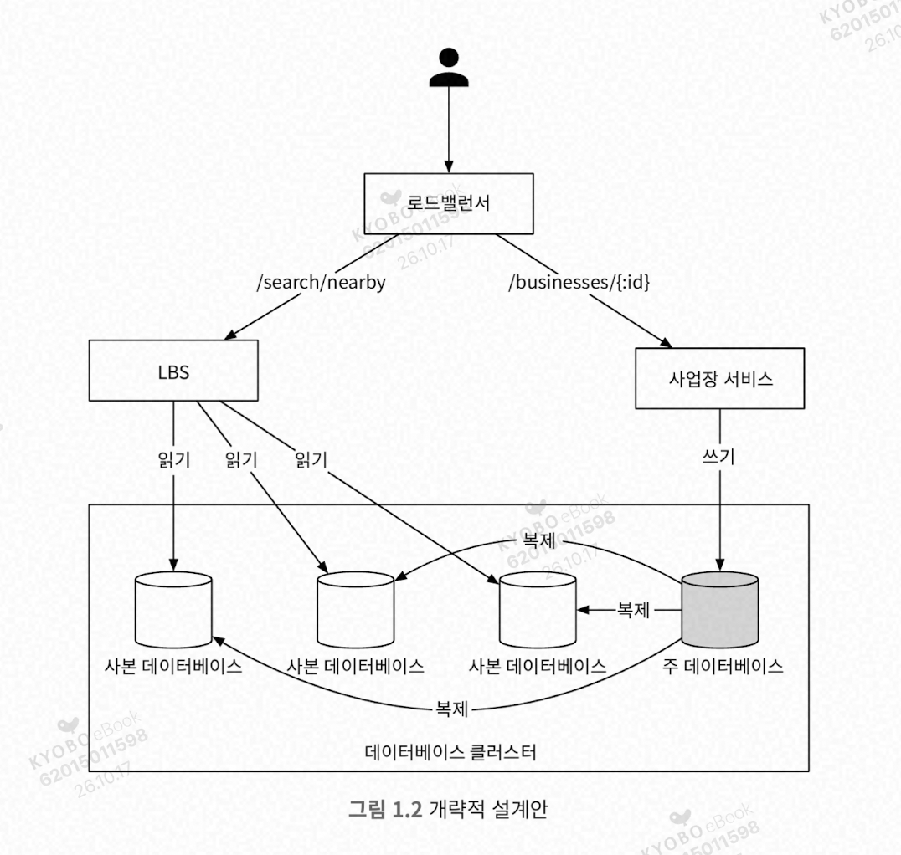

위치 기반 서비스 분리
- 읽기 요청만 빈번하게 발생한다.
- QPS가 높다. 특정 시간대, 인구 밀집 지역일수록 심하다.
- 무상태 서비스이므로 수평적 규모 확장이 쉽다.

사업장 서비스
- CUD, 즉 기본적으로 쓰기 요청을 처리한다.
- 고객이 사업장 정보를 조회하면 QPS가 높아질 수 있다.

데이터베이스 클러스터
- primary-secondary 구성
- primary는 쓰기 요청, secondary는 읽기 요청을 처리한다.
- 데이터는 주 데이터베이스에 기록된 뒤 사본 데이터베이스로 복사된다. 시간 차이가 있을 수 있지만, 사업자 정보는 실시간으로 갱신될 필요가 없다.

**주변 사업장 검색 알고리즘**
- Redis 지오해시나 PostGIS extension을 설치한 PostgreSQL을 활용한다.

방안 1: 2차원 검색 → 지나치게 단순하다.

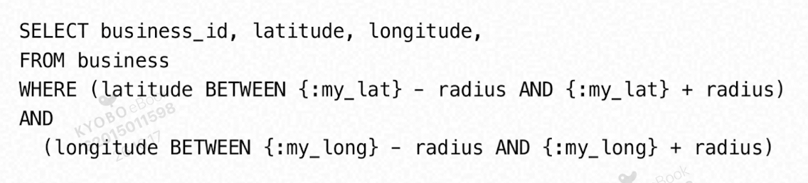

- 테이블 풀스캔이 필요하다. 인덱스를 넣어도 데이터가 2차원이라 효율적이지 않다.
- B-Tree 인덱스는 1차원 정렬이라 위도 하나로만 범위를 좁힐 수 있다. 그 안에서 경도는 정렬되어 있지 않아 결국 많은 행을 읽고 걸러내야 한다.
- 즉 DB 인덱스는 한 차원의 검색 속도만 개선할 수 있다.

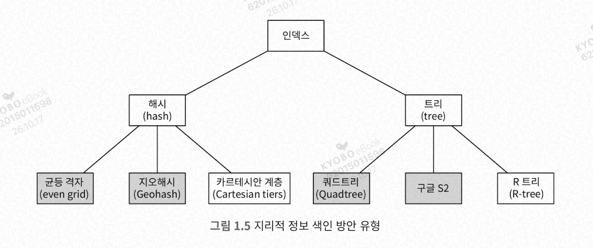

개략적 아이디어: 지도를 작은 영역으로 분할하고, 고속 검색이 가능하도록 색인을 만드는 것이다.

**균등 격자**

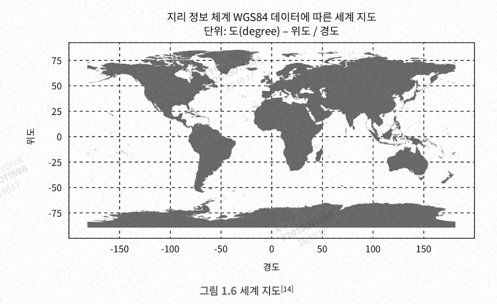

- 문제: 사업장 분포가 균등하지 않다.
- 주어진 격자의 인접 격자를 찾기가 까다로울 수 있다.

**지오해시**

2차원의 위도/경도 데이터를 1차원의 문자열로 변환한다. 지오해시 알고리즘은 비트를 하나씩 늘려가면서 재귀적으로 더 작은 격자로 분할한다.

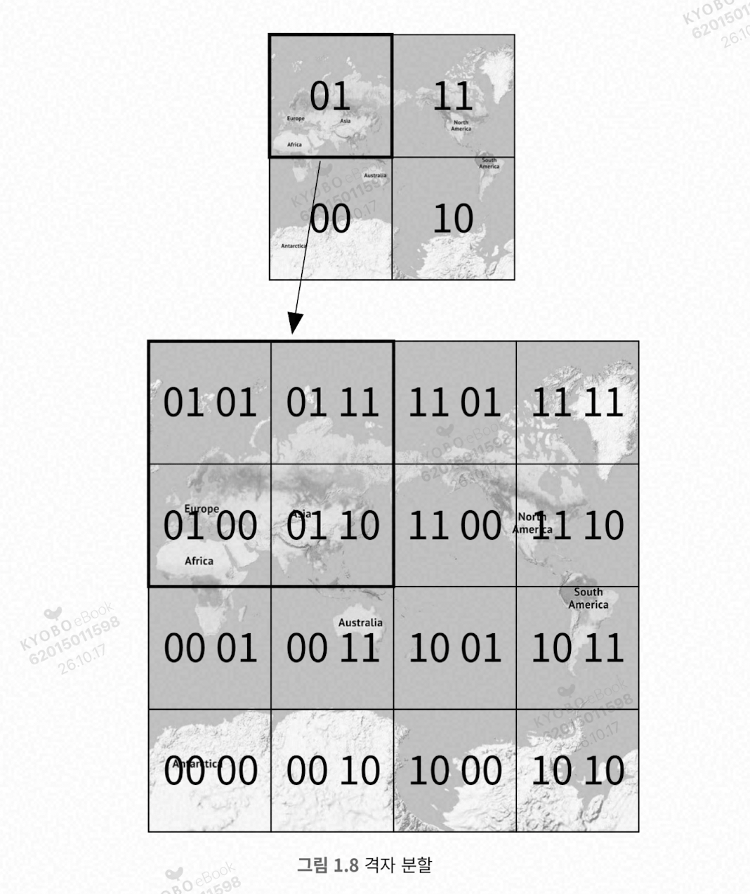

최적 정밀도는 어떻게 구하는가? 사용자가 지정한 반경으로 그린 원을 덮는 최소 크기 격자를 만드는 지오해시 길이를 구해야 한다.

격자 가장자리 이슈
- 해시값의 공통 prefix가 긴 격자들은 서로 더 가깝게 놓이도록 보장된다.

  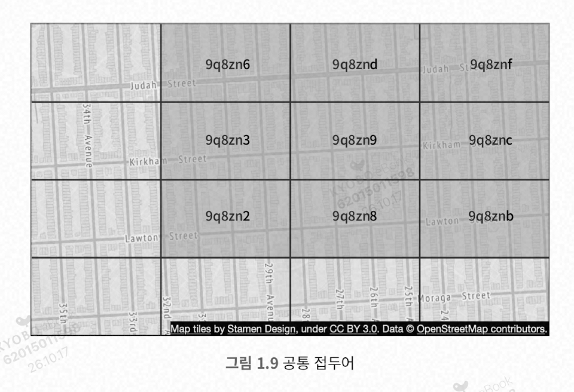

- 하지만 그 역은 참이 아니다.
  - 아주 가까운 두 위치가 어떤 공통 접두어도 갖지 않을 수 있다.
    - 적도의 다른 쪽이거나 자오선상 다른 반쪽인 경우
    - 따라서 단순 접두어 기반 SQL 질의문으로는 주변 모든 사업장을 가져올 수 없다.
- 다른 이슈
  - 공통 접두어 길이는 길지만 서로 다른 격자에 놓이는 경우
  - 해결: 현재 격자를 비롯한 인접한 모든 격자의 모든 사업장 정보를 가져온다.
    - 특정 지오해시의 주변 지오해시를 찾는 것은 상수 시간에 가능하다.

왜 상수 시간인가? 지오해시는 좌표를 **비트로 인터리빙(교차 배치)해서 만든 값**이라, 이웃을 찾는 일이 "검색"이 아니라 **비트 연산(계산)**이기 때문이다.

**1. 지오해시의 구조**

경도 비트와 위도 비트를 번갈아 끼워 넣는다.

```
경도: 1 0 1 1 ...
위도: 0 1 1 0 ...
→ 지오해시 비트: 1 0 0 1 1 1 1 0 ...
              (경, 위, 경, 위 ...)
```

즉 지오해시는 사실상 **격자의 (x, y) 인덱스를 섞어 놓은 값**이다. 격자 한 칸은 (x번째 열, y번째 행)으로 표현된다.

**2. 이웃 찾기 = x±1, y±1 계산**

1. 지오해시를 디코딩해서 격자 좌표 (x, y)를 얻는다. (비트를 짝수/홀수 자리로 분리)
2. 이웃은 (x±1, y±1) 조합 8개다.
3. 이 8개를 다시 인터리빙해서 지오해시로 인코딩한다.

이 과정은 **지오해시 길이(비트 수)에만 비례**하는 단순 연산이고, 길이는 보통 고정(예: 6~7자)이라 데이터 양과 상관없이 **O(1)**이다. 사업장이 100개든 1억 개든 이웃 셀 8개를 계산하는 비용은 같다.

**3. 왜 이게 중요한가**

앞에서 말한 "접두어는 긴데 다른 격자에 놓이는 경우" 때문이다. 격자 경계 근처에 있으면 바로 옆 칸 사업장이 더 가까운데도 접두어가 달라서 `LIKE 'wydm9%'` 한 번으로는 찾을 수 없다. 그래서 **내 격자 + 이웃 8개 = 총 9개 격자**를 계산으로 바로 구하고, 이 9개를 조회한 다음, 마지막에 실제 거리를 계산해서 반경 밖은 걸러낸다.

계산 자체는 O(1)이지만, 9개 격자 안의 사업장을 **가져오는 비용**은 그 안의 데이터 양에 비례한다. 즉 "상수 시간"은 이웃 격자를 _찾는_ 부분에만 해당한다.

표시할 사업장이 충분하지 않은 경우
- 선택지 1: 주어진 반경 내 사업장만 반환한다.
- 선택지 2: 검색 반경을 키운다.

**쿼드트리**
- 격자의 내용이 특정 기준을 만족할 때까지 2차원 공간을 재귀적으로 사분면 분할한다.
- 쿼드트리는 메모리 안에 놓이는 자료 구조이며, 데이터베이스가 아니다.

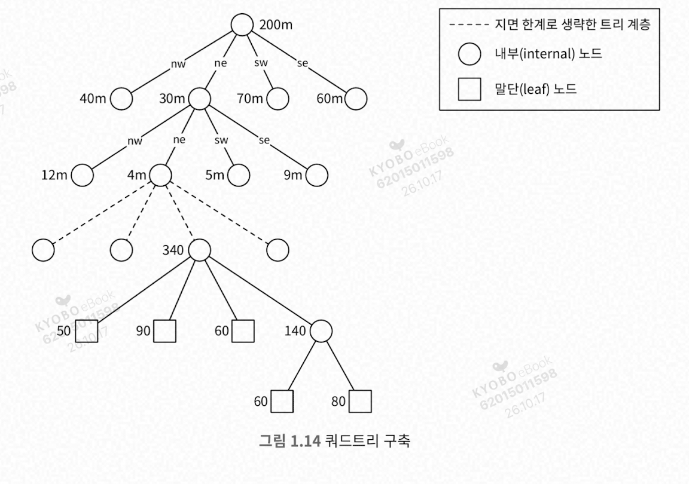

어떤 노드에도 사업장이 N개를 넘지 않을 때까지 재귀적으로 분할한다.

쿼드트리 전부를 저장하는 데 필요한 메모리
- 리프 노드
  - 격자 식별에 필요한 좌상단, 우하단 꼭짓점 좌표 (32바이트)
  - 격자 내부 사업장 id 목록: id 8바이트 × 100
  - 합계 832바이트
- 내부 노드
  - 꼭짓점 좌표 (32바이트)
  - 하위 노드 4개를 가리킬 포인터 32바이트 (8 × 4)
  - 합계 64바이트

자식이 4개씩 갈라지므로 윗층으로 갈수록 노드 수가 1/4씩 줄어든다.
내부 노드 = L/4 + L/16 + L/64 + ... = **L/3** (등비급수 합)
따라서 말단이 200만이면 내부 노드는 약 67만이다.

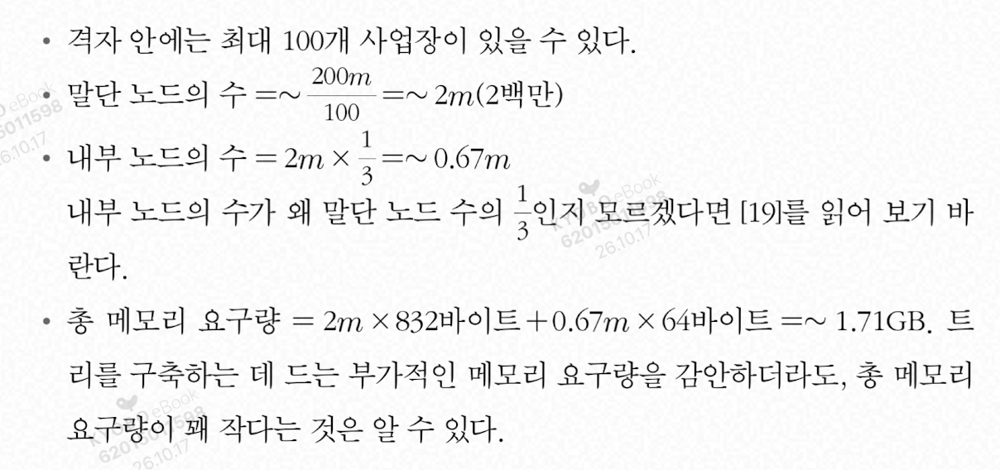

전체 쿼드트리 구축에 소요되는 시간은? n/100 log n/100이므로, 2억 개라면 몇 분 정도 소요될 수 있다.

**추가할 때**

1. 루트에서 시작해 새 사업장이 속한 격자(말단 노드)까지 내려간다.
2. 그 말단에 사업장을 추가한다.
3. 추가 후 사업장이 100개(책의 기준)를 넘으면 그 노드만 **4개로 분할**하고 사업장들을 자식에게 나눠준다.

영향받는 것은 그 경로의 노드뿐이라 나머지 트리는 그대로다.

운영 시 유의점
- 서버 시작 시 트리 구축에 몇 분이 걸릴 수 있으므로, 서버 시작 시간이 길어질 수 있다.
- 서버가 여러 대면 배포할 때 동시 요청이 생길 수 있다.

사업장 추가/갱신
- 모든 서버를 한 번에 갱신하지 않고 점진적으로 몇 대씩만 갱신한다.
- 실시간으로 갱신하는 것은 복잡하다. 여러 스레드가 동시에 접근하는 경우 락 메커니즘이 필요하다.

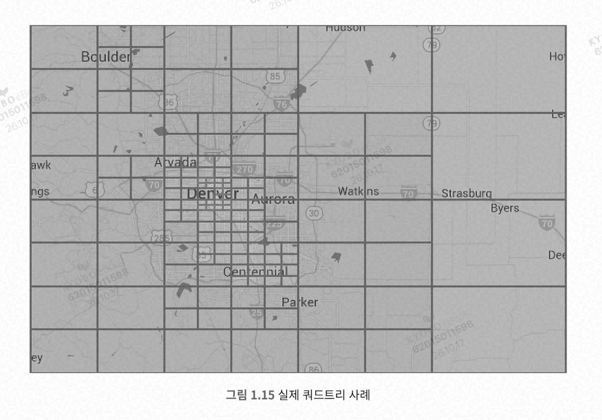

**구글 S2**
- 힐베르트 곡선(공간 채움 곡선)을 활용해 1차원으로 인덱싱한다.
- 힐베르트 곡선 상에서 인접한 두 지점은 색인화 이후 1차원 공간 내에서도 인접한 위치에 있다.

**지오해시 vs 쿼드트리**

지오해시
- 구현/사용이 쉽고, 트리 구축이 필요 없다.
- 지정 반경 이내 사업장 검색을 지원한다.
- 정밀도를 고정하면 격자 크기가 고정된다. (인구 밀도에 따라 격자 크기를 동적으로 조정할 수 없다.)
- 색인 갱신이 쉽다.

쿼드트리
- 구현이 조금 더 까다롭다.
- k번째로 가까운 사업장까지의 목록을 구할 수 있다.
- 인구 밀도에 따라 격자 크기를 동적으로 조정할 수 있다.
- 지오해시보다 색인 갱신이 까다롭다.
  - 삭제하려면 루트에서 말단 노드까지 트리를 순회해야 한다.
  - 다중 스레드를 지원하려면 더 복잡하고, 락도 사용해야 한다.
- 리밸런싱도 복잡하다.

## 상세 설계

**데이터베이스의 규모 확장성**

사업장 테이블
- 한 서버에 담을 수 없을 수도 있다.
- 샤딩 적용 후보이며, 가장 간단한 방법은 사업장 ID 기준이다.

지리 정보 색인 테이블 (지오해시)
- 방안 1: 각 지오해시에 연결되는 모든 사업장 ID를 JSON 배열로 만들어 같은 열에 저장한다.
- 방안 2: 같은 지오해시에 속한 사업장 ID를 각각 별도 열로 저장한다. (사업장마다 레코드 한 개가 필요하다.)

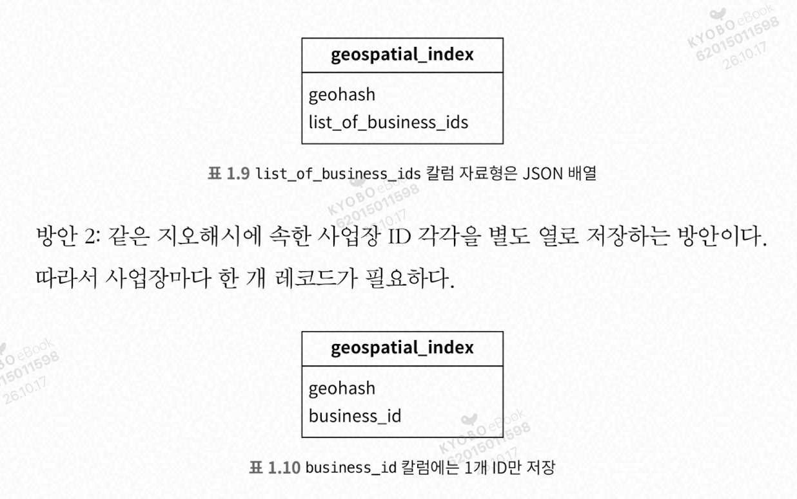

방안 1은 사업장 등록/수정 등이 복잡하고, 방안 2는 쉽다.

**지리 정보 색인의 규모 확장**
- 데이터 크기는 생각보다 크지 않다. 다만 읽기 연산 빈도가 높으면 요청 전부를 감당하지 못할 수 있다.
- 따라서 여러 데이터베이스 서버로 분산해야 한다.
- 지오해시 테이블은 샤딩이 까다롭다. (애플리케이션에서 구현해야 한다.)
- 차라리 사본 데이터베이스를 두는 편이 개발도 쉽고 간편하다.

**캐시**

정말 필요한가?
- 처리 부하가 읽기 중심이고, DB 크기는 상대적으로 작아서 모든 데이터를 DB 서버 한 대에 수용할 수 있다.
- 읽기 성능이 병목이라면, 사본 데이터베이스를 증설해서 읽기 대역폭을 늘릴 수 있다.

**캐시가 실제로 필요해지는 경우**

1. **지연시간(latency) 요구를 DB로 맞출 수 없을 때**
   레플리카를 늘리면 처리량(throughput)은 늘지만 개별 쿼리 속도는 빨라지지 않는다. DB 쿼리가 5~20ms인데 목표가 1ms 이하라면 인메모리 캐시밖에 답이 없다.
2. **같은 데이터를 압도적으로 반복해서 읽을 때 (핫스팟)**
   인기 상품, 메인 화면 설정, 세션 정보처럼 소수의 키에 읽기가 몰리면, 레플리카를 늘려도 DB가 같은 결과를 계속 재계산하는 낭비가 생긴다. 캐시 적중률이 높아 효과가 가장 크다.
3. **쿼리 자체가 비쌀 때**
   조인이 많거나 집계(랭킹, 통계)처럼 한 번 계산에 수백 ms가 걸리는 경우, 레플리카를 늘리면 비용만 커진다. 결과를 캐시하는 편이 훨씬 싸다.
4. **쓰기 부하가 늘어 레플리카 전략이 한계에 닿을 때**
   레플리카는 읽기만 분산한다. 쓰기가 늘거나 복제 지연(replication lag)이 문제가 되면 읽기를 DB 밖으로 빼야 한다.
5. **외부 의존성 보호**
   느리거나 호출당 비용이 드는 외부 API, LLM 호출 결과 같은 경우다. DB 문제가 아니어도 캐시가 필요한 대표 케이스다.
6. **트래픽 급증(스파이크) 방어**
   DB 앞에 캐시가 있으면 갑작스러운 읽기 폭주를 흡수하는 완충 역할을 한다.

**캐시 vs 레플리카, 핵심 요약**

구분 기준
- **처리량(throughput) 문제** → 레플리카 (동시 요청이 몰릴 때만 느림)
- **지연시간·반복 계산·비용 문제** → 캐시 (혼자 돌려도 느리거나, 같은 데이터를 계속 읽음)

캐시가 필요한 경우
- 지연시간 목표(예: 1ms 이하)를 DB로 맞출 수 없을 때
- 소수 핫키에 읽기가 몰릴 때
- 쿼리가 비쌀 때 (조인, 집계, 랭킹)
- 외부 API/LLM 호출 결과를 보호할 때
- 트래픽 스파이크를 완충할 때

레플리카로 충분한지 확인하는 법

1. 프라이머리 CPU/IOPS/커넥션이 실제로 포화인지
2. 쿼리 단독 실행이 빠른지 (빠르면 처리량 문제)
3. 읽기 비율이 90% 이상인지
4. 복제 지연을 허용할 수 있는지
5. 레플리카 한 대를 붙여서 처리량이 선형으로 늘어나는지 부하 테스트

비용 관점
- 인프라 비용은 보통 **캐시가 더 싸다** (히트율 90%면 DB 부하 1/10).
- 대신 숨은 비용이 있다: 무효화 설계, stale 버그, 캐시 장애 시 DB 폭주(stampede), 운영 포인트 증가.

결론
- 히트율이 높고, 약간의 stale을 허용하고, 핫키가 있다 → **캐시**
- 항상 최신이 필요하고, 읽기가 고르게 분산되고, 운영 여력이 부족하다 → **레플리카**
- "레플리카 먼저"는 비용 최적이 아니라 **복잡도 최소 순서**다.

**캐시 키**
- 직관적인 캐시 키: 사용자 위치(위도/경도 정보)
- 문제
  - 사용자 위치 정보는 추정치일 뿐 정확하지 않다. 달라질 수 있는 값이다.
  - 사용자가 이동하면 위도/경도 정보도 변경된다.
- 따라서 사용자 위치는 적절하지 않다. 지오해시/쿼드트리는 같은 격자 내 모든 사업장이 같은 해시 값을 갖도록 만들기 때문에 이 문제를 해결한다.

**캐시 데이터 유형**
- 지오해시 / 사업장 ID를 캐시에 넣으면 좋다.
- 사업장 정보는 자주 변경되지 않는다. 따라서 특정 지오해시에 해당하는 사업장 ID 목록을 미리 계산해서 캐시해 둔다.

  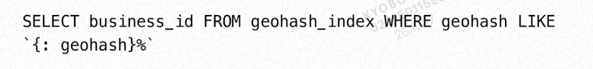

- 새로운 사업장 추가, 기존 사업장 정보 편집/삭제의 경우 캐시를 무효화한다.

추가 질문: 시간대, 혹은 사업장 유형별 검색
- 지금 영업 중인 사업장만 받고 싶다면?
  - 지오해시/쿼드트리 메커니즘으로 분할하면 격자 안의 사업장 수가 적으므로, 그 정보에서 필터링한다.

- 지오해시/쿼드트리로 "반경 내 사업장 N개"를 뽑은 뒤 영업 중인 것만 거르면, 결과가 요청한 개수(예: 20개)보다 적게 남을 수 있다.
- 특히 **심야 시간대**처럼 영업 중인 비율이 낮을 때, 혹은 "카페만", "24시간만"처럼 조건이 좁을 때 심해진다.
- 부족하면 **검색 반경을 넓히거나 인접 셀을 더 읽어서** 다시 필터링해야 하고, 이게 반복되면 지연시간이 늘어난다.

**해결 방법**

1. **반복 확장 (iterative expansion)**
   결과가 부족하면 반경/셀 범위를 단계적으로 넓혀 재탐색한다. 구현은 쉽지만 최악의 경우 여러 번 반복된다.
2. **필터를 인덱스에 포함시키기 (pre-filtering)**
   셀 키를 `지오해시 + 업종`으로 만들거나 업종별로 인덱스를 분리한다. 업종은 거의 변하지 않으므로 이 방식이 잘 맞는다.
3. **영업 상태는 후처리, 업종은 사전 필터**
   - 업종: 정적 속성 → 인덱스에 넣는다.
   - 영업 중 여부: 시간에 따라 변하는 동적 속성 → 인덱스에 넣으면 갱신 부담이 크므로 후처리한다.
4. **여유분 오버페치 (over-fetch)**
   20개가 필요하면 처음부터 50개쯤 가져와서 필터링한다. 영업 비율을 대략 알면 배수를 정할 수 있다.
5. **영업 시간대 버킷 인덱스**
   시간대별(예: 1시간 단위) 영업 중인 사업장 목록을 미리 만들어 두고 셀과 결합한다. 조회는 빠르지만 저장 공간과 갱신 비용이 늘어난다.

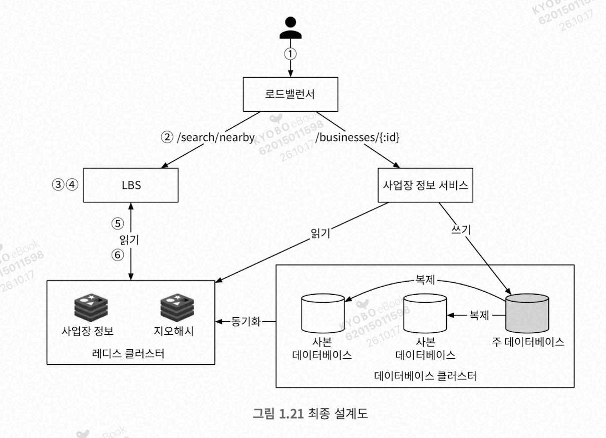
